# AUTOGRAM — Codebase Learning & Architecture Guide

> **Who this is for:** a developer who has never seen AUTOGRAM and wants to understand the whole system by reading the code in the right order.
>
> **How to use it:** read a section, open the referenced file, read the code with the section beside it, then move to the next step. Part 5 (the reading order) is the core of the guide. Everything else is either context before it or reference after it.
>
> **Snapshot:** written from a full inspection of the repository as it exists on disk (backend, automation, frontend, browser extension, Remotion demo, migrations, tests, and all project docs). Line numbers are approximate anchors ("~L553") and will drift as the code changes. Function and class names are exact.

---

## Legend used throughout

| Marker | Meaning |
|---|---|
| ✅ **Implemented** | Exists in the code, is wired into a route or a run, and has tests. |
| 🟡 **Partial** | Some pieces exist, but the feature is incomplete, not wired to the UI, or depends on optional infrastructure. |
| 🔵 **Planned** | Mentioned in docs, comments, the LLM route table, or stub classes, but not implemented. |
| ⚠️ **Doc drift** | Existing documentation (README, docstrings, `.env.example`) says something the code no longer does. |
| 💡 **Interpretation** | The repository doesn't state the reason. This is my engineering reading of the code, not confirmed history. |

Paths are relative to the repository root (`Autogram/`). Python imports assume `backend/` is the working directory (`from app...`, `from automation...`).

---

## Table of contents

1. [Executive understanding](#part-1--executive-understanding)
2. [System architecture](#part-2--system-architecture)
3. [Why did we choose this technology?](#part-3--why-did-we-choose-this-technology)
4. [Project directory map](#part-4--project-directory-map)
5. [**File-by-file reading order**](#part-5--file-by-file-reading-order) ← the core
6. [End-to-end user flows](#part-6--end-to-end-user-flows)
7. [Playwright / form-automation deep dive](#part-7--playwright--form-automation-deep-dive)
8. [Real browser examples (Greenhouse / Warp, Lever, Workday, iCIMS)](#part-8--real-browser-examples)
9. [Database deep dive](#part-9--database-deep-dive)
10. [API deep dive](#part-10--api-deep-dive)
11. [AI / ML / LLM deep dive](#part-11--ai--ml--llm-deep-dive)
12. [Security](#part-12--security)
13. [Error handling](#part-13--error-handling)
14. [State management](#part-14--state-management)
15. [Testing](#part-15--testing)
16. [Configuration and environment](#part-16--configuration-and-environment)
17. [Complete request traces](#part-17--complete-request-traces)
18. ["If I delete this file..."](#part-18--if-i-delete-this-file)
19. ["Why not simpler?"](#part-19--why-not-simpler)
20. [Implemented vs roadmap](#part-20--current-implementation-vs-future-roadmap)
21. [Known limitations](#part-21--known-limitations)
22. [Debugging guide](#part-22--debugging-guide)
23. [Interview / viva preparation](#part-23--interview--viva-preparation)
24. [Rapid revision](#part-24--rapid-revision)
25. [Complete mental model](#part-25--complete-mental-model)
26. [Documentation audit](#documentation-audit)

---

# PART 1 — EXECUTIVE UNDERSTANDING

## 1.1 What is AUTOGRAM?

**In one sentence.** AUTOGRAM is a FastAPI + React platform that turns a candidate's résumé and master profile into matched jobs and then fills real job-application forms in a real browser with Playwright, with a human approving the final submission by default.

**In one paragraph.** A user signs up, uploads a résumé, and builds a *master candidate profile* (contact details, work authorization, education, experience, skills, and optional saved EEO/demographic answers). AUTOGRAM can fetch live jobs from Adzuna, embed them and the résumé as vectors in PostgreSQL (pgvector), and rank matches with a blend of vector similarity, LLM-extracted skill overlap, and an ATS-keyword score. The user can then paste any job link (or click Apply on a match). A Playwright-driven engine detects which Applicant Tracking System (ATS) the link belongs to (Greenhouse, Lever, Workday, or unknown), fills the form page by page from the profile, answers leftover screening questions with a cached, option-aware LLM engine, and stops for a human at CAPTCHAs, login walls, OTP codes, missing data, low confidence, and (by default) the final Submit button. A second, independent engine, the **autonomous agent**, drives any career site with an observe → decide (LLM) → act loop over a closed action vocabulary, with code-level gates on sensitive fields and submission.

**In technical terms.**
- **Backend:** Python 3.10, FastAPI, SQLAlchemy 2 ORM, Alembic, Neon (serverless PostgreSQL) with the `pgvector` extension and HNSW indexes, APScheduler, optional Redis (rate limiting, pub/sub event bus, run leases, control signals) and Celery (worker queue).
- **AI:** OpenAI `gpt-4.1-mini` behind a provider-agnostic `LLMRouter` with per-task routes (`app/ai/llm/registry.py`), plus local FastEmbed/ONNX `all-MiniLM-L6-v2` 384-dimensional embeddings.
- **Automation:** Playwright (sync API) attached to the user's own Chrome over CDP by default, a per-ATS adapter layer, a widget-level field-handler registry (native select, react-select, combobox, country picker, listbox, checkbox, toggle, radio, date, file, text), a multi-page "page cycle" with proof-of-navigation, a vision fallback, and an LLM agent loop.
- **Frontend:** React 18 + Vite + Tailwind + React Router, plus a Chrome MV3 extension and a separate Remotion demo-video project.

**In beginner-friendly language.** Applying for jobs means typing the same facts into a hundred slightly different forms. AUTOGRAM stores your facts once, finds jobs that fit you, and then opens the job's application page in your own Chrome and types your answers for you, the way a careful assistant would. When it isn't sure, or when a website asks something only you can answer (a CAPTCHA, a one-time code, "are you a veteran?"), it stops and asks you. By default it never presses Submit without your "yes".

## 1.2 What problem does AUTOGRAM solve?

Each pain point below is mapped to the code that addresses it.

| # | Pain point | What AUTOGRAM does | Status | Where |
|---|---|---|---|---|
| 1 | Finding relevant jobs | Fetches listings from Adzuna, dedups them, embeds them | ✅ (Adzuna only) | `app/services/job_ingestion.py`, `app/services/job_sources/` |
| 2 | Deciding if a job fits | Vector shortlist → hard filters → LLM skill extraction → blended score + ATS keyword score + explanation | ✅ | `app/services/matching/ranker.py` |
| 3 | Typing the same facts into every form | One master profile. `FieldMapper` maps labels/names to profile attributes | ✅ | `automation/forms/field_mapper.py`, `app/models/db_models.py::CandidateProfile` |
| 4 | Every ATS is different | ATS detection + per-ATS adapters (Greenhouse, Lever, Workday) + a generic fallback | ✅ | `automation/ats/` |
| 5 | Every widget is different (react-select, comboboxes, hidden checkboxes...) | 12 widget handlers with fill → verify → retry | ✅ | `automation/forms/field_handlers.py` |
| 6 | Screening questions ("Why us?", "Notice period?") | Deterministic classifier → answer cache (exact + semantic) → one batched LLM call, option-aware | ✅ | `automation/forms/answer_engine.py` |
| 7 | Multi-page forms (Workday) | Page cycle with structural page signatures, verified navigation | ✅ | `automation/applications/application_flow_manager.py`, `page_navigator.py` |
| 8 | Missing information | Required-field scan → `manual_required`, human pause, question ledger for review | ✅ | `find_unfilled_required_fields`, `application_questions` table |
| 9 | CAPTCHAs, login walls, OTP | Detected, never bypassed. The run waits for a human. OTP can be typed into Autogram's own UI | ✅ | `selectors.py::find_human_gate/page_has_captcha`, `verification_channel.py` |
| 10 | Sensitive EEO questions | Answered only from explicitly saved demographics, never by an LLM | ✅ | `answer_engine.py::_demographic_answer`, `demographic_matching.py` |
| 11 | Trust and control | Copilot mode by default, approval endpoint, kill switch, per-site trust levels, audit log | ✅ | `decide_action`, `/applications/{id}/approve`, `SiteTrustLevel` |
| 12 | Not losing state | `applications`, `automation_runs`, `application_questions`, `autonomous_tasks`, chat transcript | ✅ | `app/models/db_models.py` |
| 13 | Unknown / custom portals | Autonomous LLM agent with a closed action vocabulary | ✅ | `automation/agents/autonomous/` |
| 14 | Double-applying | Partial unique indexes + advisory lock + lifetime "already submitted" check | ✅ | `app/services/automation_ownership.py` |

## 1.3 Why was this project chosen?

💡 *Interpretation, based on what the code optimizes for:* AUTOGRAM is interesting because no single technique solves the problem.

- **A job scraper** stops at step 1. AUTOGRAM's scraper (`adzuna_client.py`) is 26 lines. The rest of the system is what happens after.
- **A CRUD app** stores data. AUTOGRAM's CRUD (profile, documents, demographics) exists to feed an automation engine that must be *correct on third-party websites it doesn't control*.
- **A chatbot** produces text for a human to read. AUTOGRAM's LLM output is typed verbatim into an employer's form, so it is constrained: option-matched, confidence-gated, meta-commentary-filtered, never used for demographics (`answer_engine._SYSTEM_PROMPT`, `vision_fallback._validate`).
- **A basic RAG app** retrieves context for a prompt. AUTOGRAM uses retrieval twice for different reasons: pgvector nearest-neighbor for job matching (`job_vector_store.py`) and semantic answer-memory lookup (`answer_cache_repository.find_similar_answer`).
- **A simple Playwright script** works on one form, once. AUTOGRAM's automation handles hydration races, decoy dropdown containers, hidden inputs, multi-page navigation proof, iframes, CAPTCHAs, OTP handoff, crash recovery, and concurrent-start races, and each of those has a regression test built from a real failure.

The combination spans backend engineering, data modeling, information retrieval, LLM engineering, browser automation, distributed coordination (Redis leases, Celery), human-in-the-loop design, and a React UI.

## 1.4 The core user journey (as implemented)

There are three entry points. They share the profile and the database, but they are separate code paths.

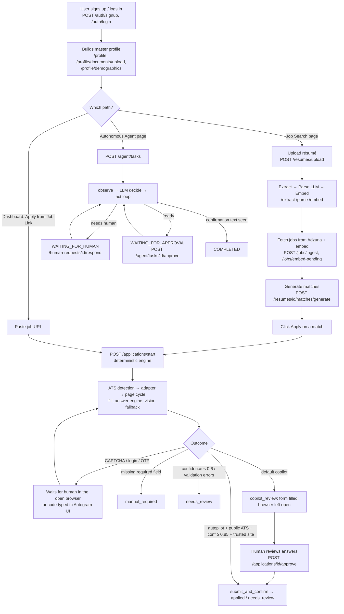

**What does *not* exist (so don't look for it):** there's no in-app resume tailoring (removed, see `app/services/tailoring_service.py`), no LinkedIn/Indeed/Remotive/Arbeitnow connectors (only Adzuna is registered), no community or admin UI (planned in `PLATFORM_PLAN.md`), and no automatic account creation or password entry on any job site.

---

# PART 2 — SYSTEM ARCHITECTURE

## 2.1 High-level architecture

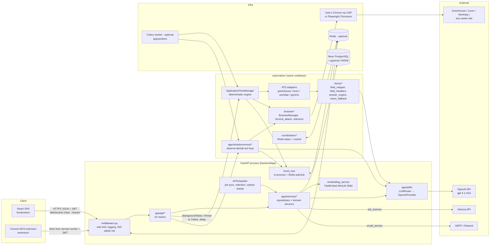

## 2.2 Components and their responsibilities

| Component | What it is | Why it's needed | Owns | Talks to | Should NOT own |
|---|---|---|---|---|---|
| **React SPA** (`frontend/src`) | Vite-built single-page app | The human's control surface: profile, job search, application review, approvals, agent chat | UI state, JWT in `localStorage` | Backend only, via `src/api.js` | Business rules, ATS logic |
| **Chrome extension** (`extension/`) | MV3 service worker + content script + React side panel | Fills a form in the user's already-open tab (useful for login-gated sites) | DOM filling inside the tab it's injected into | Backend (`/automation/*`, `/applications/*`) | Deciding when to submit (the server's `decide_action` decides) |
| **Middleware** (`app/core/middleware.py`) | One HTTP middleware | Rate limiting, request logging, convert unhandled errors to 500/503 | Per-IP sliding window | Redis (optional) | Auth |
| **Routers** (`app/api/*`) | FastAPI `APIRouter`s | HTTP contract, ownership checks, orchestration | Request validation, HTTP errors | Services, automation, dispatch | SQL details, DOM logic |
| **Services / repositories** (`app/services/*`) | Plain functions over a `Session` | All DB access and pure domain logic | Queries, status transitions | DB, LLM router, embeddings, storage | HTTP |
| **LLM layer** (`app/ai/llm`) | Router + registry + provider | One entry point, model choice as config, retries | Task→model routes | OpenAI SDK (only `openai_provider.py` imports it) | Prompts (callers own them) |
| **Automation engine** (`automation/applications`, `ats`, `forms`, `browser`) | Deterministic apply engine | Fill forms on known + unknown ATS reliably | Browser lifecycle, fill/verify, submit decision | Playwright, answer engine, LLM | Persisting results (returns `ApplicationRunResult`, and `app/` persists it) |
| **Autonomous agent** (`automation/agents/autonomous`) | LLM agent loop | Handle portals no adapter models | Task loop, action gating | Playwright, LLM, `autonomous_task_repository` | Per-ATS branching (none exists by design) |
| **Coordination** (`automation/coordination`) | Redis lease + control signals | Multi-process ownership and cross-worker resume/cancel/approve/OTP | `autogram:lease:*`, `autogram:control:*` keys | Redis | Business decisions |
| **Workers** (`app/workers`) | Dispatch + Celery app + lease-guarded runtime | Run automation off the API process when a broker exists | Queue vs in-process choice | Celery, Redis, run functions | The run logic itself (reuses the same functions) |
| **Scheduler** (`app/core/scheduler.py`) | APScheduler background jobs | Periodic job sync (opt-in), retention purge (always), orphan sweep (Redis only) | Job schedules | Services | Request handling |
| **PostgreSQL/Neon + pgvector** | Relational DB with a vector column type | Single source of truth incl. vectors | 21 tables | — | — |
| **Redis** (optional) | Key-value + pub/sub | Shared rate limit, cross-replica events, leases, Celery broker | Ephemeral coordination state | — | Durable truth (never) |

## 2.3 The two automation engines, side by side

This is the single most important architectural fact about AUTOGRAM. There are **two independent engines**, and they share no tables and no execution logic. `automation_ownership.py` is the only thing that coordinates them.

| | Deterministic engine | Autonomous agent |
|---|---|---|
| Entry | `POST /applications/start` | `POST /agent/tasks` |
| Orchestrator | `ApplicationFlowManager` | `AutonomousAgentLoop` |
| Decides *what to type* | `FieldMapper` synonyms → answer engine → vision | LLM per iteration (`decide_next_step`) + `TruthStore` + saved-demographics prepass |
| Decides *how to interact* | `field_handlers.fill_field` | `ActionExecutor` (reuses `fill_field` for some actions) |
| ATS-specific code | Yes (`automation/ats/*`) | None ("no `if platform ==` anywhere") |
| Submit decision | `decide_action()` table | `auto_submit_approved` flag set only by `/approve` |
| Tables | `applications`, `automation_runs`, `application_questions`, `application_audit_log` | `autonomous_tasks`, `human_interaction_requests`, `application_audit_log` |
| Cost profile | Mostly no LLM; one batched LLM call per form for leftovers | One LLM call per step (max 80 per resume) |
| Doc | `ARCHITECTURE.md`, `automation/README.md` | `AUTONOMOUS_AGENT.md` |

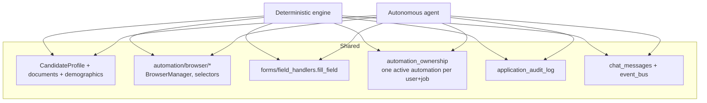

## 2.4 Layering rules (what imports what)

The intended direction (`automation/interfaces.py` docstring):

```text
app.api  ──►  automation  ──►  app.services / app.models / app.core / app.ai
```

`automation/` must never import `app.api`. That rule holds for `automation/`. There are three places where `app/` reaches the other way, each worth knowing:

- `app/services/profile_repository.py` imports `automation.forms.field_mapper.FieldMapper` (for `write_back_stable_answer`).
- `app/services/automation_ownership.py` lazily imports `app.api.applications.IN_PROGRESS_STATUSES` inside a function to avoid a cycle.
- `app/workers/runtime.py` imports `app.api.applications._run_application`. That's why the worker package lives in `app/workers/` rather than `automation/`, as the roadmap explains.


---

# PART 3 — WHY DID WE CHOOSE THIS TECHNOLOGY?

Every "why" below is tied to what the code actually does. Where the repo doesn't record the reason, the entry is marked 💡.

### Python
- **What:** the backend language (Dockerfile pins `python:3.10-slim`).
- **Why AUTOGRAM uses it:** the three hardest dependencies are all first-class in Python: Playwright's sync API, the OpenAI SDK, and ONNX embedding runtimes (FastEmbed). SQLAlchemy/Alembic/pgvector also have mature Python bindings.
- **Alternatives:** Node.js has Playwright too, but the ML/LLM tooling and the existing FastAPI stack keep everything in one language. 💡

### FastAPI (+ Uvicorn)
- **Why:** automatic request validation from Pydantic models (`app/models/*.py` request bodies), dependency injection for `get_db` and `get_current_user` on every route, built-in `BackgroundTasks` (used for résumé extraction and in-process application runs), native WebSockets (`/chat/{scope}/{id}/stream`), and auto-generated Swagger docs at `/docs`.
- **Why not Flask:** no built-in validation, DI, WebSockets, or async. 💡
- **Why not Django:** Django's ORM and admin are heavyweight for an API-only backend that already uses SQLAlchemy + pgvector. 💡
- **A nuance worth knowing:** most route handlers are plain `def` (sync), and FastAPI runs them in a threadpool. Playwright's *sync* API refuses to start on a thread with a running asyncio loop, so `app/api/applications.py::_run_on_dedicated_thread` launches every deterministic run on a brand-new plain thread (~L108).

### SQLAlchemy ORM
- **Why:** the models (`app/models/db_models.py`) use `JSONB`, `Vector(384)`, partial unique indexes (`postgresql_where`), and `ForeignKey(..., ondelete="CASCADE")`, all expressible declaratively. Repositories (`app/services/*_repository.py`) keep queries out of routes.
- **Alternative:** raw SQL (`psycopg2`) would lose the model/migration symmetry. Some raw SQL still exists where needed (`pgvector_setup.py` DDL, `pg_advisory_xact_lock` in `automation_ownership.py`).

### PostgreSQL on Neon
- **Why:** one database holds relational data, JSONB documents (parsed résumé, action history, ledgers) and vectors. `README.md` and `PROJECT_REPORT.md` say Neon was chosen as serverless Postgres, so no local DB is required.
- **Consequence visible in code:** Neon suspends idle compute and drops idle connections, so `app/core/database.py` sets `pool_pre_ping=True`, `pool_recycle=180`, TCP keepalives, a 10 s connect timeout, and provides `read_with_reconnect()` (a retry-once for reads). `middleware.py` returns **503 + `Retry-After`** for a dropped connection instead of 500. A real incident (application `46665f90`, `logs/.../error.log`: `PendingRollbackError`) led to the answer engine using a `session_factory` instead of holding one session through a ~400 s browser phase (`automation/tests/test_run_db_resilience.py`).
- **Alternatives:** local Postgres (the original setup per `PROJECT_REPORT.md`), Supabase, RDS.

### Alembic
- **Why:** versioned schema changes. There are 29 revisions in one linear chain (`fbfb4ab1cf61` → ... → `b2d8e4f61a37`). `README.md`: "Alembic migrations are the production schema source of truth."
- **Also present:** `app/main.py` still calls `Base.metadata.create_all()` plus `ensure_vector_schema()` (idempotent `ALTER TABLE ... ADD COLUMN IF NOT EXISTS`) as a first-run convenience. The Dockerfile runs `alembic upgrade head` before starting uvicorn.

### pgvector
- **Why:** vectors live next to the rows they describe, so nearest-neighbour search is one SQL query returning full `JobRecord` rows (`job_vector_store.search_similar_jobs`). The earlier Qdrant Cloud design is described in `PROJECT_REPORT.md` and was replaced ("Replaces the previous Qdrant-backed implementation", `job_vector_store.py` docstring).
- **Used for:** `jobs.embedding_vector`, `resumes.embedding_vector`, `answer_cache.embedding_vector`, all `vector(384)`.
- **Alternatives:** Qdrant/Pinecone/Weaviate (a second system to sync), FAISS in memory (lost on restart, no SQL filtering).

### HNSW index
- **Why:** approximate nearest neighbour with good recall and no training step (unlike IVFFlat, which needs data to build lists). Created in `app/core/pgvector_setup.py::ensure_vector_schema` with `USING hnsw (embedding_vector vector_cosine_ops)` on `jobs` and `answer_cache`.
- **Why cosine:** embeddings are L2-normalized in `embedding_service.generate_embedding`, so cosine ordering equals dot-product ordering. Similarity = `1 - (a <=> b)`.
- **Note:** `resumes.embedding_vector` has no HNSW index. It is only ever the *query* vector, never searched.

### Playwright (sync API)
- **Why:** reliable auto-waiting locators, real Chromium, `set_input_files` on hidden inputs, tracing (`context.tracing` → `trace.zip` per run), screenshots, and `connect_over_cdp` to attach to the user's real Chrome.
- **Why sync not async:** automation runs on worker threads/Celery processes, not inside FastAPI's event loop (`browser_manager.py` docstring).
- **Why not Selenium:** 💡 weaker auto-waiting, no built-in tracing, CDP attach is clunkier.
- **Why not Puppeteer:** Node-only.

### Chrome DevTools Protocol attach (`AUTOMATION_BROWSER_MODE=cdp`, the default)
- **Why:** login-gated ATSs (Workday, iCIMS) need the user's real session. AUTOGRAM never creates accounts or types passwords, so attaching to the user's own logged-in Chrome is how it reaches those forms (`chrome_attach.py`, `WorkdayAdapter` docstring "Login").
- **Fallback chain:** `cdp → persistent` (real on-disk profile). `launch` (throwaway, headless-capable) is for CI/servers and is never used as an automatic fallback, so a user doesn't silently lose logins (`browser_manager._MODE_CHAIN`).

### An LLM, and specifically `gpt-4.1-mini`
- **Why an LLM at all:** three tasks can't be done deterministically: parsing free-form résumés into a schema, extracting required skills and ATS keywords from job descriptions, and answering subjective or oddly phrased screening questions. The autonomous agent also needs a policy that works on arbitrary pages.
- **Why `gpt-4.1-mini`:** every route in `app/ai/llm/registry.py::TASK_ROUTES` uses it. The file's own philosophy is "cheap/structured extraction tasks → small, fast models." It's JSON-mode capable and vision-capable (the vision fallback sends cropped screenshots and relies on that).
- **Recorded as undecided:** whether the autonomous-agent decision and `field_reasoning` should move to a premium model is explicitly "a pending product decision" (registry comments).
- **Temperatures:** 0.0 for extraction/decisions/vision, 0.4 for application answers, 0.5 for cover letters.

### FastEmbed + `sentence-transformers/all-MiniLM-L6-v2`
- **Why local embeddings:** free, no API key, deterministic, and fast enough on CPU. 384 dimensions keep the index small.
- **Why FastEmbed:** the code comment says "Uses FastEmbed/ONNX instead of PyTorch" (`embedding_service.py`). ONNX avoids a multi-GB PyTorch dependency.
- ⚠️ **Doc/dependency drift:** `requirements.txt` still lists `sentence-transformers` and does **not** list `fastembed`, and the Dockerfile installs CPU `torch` for sentence-transformers. The import `from fastembed import TextEmbedding` will fail on a clean install from `requirements.txt` unless `fastembed` is added. README, `registry.py`, and `automation/interfaces.py::embed_text` still say "sentence-transformers".

### Adzuna API
- **Why:** a keyed job-search API across many countries (`country` param: `gb`, `in`, `us`...) with salary fields. `adzuna_client.fetch_jobs` → `adzuna_normalizer.normalize_adzuna_job` → common dict shape.
- **Only source today:** Remotive and Arbeitnow connectors were removed ("Adzuna only", `registry.py`, and the two stub files). ⚠️ README still lists them.

### APScheduler
- **Why:** in-process periodic jobs without extra infrastructure. It runs three jobs: `job_sync` (only if `JOB_SYNC_QUERIES` is set), `retention_purge` (always, every `RETENTION_PURGE_INTERVAL_HOURS`), and `orphan_sweep` (every 60 s, only when `REDIS_URL` is set).

### Redis (optional) and Celery (optional)
- **Why:** to run more than one process safely. Redis provides a shared sliding-window rate limiter (`middleware._is_rate_limited_redis`), cross-replica WebSocket fan-out (`event_bus._mirror_to_redis`), run-ownership **leases** with `SET NX PX` (`coordination/lease.py`), and control flags + a one-shot OTP mailbox (`coordination/control.py`). Celery (`app/workers/celery_app.py`) runs automation in a worker with `acks_late`, `prefetch_multiplier=1`, and `max_retries=0` (an apply must never auto-retry).
- **Without them:** everything degrades to in-process equivalents and `app/main.py` logs a loud "single process only" warning.

### cryptography (Fernet)
- **Why:** field-level encryption at rest for `phone`, `address` (`app/core/crypto.py`) and for saved Playwright storage-state files (`automation/browser/session.py::SessionStore`, `*.session.enc`).

### PyJWT + PBKDF2
- **Why:** stateless bearer auth (`HS256`, `sub`=user_id, `jti`, `exp`), stdlib-only password hashing (PBKDF2-HMAC-SHA256, 200k iterations, random 16-byte salt, constant-time compare) in `app/core/auth.py`.

### MarkItDown, pdfplumber, python-docx
- **Why:** MarkItDown is the primary extractor for both PDF and DOCX. pdfplumber (column-aware gutter detection) and python-docx (paragraphs + tables in order) are fallbacks. Optional OCR (`pypdfium2` + `pytesseract`) is commented out in requirements (`app/services/text_extraction.py`).

### React 18 + Vite + Tailwind + React Router
- **Why:** SPA with routes `/dashboard`, `/search`, `/applications/:id`, `/agent/:id`, `/metrics`, `/profile`, `/resumes`, `/settings` (`frontend/src/App.jsx`). Vite's dev proxy maps `/api/*` (including WebSockets) to FastAPI (`vite.config.js`), so local dev needs no CORS. Tailwind for styling, lucide-react for icons, Vitest + Testing Library for tests.

### Chrome MV3 extension
- **Why:** fills inside the user's own tab without a server-side browser. `background.js` is the only thing that calls the backend (a service worker's `fetch` isn't subject to page CORS), and `content-script.js` is the only thing that touches the DOM (`extension/README.md`).

### Docker, nginx, Railway
- **Why:** Playwright + Chromium + long-lived threads need a container, not a serverless function (`README.md` "Deployment"). `backend/railway.json` pins `numReplicas: 1`. The frontend is built by Vite and served by nginx (`frontend/Dockerfile`, `nginx.conf.template`).

### boto3 (S3-compatible storage)
- **Why:** `STORAGE_BACKEND=s3` routes file bytes to S3/R2/MinIO through `app/services/storage/s3_backend.py`. The default is `local`.

### Remotion
- **Why:** a separate Node project at the repo root (`package.json` name `autogram-demo-video`) that renders marketing/demo videos. It is **not** part of the shipped product.

---

# PART 4 — PROJECT DIRECTORY MAP

```text
Autogram/
├── README.md, ARCHITECTURE.md, AUTONOMOUS_AGENT.md, PHASE2_ARCHITECTURE.md,
│   PLATFORM_PLAN.md, PLATFORM_ROADMAP.md, PROJECT_REPORT.md, RAILWAY.md
│                                  # design docs & roadmaps (some drift — see audit)
├── implentation-docs/             # 3 feature write-ups (multi-page flow, cover letter, profile filling)
├── docker-compose.yml             # api + frontend + redis + worker for local dev
├── .env.example                   # root compose env template
├── package.json, remotion.config.ts, tsconfig.json, src/   # Remotion demo video (not product)
├── .claude/settings.json          # local AI-assistant permission allowlist (dev tooling)
│
├── backend/
│   ├── Dockerfile, railway.json, alembic.ini, pytest.ini, ruff.toml, mypy.ini
│   ├── requirements.txt, requirements-dev.txt, requirements-migrate.txt, .env.example
│   ├── alembic/                   # env.py + 29 versions (linear chain)
│   ├── scripts/                   # make_admin.py, reset_db.py (ops utilities)
│   ├── app/
│   │   ├── main.py                # app factory: bootstrap DB, scheduler, recovery, routers
│   │   ├── core/                  # config, database, auth, crypto, middleware, redis, scheduler,
│   │   │                          # pgvector_setup, security (unused), skills_taxonomy
│   │   ├── models/                # db_models.py (ORM) + Pydantic request/response schemas
│   │   ├── api/                   # 10 routers
│   │   ├── services/              # repositories + domain services
│   │   │   ├── job_sources/       # JobSource contract, Adzuna connector, registry
│   │   │   ├── matching/          # retrieval, hard filters, LLM skill extraction, skill gap, ranker
│   │   │   ├── ats/               # ats_scorer (keyword + format score)
│   │   │   └── storage/           # StorageBackend: local / s3
│   │   ├── ai/llm/                # LLMRouter, registry, OpenAI provider
│   │   ├── ai/prompts/            # tailoring_prompts.py (REMOVED stub)
│   │   └── workers/               # dispatch, runtime (leases), celery_app, tasks
│   ├── automation/
│   │   ├── interfaces.py          # contract: automation ↔ app (DB session, profile, LLM, ApplicationRunResult)
│   │   ├── README.md              # ~1,300 lines of engine design notes & live-bug write-ups
│   │   ├── browser/               # BrowserManager, chrome_attach, selectors, session (encrypted storage-state, pacing)
│   │   ├── ats/                   # base.py (ATSAdapter), detector, registry, one folder per ATS
│   │   ├── forms/                 # field_mapper, field_handlers, answer_engine, question_classifier,
│   │   │                          # option/demographic matching, profile_formatting, resume_context,
│   │   │                          # vision_fallback, country_dial_codes
│   │   ├── applications/          # ApplicationFlowManager, page_navigator, application_state,
│   │   │                          # cover_letter, verification_channel
│   │   ├── agents/                # 3 Phase-6 stubs + autonomous/ (the real agent)
│   │   ├── coordination/          # Redis lease + control signals
│   │   ├── utils/                 # element_actions, human_input, retry, scrolling
│   │   ├── workers/               # Phase-4 stubs (superseded by app/workers)
│   │   └── tests/                 # 106 test files + fixtures/hitl_test_site.py
│   ├── tests/                     # 32 API/service-level test files
│   ├── storage/                   # runtime: résumés, documents, encrypted sessions (gitignored data)
│   └── logs/                      # runtime: per-run screenshots, traces, error.log
│
├── frontend/
│   ├── Dockerfile, nginx.conf.template, railway.json, vite.config.js, tailwind.config.js
│   ├── vitest.setup.js, index.html, package.json, .env.example
│   └── src/
│       ├── main.jsx, App.jsx, api.js, index.css
│       ├── pages/                 # Landing, Home, JobsAndMatches, Applications, ApplicationDetail,
│       │                          # AutonomousAgent, Metrics, Profile, ResumeManagement, Settings
│       ├── components/            # 21 components (panels, modals, chat, badges...)
│       └── __tests__/             # 4 Vitest files
│
└── extension/
    ├── manifest.json, background.js, content-script.js, README.md
    ├── package.json, vite.config.js, tailwind.config.js
    └── src/sidepanel/             # React side panel (App.jsx, main.jsx, lib/chrome.js)
```

### Why each directory exists

| Directory | Why it exists | Key responsibility |
|---|---|---|
| `backend/app/core` | Cross-cutting infrastructure every other module needs before it can do anything | Config (fail-fast), engine/session, JWT/password, encryption, middleware, Redis clients, scheduler |
| `backend/app/models` | One place for the schema (ORM) and one place per domain for API shapes (Pydantic) | `db_models.py` = 21 tables + status vocabularies; `profile.py`, `application.py`, etc. = request/response models |
| `backend/app/api` | HTTP boundary | Validate, authorize (ownership = 404), orchestrate, map exceptions to status codes |
| `backend/app/services` | Business + data-access layer | Repositories (`*_repository.py`), pipelines (ingestion, matching, retention), storage, event bus |
| `backend/app/ai` | Vendor isolation for LLMs | Only `openai_provider.py` may import `openai` |
| `backend/app/workers` | Scale-out without rewriting run logic | Queue-or-thread dispatch, lease heartbeat, Celery tasks |
| `backend/automation/browser` | Browser lifecycle and page-level heuristics | Getting a context, closing only *our* tabs, CAPTCHA/human-gate/confirmation detection |
| `backend/automation/ats` | Per-platform knowledge | Which selectors, which button is "Next", is this the final page |
| `backend/automation/forms` | "What value goes here" and "how to put it there" | Mapping, answering, widget interaction, verification |
| `backend/automation/applications` | Orchestrating one application | Page cycle, submit decision, human waits, verification-code channel |
| `backend/automation/agents/autonomous` | A second, LLM-driven engine | Observe/decide/act with code-level safety gates |
| `backend/automation/coordination` | Multi-process correctness | Leases + control signals over Redis |
| `backend/alembic` | Schema history | Reproducible migrations |
| `backend/scripts` | Ops tasks with no API on purpose | Promote an admin; reset DB |
| `frontend/src` | The human's cockpit | Screens for every backend capability |
| `extension` | Filling inside the user's own tab | Content-script DOM fill, server-decided submit |
| `src/` (root) | Demo video | Remotion compositions `AutogramDemo`, `AutogramAmericanExpressDemo` |


---

# PART 5 — FILE-BY-FILE READING ORDER

This is the order I'd walk a new senior engineer through the codebase. It follows **dependency order** (you never read a file before the files it depends on) and **conceptual order** (each stage unlocks the next capability).

```mermaid
flowchart TD
    A["Stage A — Foundation<br/>config · database · models · migrations · crypto · auth · middleware · main"] --> B
    B["Stage B — Résumé & job matching<br/>storage · extraction · LLM router · parser · embeddings · ingestion · ranking · resumes API"] --> C
    C["Stage C — Master profile<br/>profile schema · repository · profile API · résumé→profile draft"] --> D
    D["Stage D — Automation foundations<br/>interfaces · browser manager · CDP attach · selectors · utils · ATS detector"] --> E
    E["Stage E — Forms<br/>field_mapper · field_handlers · classifier · option matching · answer cache · answer_engine · vision"] --> F
    F["Stage F — Adapters & orchestration<br/>ats/base · greenhouse · lever · workday · generic · page_navigator · flow manager"] --> G
    G["Stage G — Application API & coordination<br/>application repo · ownership · recovery · leases · workers · applications API · extension"] --> H
    H["Stage H — Autonomous agent<br/>task repo · observer · actions · decision · truth store · executor · loop · runner · agent API"] --> I
    I["Stage I — HITL & operations<br/>event bus · chat · audit · metrics · retention · scripts"] --> J
    J["Stage J — Frontend<br/>api.js · App.jsx · pages · components"] --> K
    K["Stage K — Stubs, tests, deployment"]
```

**Template.** Big files get the full template (why now, problem, responsibility, what it unlocks, dependencies, classes, functions, walkthrough, data flow, design decisions, alternatives, beginner explanation, questions). Small supporting files are grouped with a shorter template so the guide stays navigable.

---

## STAGE A — FOUNDATION

### Step 1 — `backend/app/core/config.py`

**Why read this now?** Nothing in the backend can be imported until this module succeeds. It's the first line of `app.core.database`, `app.core.auth`, `app.core.crypto`, and `app.ai.llm.providers.openai_provider`.

**Problem it solves.** Centralizes every environment variable, applies defaults, and **fails fast** at import time when a required secret is missing, instead of failing mid-request.

**Responsibility.** Read `.env` via `python-dotenv`, expose module-level constants, validate enums.

**What it unlocks.**
```text
config.py (DATABASE_URL, JWT_SECRET, ENCRYPTION_KEY, OPENAI_API_KEY, AUTOMATION_*)
   ↓ database.py can create the engine
   ↓ auth.py can sign/verify JWTs
   ↓ crypto.py can build a Fernet
   ↓ openai_provider.py can build a client
   ↓ BrowserManager knows which browser mode to use
```

**Dependencies.** Depends on: `os`, `dotenv`. Depended on by: `database.py`, `auth.py`, `crypto.py`, `middleware.py`, `redis_client.py`, `scheduler.py`, `openai_provider.py`, `adzuna_client.py`, `email_service.py`, `application_repository.py`, `browser_manager.py`, `session.py`, `application_flow_manager.py`, `app/api/applications.py`, `app/workers/*`, `storage/__init__.py`, `alembic/env.py`.

**Important values (grouped).**

| Group | Variables | Required? | Behavior if missing |
|---|---|---|---|
| Core secrets | `DATABASE_URL`, `ADZUNA_APP_ID`, `ADZUNA_APP_KEY`, `OPENAI_API_KEY`, `JWT_SECRET`, `ENCRYPTION_KEY` | **Yes** | `RuntimeError` at import. The app won't start. |
| Auth | `JWT_EXPIRE_MINUTES` (1440), `API_KEY` (unused, see Step 6), `RATE_LIMIT_PER_MINUTE` (60) | No | Defaults |
| Email | `SMTP_*`, `RESEND_API_KEY`, `EMAIL_FROM`, `APP_BASE_URL`, `RESET_TOKEN_EXPIRE_MINUTES` (30) | No | Reset emails are logged, not sent |
| Scale | `REDIS_URL`, `TRUST_PROXY`, `CELERY_BROKER_URL`/`RESULT_BACKEND` (default to `REDIS_URL`), `WORKER_CONCURRENCY` (2), `COPILOT_APPROVAL_*` | No | In-process mode |
| CORS | `CORS_ORIGINS`, `CORS_ORIGIN_REGEX` | No | CORS middleware not installed |
| Job sync | `JOB_SYNC_QUERIES` (`;`-separated), `JOB_SYNC_INTERVAL_HOURS` (6), `JOB_SYNC_COUNTRY` (`gb`) | No | No sync job |
| Browser | `AUTOMATION_BROWSER_MODE` (`cdp`/`persistent`/`launch`, validated), `AUTOMATION_CDP_URL`, `AUTOMATION_CDP_AUTOLAUNCH`, `AUTOMATION_CHROME_PATH`, `AUTOMATION_CHROME_USER_DATA_DIR`, `AUTOMATION_HEADLESS` | No | `cdp` default; invalid mode raises |
| Runtime dirs | `AUTOMATION_SESSION_DIR`, `AUTOMATION_LOGS_DIR` | No | `storage/automation_sessions`, `logs` |
| HITL | `AUTOMATION_HUMAN_WAIT_TIMEOUT_S` (600), `AUTOMATION_VISION_FALLBACK` (true) | No | Defaults |
| Retention | `RETENTION_PURGE_INTERVAL_HOURS` (24) | No | Default |
| Storage | `STORAGE_BACKEND` (`local`/`s3`), `S3_BUCKET` (required if s3), `S3_REGION`, `S3_ENDPOINT_URL` | No | `local` |

**Design decisions.** Module-level constants rather than a `BaseSettings` class. 💡 Simple and import-cheap, but it means tests must set env vars **before** any `app.*` import. That's exactly what `tests/conftest.py` and `automation/tests/conftest.py` do with `os.environ.setdefault(...)`.

⚠️ **Doc drift.** The `STORAGE_BACKEND` comment says text extraction and the Playwright upload path "aren't rewired to the new `local_path()` accessor yet". They are: `text_extraction.extract_text` and `ATSAdapter.upload_resume` both use `get_storage_backend().local_path(...)`.

**Alternative.** `pydantic-settings` would give typed settings and one object to inject in tests. Tradeoff: a bigger refactor for every import site.

**Beginner explanation.** This is the app's settings file. If you forget a password-like setting, the app refuses to start and tells you which one.

**Questions you should be able to answer.**
1. Why does the app crash at import instead of at first request? (Fail-fast: a missing key would otherwise surface as a 500 deep in a request or a background thread.)
2. Which env vars are mandatory? (The six core secrets above.)
3. How do tests import `app.*` without a real `.env`? (`conftest.py` sets defaults before imports.)
4. What happens if `AUTOMATION_BROWSER_MODE=foo`? (`RuntimeError` at import.)
5. What's the default browser mode, and why? (`cdp`: reuse the user's logged-in Chrome.)
6. What makes Celery active? (`CELERY_BROKER_URL`, which defaults to `REDIS_URL`.)

---

### Step 2 — `backend/app/core/database.py`

**Why read this now?** Every repository, route, and background run needs a `Session`. Models inherit from `Base`, which is defined here.

**Problem.** Create one engine tuned for Neon serverless Postgres, provide a per-request session, and survive connections Neon killed while idle.

**What it unlocks.**
```text
engine + SessionLocal + Base
   ↓ db_models.py can declare tables (inherits Base)
   ↓ get_db() → every route gets a session via Depends
   ↓ SessionLocal() → background runs open their own sessions
   ↓ read_with_reconnect() → auth survives a dead pooled connection
```

**Dependencies.** Depends on `config.DATABASE_URL`. Used by essentially everything that touches the DB, plus `middleware.py` (`is_disconnect_error`) and `answer_engine.py` (`is_disconnect_error`).

**Important functions.**

| Function | Purpose | Input → Output | Called by | Failure cases |
|---|---|---|---|---|
| `get_db()` | FastAPI dependency. Yields a session and always closes it | — → `Session` | `Depends(get_db)` on routes | Exceptions propagate. `finally: db.close()` still runs |
| `is_disconnect_error(exc)` | True if SQLAlchemy flagged the connection invalidated | exception → bool | middleware, auth, answer engine | — |
| `read_with_reconnect(db, query)` | Runs a **read-only** query and retries once on a dropped connection after `rollback()` | session, callable → result | `get_current_user` | A second failure raises. Never use for writes (double-apply risk) |

**Code walkthrough.**
- `create_engine(..., pool_pre_ping=True, pool_recycle=180, connect_args={connect_timeout:10, keepalives...})`: pre-ping validates a pooled connection at checkout, recycle retires it before Neon's proxy does, and keepalives detect half-open sockets.
- `SessionLocal = sessionmaker(autocommit=False, autoflush=False)`: explicit commits. Repositories call `db.commit()` themselves.
- `get_db()` is a generator dependency. FastAPI runs the `finally` after the response, so the session is owned per request and closed even on exceptions.

**Data flow.**
```text
HTTP request → Depends(get_db) → SessionLocal() → route → repository → commit → response → db.close()
Background run → SessionLocal() explicitly → ... → close() in finally
```

**Design decisions.** Background work never reuses the request session. `resumes._run_extraction`, `applications._run_application`, and the scheduler all open their own. The request session is closed by the time a background task runs.

**Questions.**
1. Why `pool_pre_ping`? (Neon drops idle connections.)
2. Why is `read_with_reconnect` read-only? (Replaying a write could apply it twice.)
3. Who closes the session in a route? (The `finally` in `get_db`.)
4. What status does a dropped connection produce? (503 + `Retry-After: 2`, via middleware.)
5. Why doesn't `_run_application` keep the DB session open during the browser run? (It closes it before `manager.run` and opens `result_db` afterwards. A ~400 s idle session died on Neon in a real run.)

---

### Step 3 — `backend/app/models/db_models.py`

**Why read this now?** It's the vocabulary of the whole system: every table, every status string, and the confidence thresholds shared with the automation engine.

**Problem.** Define the persistent entities and their allowed values in one place.

**What it unlocks.** Every repository in `app/services/` and every status transition in automation. Part 9 is the full database deep dive. Here is the reading map:

| Group | Tables | Read when you study |
|---|---|---|
| Identity | `users`, `password_reset_tokens` | Auth (Step 6) |
| Matching | `resumes`, `jobs`, `match_results` | Stage B |
| Master profile | `candidate_profiles`, `education_entries`, `experience_entries`, `profile_documents`, `candidate_demographics` | Stage C |
| Deterministic engine | `applications`, `automation_runs`, `application_questions`, `answer_cache`, `application_audit_log` | Stages E–G |
| Autonomous engine | `autonomous_tasks`, `human_interaction_requests` | Stage H |
| HITL/ops | `chat_messages`, `site_trust_levels`, `retention_policies`, `retention_purge_log` | Stage I |

**Important module-level constants (read these first in the file):**
- `EMBEDDING_DIM = 384`.
- `VALID_USER_ROLES = {member, moderator, admin}`, `VALID_USER_STATUSES = {active, suspended, banned}`.
- `VALID_APPLICATION_STATUSES = {pending, processing, applied, failed, manual_required, needs_review, copilot_review, cancelled}`.
- `VALID_QUESTION_SOURCES = {profile, answer_memory, llm, vision, needs_user_input, human}`.
- `VALID_TRUST_LEVELS = {FULL_MANUAL_REVIEW, TRUSTED_AUTO_SUBMIT, DRAFT_ONLY}`. The comment says `FULL_MANUAL_REVIEW` and `DRAFT_ONLY` currently produce **identical** runtime behavior.
- `HIGH_CONFIDENCE_THRESHOLD = 0.85`, `LOW_CONFIDENCE_THRESHOLD = 0.6`, which mirror `ApplicationFlowManager`'s thresholds, and `confidence_level_for(source, confidence)` → `HIGH/MEDIUM/LOW`.
- `VALID_AUTONOMOUS_TASK_STATUSES` and the derived `AUTONOMOUS_TASK_ACTIVE_STATUSES` (complement of terminal).
- `VALID_HUMAN_REQUEST_TYPES` and `SECRET_HUMAN_REQUEST_TYPES = {OTP_REQUIRED, MFA_REQUIRED}`.

**Design decisions worth memorizing.**
1. **Partial unique indexes** enforce "one *active* automation per (user, job)": `uq_applications_active_job` (status in `pending/processing/copilot_review`) and `uq_autonomous_tasks_active_job` (status not terminal). The deterministic one was originally a full `UniqueConstraint`, which made deliberate re-application impossible without overwriting history. The docstring explains the change.
2. **Encrypted columns** are named `phone_encrypted` and `address_encrypted`. There's no plaintext attribute, so code can't read them accidentally.
3. **Snapshots, not references**, for autonomous tasks: `AutonomousTask.candidate_profile` is a JSONB copy taken at start, so editing your profile mid-run doesn't change a running task.
4. **JSONB for evolving shapes**: `parsed_data`, `skills`, `action_history`, `field_attempt_ledger`, `question_ledger`.
5. **`ON DELETE CASCADE`** on almost every child, so deleting a user or application deletes its history. `resume_used` uses `SET NULL`.

**Beginner explanation.** Each class is a table. The sets at the top are the allowed labels for status columns, so a typo can't become a new state.

**Questions.**
1. Why are there two unique indexes instead of one constraint across both engines? (A unique index can't span two tables. Cross-engine exclusion uses an advisory lock, see Step 36.)
2. Why is the deterministic unique index partial? (To keep past `applied` rows while still blocking concurrent active attempts.)
3. Where are phone and address stored? (`*_encrypted` columns, Fernet ciphertext.)
4. What makes an answer "HIGH" confidence? (Source `profile`/`answer_memory`, or confidence ≥ 0.85.)
5. Why is `AutonomousTask.candidate_profile` a snapshot? (Consistency during a run.)
6. Which statuses count as "active" for a task? (Everything except COMPLETED/FAILED/CANCELLED.)

---

### Step 4 — Schema bootstrap: `app/core/pgvector_setup.py`, `alembic/env.py`, `alembic/versions/*`

**Why now?** You know the models. Now see how they reach the database.

**`pgvector_setup.py`.** `ensure_pgvector_extension()` runs `CREATE EXTENSION IF NOT EXISTS vector` and **must** run before `create_all` because `Vector` columns need the type. `ensure_vector_schema()` then idempotently adds columns that `create_all` can't add to existing tables (`embedding_vector`, `dedup_key`, `user_id`, `autopilot_globally_disabled`, `pages_completed`, `source`, `log_lines`) and creates the two HNSW indexes plus `ix_jobs_dedup_key`.

**`alembic/env.py`.** Adds `backend/` to `sys.path`, imports `DATABASE_URL`, `Base`, and `db_models`, and sets `target_metadata = Base.metadata`, so autogenerate diffs against the ORM.

**Migration chain (linear, oldest → newest).** `fbfb4ab1cf61` initial → `ecf1f417b3bc` → `38a1554e4dc5` → `781f7635d6a3` ATS scoring → `4475eb486d90` min_years → `a1b2c3d4e5f6` users + résumé ownership → `9b1c2f7a3e4d` candidate profile tables → `c3d4e5f6a7b8` applications tracking → `e5f6a7b8c9d0` answer cache → `f1a2b3c4d5e6` work auth + demographics → `4dda3fb4a3ad` → `b7c8d9e0f1a2` → `c8d9e0f1a2b3` tier-2 fields → `d9e0f1a2b3c4` tier-3 fields → `a2b3c4d5e6f7` HITL tables → `b3c4d5e6f7a8` application source → `c4d5e6f7a8b9` detected ATS → `d1e2f3a4b5c6` autonomous tasks → `e1f2a3b4c5d6` human interaction requests → `f2a3b4c5d6e7` task job_url_hash → `a3b4c5d6e7f8` partial active unique → `b4c5d6e7f8a9` chat messages → `c5d6e7f8a9b0` field ledger → `d2e3f4a5b6c7` trust levels + retention → `e3f4a5b6c7d8` drop document retention → `f4a5b6c7d8e9` user role/status → `a6b7c8d9e0f1` password reset tokens → `a1c7f0e29b41` question ledger → **`b2d8e4f61a37` hispanic_latino (head)**.

**Design decision.** There are two schema paths (Alembic + `create_all`/`ensure_vector_schema`). 💡 A convenience for first-run local setups. The risk is drift between the two, which `PHASE2_ARCHITECTURE.md` calls out ("Alembic drift fix").

**Questions.** Why must the extension exist before `create_all`? What does `ensure_vector_schema` do that `create_all` can't? Which revision is head? Why is HNSW created in startup code rather than only in a migration? (Idempotent safety for DBs created by `create_all`.)

---

### Step 5 — `backend/app/core/crypto.py`

**Why now?** Profile PII and browser sessions are encrypted with it, so you need it before the profile repository and `SessionStore`.

**Functions.** `encrypt_field(value)` returns `None` for `None` (keeps optional columns NULL) and Fernet ciphertext otherwise. `decrypt_field(value)` returns plaintext, or `None` on `InvalidToken` (a corrupt value can't crash a profile read).

**Used by.** `profile_repository` (phone/address), `automation/ats/base.py` (`self.phone`, `self.address` decrypting properties), `automation/browser/session.py` (encrypted storage-state files).

**Design.** Only fields that never need server-side search are encrypted. `email` stays plaintext because it's the unique login identifier.

**Questions.** Why is email not encrypted? What happens if `ENCRYPTION_KEY` rotates? (Old values decrypt to `None`. No rotation mechanism exists.)

---

### Step 6 — Authentication: `app/core/auth.py`, `app/api/auth.py`, `app/services/email_service.py`, `app/core/security.py`

**Why now?** Every business route depends on `get_current_user`. You need it before any route makes sense.

**`app/core/auth.py`.**

| Function | Purpose | Notes |
|---|---|---|
| `hash_password` / `verify_password` | PBKDF2-HMAC-SHA256, 200k iterations, 16-byte salt, stored as `salt_hex$digest_hex` | `hmac.compare_digest` for constant time |
| `generate_reset_token` / `hash_reset_token` | 32-byte URL-safe token; DB stores only SHA-256 | Fast hash is fine for 256-bit random tokens |
| `create_access_token(user_id, role)` | HS256 JWT with `sub`, `role` (frontend hint only), `jti`, `exp` | Expiry `JWT_EXPIRE_MINUTES` |
| `get_current_user(token, db)` | Decode → load `User` via `read_with_reconnect` → 401 if missing/invalid → **403** if `banned`/`suspended` | Always trusts the DB row, never the `role` claim |
| `require_role(*roles, hide=False)` | Dependency factory. `hide=True` returns 404 instead of 403 | `get_current_moderator`, `get_current_admin` |

🔵 **Role gates are defined and tested (`tests/test_rbac.py`) but no route uses them yet.** The admin console is planned (Phase 12). `scripts/make_admin.py` is the only way to set a role.

**`app/api/auth.py` routes.** `POST /auth/signup` (min 8 chars, lowercase email, 409 on duplicate incl. race via `IntegrityError`), `POST /auth/login` (OAuth2 form; the same error for an unknown email and a bad password), `GET /auth/me`, `POST /auth/forgot-password` (always the same generic response, invalidates older tokens, sends the email in a `BackgroundTask` so timing doesn't leak existence), `POST /auth/reset-password` (single use; invalidates all other outstanding tokens).

**`email_service.py`.** Tries SMTP if `SMTP_USER`/`SMTP_PASSWORD` are set, then Resend if `RESEND_API_KEY` is set, otherwise logs. Never raises.

**`app/core/security.py`.** `require_api_key` (an `X-API-Key` check). ⚠️ **Not wired to any router.** README claims "set `API_KEY` → every endpoint requires `X-API-Key`". In the inspected code, setting `API_KEY` has **no effect**.

**Data flow.**
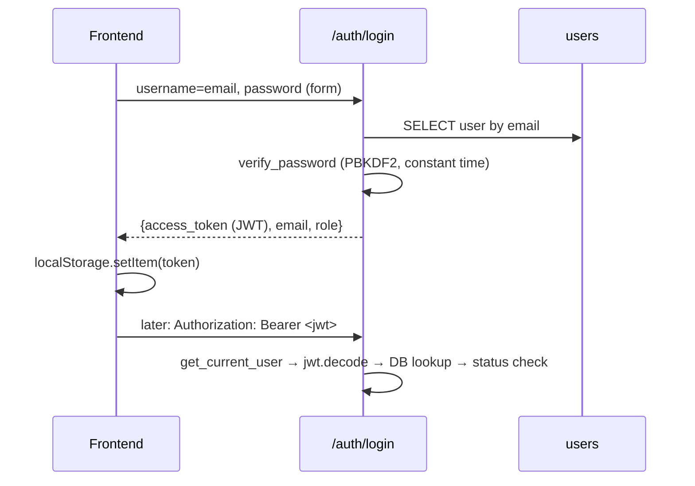

**Questions.** Why is the role in the JWT only a hint? Why does forgot-password always return the same message? Why a 403 rather than a 401 for a banned user? Is `API_KEY` enforced? (No.) How is the first admin created? (`python scripts/make_admin.py <email>`.)

---

### Step 7 — `app/core/middleware.py` and `app/core/redis_client.py`

**Why now?** They wrap every request, and they introduce the "Redis optional, in-process fallback" pattern that appears again in the event bus, leases, and workers.

**`redis_client.py`.** Two lazy singletons from one `REDIS_URL`. `sync_redis()` (3 s socket timeout, used by automation threads so a hung Redis never stalls a run) and `async_redis()` (no socket timeout, because the pub/sub listener idles). Both return **`None`** if `REDIS_URL` is unset, and every caller must handle that.

**`middleware.py::register_middleware`.** One `@app.middleware("http")`:
1. **Rate limit** (skips `/health`, `/docs`, `/openapi.json`, `/redoc`). With Redis: a sorted-set sliding window (`ZREMRANGEBYSCORE` + `ZADD` + `ZCARD` + `EXPIRE` in one pipeline), bounded by `asyncio.wait_for(timeout=2.0)`, and it **fails open** on any Redis error. Without Redis: an in-process `deque` per IP, pruned past 10k IPs. Client IP is `X-Forwarded-For`'s first hop only if `TRUST_PROXY=true`.
2. **Timing + logging**: `METHOD path -> status (ms)`. Query strings aren't logged.
3. **Last-resort error handler**: a disconnect → **503** + `Retry-After: 2`; anything else → **500** `{"detail":"Internal server error."}` with the stack trace logged and never returned.

**Questions.** Why fail open? (A limiter outage must not take the API down.) Why is `TRUST_PROXY` opt-in? (Otherwise callers could spoof their bucket.) What's the difference between the two Redis clients?

---

### Step 8 — `backend/app/main.py`

**Why now?** You have everything it wires together. This file is the **boot sequence**.

**Boot sequence (module import time, in order).**
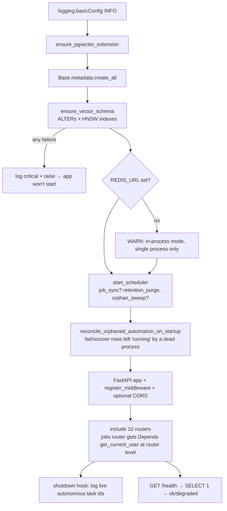

**Why reconciliation happens here.** Both engines drive automation from process memory (`runner._REGISTRY`, `_OPEN_REVIEW_SESSIONS`) but persist ownership as a **status**. After a restart those registries are empty, so any row still in an active status was abandoned. Without reconciliation it would block its job with `409` forever (see Step 36).

**Router auth pattern.** Most routers add `Depends(get_current_user)` per endpoint. `jobs.router` gets it at include time. `auth` is public. `chat`'s WebSocket authenticates via `?token=`.

**Questions.** What runs before the first request? Why is `create_all` still called when Alembic exists? Why is recovery done at import time rather than in a lifespan hook? (Matches the existing pattern. `AUTONOMOUS_AGENT.md` notes the multi-worker caveat.) What does `/health` check? (DB reachability only.)

---

## STAGE B — RÉSUMÉ UPLOAD → JOB MATCHING

### Step 9 — Storage: `app/services/storage/{base,local_backend,s3_backend,__init__}.py`, `file_storage.py`, `document_storage.py`

**Why now?** The résumé pipeline starts with saving bytes.

**Responsibility.** `StorageBackend` (ABC) has `save(key, bytes) → locator`, `read`, `exists`, `delete`, and `local_path(locator)` (a context manager returning a real file path: a no-op locally, a temp download for S3). `get_storage_backend()` is a cached singleton selected by `STORAGE_BACKEND`.

**`file_storage.py`** (résumés for matching): extension whitelist `{.pdf, .docx}`, **magic-byte** check (`%PDF-`, `PK\x03\x04`), UUID filename under `storage/resumes/`, and `compute_file_hash` = SHA-256 of the bytes. **`document_storage.py`** (profile documents): the same validation for more types, plus `save_task_upload_file` and `stage_stored_file_for_agent` (materialize a document as a stable local file for Playwright uploads by the autonomous agent).

**Why this design.** One seam between "where do bytes live" and everything else. Extraction and Playwright need real files, hence `local_path()`.

**Questions.** Why check magic bytes? (A renamed `.exe` is rejected.) What does `local_path` do under S3? Why UUID filenames? (No user-controlled paths.)

---

### Step 10 — `app/services/text_extraction.py`

**Problem.** Turn a PDF/DOCX into clean text for the LLM.

**Flow of `extract_text(stored_path)`.**
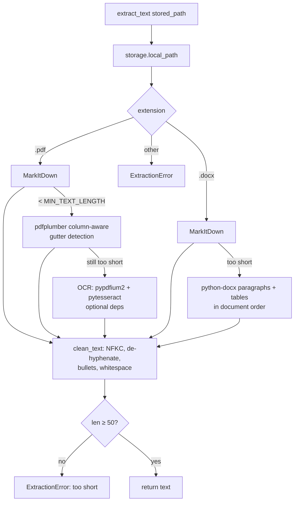

**Design.** MarkItDown first, with the hand-written extractors kept as a safety net. Garbage in → clear error rather than silent garbage to the LLM.

**Questions.** How are two-column résumés handled? What happens with a scanned PDF without Tesseract installed? Why clean text before the LLM?

---

### Step 11 — The LLM layer: `app/ai/llm/base.py`, `registry.py`, `router.py`, `providers/openai_provider.py`

**Why now?** Résumé parsing is the first LLM call, and every later AI feature goes through this same router.

**Problem.** Keep vendor SDKs out of application code, make model choice configuration, and give every caller retries and one exception type.

**Classes/functions.**

| Item | Purpose |
|---|---|
| `LLMProvider.complete(model, prompt, system, temperature, max_tokens, json_mode, images)` | Abstract. Must raise `LLMError` (never a vendor exception) |
| `TaskRoute(provider, model, temperature, max_tokens, json_mode)` | Frozen dataclass. One per task |
| `TASK_ROUTES` | `resume_parse`, `job_fit_analysis`, `application_answer`, `form_vision_answer`, `field_reasoning`🔵, `resume_selection`🔵, `autonomous_agent_decision`, `cover_letter_generation`. All `gpt-4.1-mini` |
| `PROVIDER_FACTORIES` | `{"openai": _openai_factory}`, lazily imported |
| `LLMRouter.run(task, prompt, system, images, **overrides)` | Resolve route → cached provider → up to **3 attempts** with exponential backoff (1 s, 2 s) on `LLMError` → `LLMRouterError` |
| `llm_router` | Module singleton, imported as `from app.ai.llm import llm_router` |
| `OpenAIProvider` | `OpenAI(timeout=60, max_retries=0)` (retries are the router's job), `response_format={"type":"json_object"}` in JSON mode, images as `data:image/png;base64` parts with `detail:"high"` *after* the text |

🔵 `field_reasoning` and `resume_selection` are registered but **never called**. They were reserved for the planned LangGraph agents.

**Data flow.**
```text
caller(task="resume_parse") → LLMRouter.run → TASK_ROUTES[task] → OpenAIProvider.complete
   → OpenAI Chat Completions → text (JSON string) → caller parses/validates
```

**Design decisions.** Retrying only `LLMError` (the provider's normalized error). SDK retries disabled to avoid double backoff. Images forwarded only when non-empty, so text-only test doubles still work.

**Questions.** How do you switch one task to another model? (Edit `TASK_ROUTES`.) Which file may import `openai`? What exception do callers catch? How many attempts, and what's the backoff? Why `max_retries=0` on the SDK?

---

### Step 12 — Résumé parsing: `app/models/parsed_resume.py`, `app/services/resume_parser.py`, `normalizer.py`, `app/core/skills_taxonomy.py`

**Problem.** Convert résumé text into a trustworthy structured object.

**`ParsedResume` (Pydantic).** Identity, links, `professional_summary` (verbatim only), `total_years_experience`, `skills` (explicit), `inferred_skills` (separate), `experience[]`, `education[]`, `certifications`, and `skill_categories` (six buckets that match the Master Profile UI).

**`parse_resume_text(text) → (ParsedResume, confidence)`.** Two attempts. Attempt 1 uses `SYSTEM_PROMPT` + `JSON_SCHEMA_HINT`. Attempt 2 prepends "Your previous response was not valid JSON...". Each attempt strips Markdown code fences, `json.loads`, then validates with Pydantic. `ParsingError` after two failures. `_compute_confidence` = fraction of 6 checks (name, email, skills, experience, all experience has start dates, education).

**Anti-hallucination rules in the prompt:** never invent facts, explicit vs inferred skills kept separate, only literal URLs, summary copied verbatim, only compute total years.

**`normalizer.normalize_resume`.** Canonicalizes skills via `skills_taxonomy.canonicalize_skill` (alias map, e.g. `postgres`/`postgresql` → `PostgreSQL`), dedups case-insensitively, removes inferred skills already explicit, and **recomputes `total_years_experience` from date ranges in code** (doesn't trust LLM arithmetic; overlapping roles aren't deduped).

**Questions.** Why separate explicit and inferred skills? Why recompute years? What does the confidence score mean? (Structural completeness, not correctness.) What happens on invalid JSON twice? (422 from the route.)

---

### Step 13 — Embeddings: `app/services/embedding_service.py`, `resume_text_builder.py`, `job_text_builder.py`

**`generate_embedding(text) → list[float]`.** Lazy-loads `fastembed.TextEmbedding("sentence-transformers/all-MiniLM-L6-v2")` once per process, embeds, and **L2-normalizes** in Python (zero vector if the norm is 0). Normalization is what makes cosine similarity equal a dot product.

**Text builders.** `build_resume_summary_text` emits a dense "signal" text (years, skills, inferred skills, titles at companies, descriptions, achievements, degrees, certifications) and deliberately omits contact info. `build_job_summary_text` = title + company + location + description.

**Used by.** Résumé embedding (`/resumes/{id}/embed`), job embedding (`embed_pending_jobs`), and the answer cache's semantic lookup and save.

⚠️ `fastembed` is missing from `requirements.txt` (see Part 3).

**Questions.** Why normalize? Why exclude contact info from the embedded text? Why a module-level singleton? (Model load is expensive.)

---

### Step 14 — Job discovery: `app/services/job_sources/*`, `job_ingestion.py`, `job_repository.py`, `app/api/jobs.py`, `app/core/scheduler.py`

**Problem.** Pull listings from external boards into one normalized, deduplicated table.

**Plugin contract (`job_sources/base.py`).** `JobSource.fetch(query, *, country, location, limit) → list[normalized dict]`, and it raises `JobSourceError` on failure. The normalized keys are `job_id` (prefixed with the source), `title`, `company`, `location`, `description`, `salary_min/max`, `remote`, `min_years_required`, `apply_url`, `source`.

**Implemented connector.** `AdzunaSource` → `adzuna_client.fetch_jobs` (httpx GET `https://api.adzuna.com/v1/api/jobs/{country}/search/1`, 15 s timeout) → `normalize_adzuna_job` (`job_id = "adzuna_<id>"`, `remote=None` because Adzuna has no reliable flag, `min_years_required` via regex `experience_extractor`). `remotive_source.py`/`arbeitnow_source.py` are **REMOVED stubs**. `html_utils.strip_html` remains for them.

**`ingest_from_sources(db, query, sources, country, location, limit)`.**
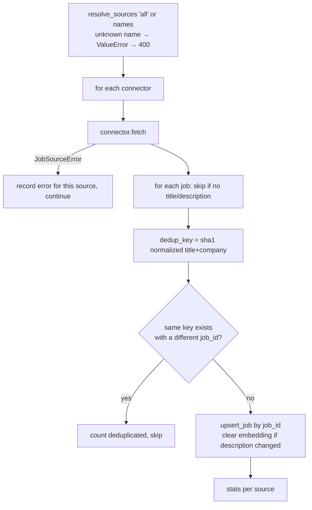

**`embed_pending_jobs`.** Embeds every job whose `embedding_vector IS NULL` and commits once.

**Scheduler.** `_sync_all_queries` runs ingestion for each `JOB_SYNC_QUERIES` term, then embeds. It's opt-in, first run 15 s after boot, `max_instances=1`, `coalesce=True`.

**Questions.** How do you add a new job board? (One connector + one registry line.) Why dedup by title+company instead of URL? (The same role posted on different boards.) What invalidates a job's embedding? Does one failing source fail the request? (No.)

---

### Step 15 — Matching: `app/services/matching/{retrieval,job_vector_store,hard_filters,job_skill_extractor,skill_gap,ranker,vector_similarity}.py`, `app/services/ats/ats_scorer.py`, `match_repository.py`

**Problem.** Rank jobs for a résumé in a way that's cheap and explainable.

**Funnel (cheap → expensive).**
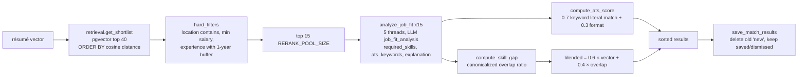

**Key details.**
- `search_similar_jobs` computes `(1 - cosine_distance)` as `similarity` and filters `embedding_vector IS NOT NULL`, so it uses the HNSW index.
- `apply_hard_filters`: `None` experience requirement = unknown (not zero). The candidate is excluded only if short by more than 1 year. Unparseable values never filter.
- `analyze_job_fit` truncates the description to 3,000 chars and **never raises**. On failure it returns empty skills and "Could not generate explanation."
- `compute_skill_gap`: explicit + inferred skills both count; `overlap_ratio = matched/required` (1.0 if no requirements).
- `compute_ats_score`: keyword presence checked against the **raw résumé text** (literal, like real ATS scanners, so "JS" ≠ "JavaScript" on purpose), and a format score from standard section headers + length.
- `vector_similarity.cosine_similarity` is **dead code** (never imported).

**Questions.** Why only 15 LLM calls? (Cost; `README` "cost-aware pipeline".) Why is ATS keyword matching literal while skill matching is canonicalized? What happens to saved matches when you regenerate? Where's the threshold? (No similarity threshold; top-N + hard filters.)

---

### Step 16 — `app/api/resumes.py` (the first complete vertical slice)

**Why now?** It ties Stage B together, and it's the simplest router to study end to end.

**Routes.** `GET /resumes`, `POST /resumes/upload` (≤ 5 MB, per-user SHA-256 dedup → `duplicate_of_existing`, handles an `IntegrityError` race, background extraction), `POST /{id}/extract?force=`, `POST /{id}/parse` (400 if not extracted; 422 `ParsingError`; **502** `LLMRouterError`), `POST /{id}/embed`, `GET /{id}/shortlist?top_n=`, `POST /{id}/matches/generate?location_contains=&min_salary=`, `GET /{id}/matches?status=`, `PATCH /matches/{match_id}/status`.

**Patterns to notice.**
- `_get_owned_resume` returns **404** (not 403) for someone else's résumé, so IDs can't be probed.
- Status lifecycle: `uploaded → extracted | extraction_failed → parsed` (the embedding doesn't change status).
- `_run_extraction` opens its own `SessionLocal()` because the request session is already closed.

⚠️ README's `/resumes/matches/{id}/tailor` and `/cover-letter` endpoints don't exist (removed).

**Questions.** Why is a duplicate upload not an error? Why 502 for LLM failure? Why does `/matches` not recompute?


---

## STAGE C — MASTER CANDIDATE PROFILE

### Step 17 — `app/models/profile.py` and `app/services/profile_repository.py`

**Why now?** The automation engine fills forms *from the profile*. Before reading any automation code you need to know what facts exist.

**`app/models/profile.py`.** Pydantic models: `ProfileUpsertRequest` (every field optional; the same model for create and PATCH), `ProfileResponse`, `EducationRequest/Response`, `ExperienceBase/Create/BatchCreate/Request/Response` (normalization: blank → None, cleaned `skills_used`, rejects empty entries and duplicates within a batch), `SkillsRequest` (six buckets), `LanguageEntry`, `DemographicsRequest/Response`, `DocumentResponse`, `AutomationSettings*`, `SiteTrustLevel*`, `RetentionPolicy*`, and `ResumeDraft*` (the résumé → profile preview shape).

**`profile_repository.py` key functions.**

| Function | Purpose | Notes |
|---|---|---|
| `_apply_profile_fields` / `update_profile` | Partial update: only keys present are written | Encrypts `phone`/`address` into `*_encrypted` |
| `profile_to_dict(profile)` | Decrypts for the owner's own responses | Used by `/profile` and the agent snapshot |
| `add_experiences(db, profile_id, items)` | Batch create in one transaction | `add_experience` delegates to it |
| `set_default_document` | Unsets other defaults of the same type, then sets this one | |
| `write_back_stable_answer(db, user_id, question, value)` | When a human answers a question that's really a profile fact (phone, city, LinkedIn...), save it to the profile | Uses `FieldMapper.map_field(label=question)`, restricted to `_WRITE_BACK_SAFE_ATTRIBUTES` (contact, location, links, current company/role) and a minimum mapping confidence of 0.75. Never raises |
| `load_owned_demographics(db, user_id, profile)` | Loads saved EEO answers **through the user's own profile** and verifies ownership | Raises `DemographicsOwnershipError`, which fails the run |
| `detached_copy(row)` | Plain session-free copy of a mapped row | So a long browser run never touches a dead session |
| `update_automation_settings` | The account kill switch `autopilot_globally_disabled` | |

**Design decisions.** A detached copy + preloaded demographics came directly from the Neon incident (`test_run_db_resilience.py`). Write-back is whitelisted so a free-text answer can't overwrite, say, `work_authorization`.

**Questions.** Why does the repository encrypt, not the route? What is write-back and why is it restricted? Why detach ORM objects before the browser phase?

---

### Step 18 — `app/api/profile.py`, `app/services/profile_draft.py`, `trust_level_repository.py`, `retention_repository.py`

**Routes (`/profile`).** CRUD for profile, education, experience (single or JSON array batch), `PUT /skills`, `PUT /automation-settings` (kill switch), site trust levels (`GET`, `PUT /{domain}`, `DELETE /{domain}`), retention policy (`GET`, `PUT`, `POST /purge-now`), documents (`POST /upload?document_type=` creates a profile on first upload and dedups by hash per type; `GET`; `PATCH /{id}/set-default`; `DELETE`), `POST /documents/{id}/profile-draft` (preview), `POST /documents/{id}/apply-resume-draft` (save), demographics (`GET`, `POST`, `PUT`), and `GET /profile/workflow` (readiness: `profile_ready`, `resume_ready`, `ready_to_apply`, `default_trust_level`, `autopilot_disabled`).

**Validation.** `_validate_profile_choices`/`_validate_demographic_choices` check closed vocabularies (`VALID_REMOTE_PREFERENCES`, `VALID_GENDER_VALUES`, etc.) on both POST and PUT.

**`profile_draft.py`.** `draft_from_document(document)` = `local_path` → `extract_text` → `parse_resume_text` → a draft shaped like the profile models (skills classified into six buckets). `apply_resume_draft_to_profile` **never overwrites** a fact already on the profile: scalars fill only blanks, skills are a case-insensitive union, and education/experience are added only if not already present (keyed identity).

**`trust_level_repository.resolve_trust_level(db, user_id, job_url)`.** A per-domain override (hostname) → the user's `default_trust_level` → `FULL_MANUAL_REVIEW`. It fails closed.

**Questions.** How does a résumé become a profile without clobbering edits? What's the order of trust-level resolution? Why is the kill switch read fresh on every page? (Step 34.)

---

## STAGE D — AUTOMATION FOUNDATIONS

### Step 19 — `backend/automation/interfaces.py`

**Why now?** It's the documented contract between `automation/` and `app/`, and every automation module imports from it.

**Two layers.**
- **A. Real integration functions:** `automation_db_session()` (a context manager for sessions outside requests), `get_candidate_profile`, `get_candidate_profile_dict`, `list_education`, `list_experience`, `get_default_resume`, `get_resume_for_job` (prefers `job_type_tag`), `list_documents`, `get_candidate_demographics`, `generate_answer(task, prompt, system, **overrides)` (→ `llm_router.run`), and `embed_text` (→ `generate_embedding`).
- **B. Plain dataclasses kept for compatibility:** `CandidateProfileView`, `EducationView`, `ExperienceView`, `ResumeDocumentView`, and most importantly **`ApplicationRunResult`**, the value object a deterministic run returns (`application_id`, `status`, `ats_platform`, `detected_ats_platform`, `confidence`, `screenshot_paths`, `trace_path`, `error_log`, `pages_completed`, `log_lines`, `detected_company`, `detected_position`).

**Key rule.** `automation/` never persists its own result. It returns `ApplicationRunResult`, and `app/services/application_repository.apply_run_result` writes it.

**Questions.** Why is `automation` allowed to import `app.services` but not `app.api`? What is `ApplicationRunResult` for?

---

### Step 20 — Browser lifecycle: `automation/browser/chrome_attach.py`, `session.py`, `browser_manager.py`

**Why now?** Every automation path starts with "get me a page".

**`chrome_attach.py`.** `normalize_cdp_url`, `devtools_version` (GET `/json/version`), `find_chrome_executable` (real Chrome, not Playwright's Chromium; Windows/macOS/Linux paths), `default_chrome_user_data_dir`, `connect_to_chrome` (`connect_over_cdp` → the **existing default context**), `launch_chrome_with_remote_debugging` (starts real Chrome with `--remote-debugging-port` and a dedicated profile dir, left running on purpose), `attach_or_launch_chrome` (attach → else autolaunch → else `ChromeAttachError`), and `launch_persistent_chrome` (Playwright persistent context on a real profile dir).

**`session.py`.** `HumanPacing` (frozen floors: 50–200 ms/char, 2–7 s/action, 60–180 s between applications, 30/day cap) and `DEFAULT_PACING`. `SessionStore` saves and loads Playwright storage-state per `(user, ats)` as Fernet-encrypted JSON at `storage/automation_sessions/<user>__<ats>.session.enc`.

**`BrowserManager`.**

| Method | Purpose |
|---|---|
| `launch_context()` | Idempotent. Starts `sync_playwright()` and walks `_MODE_CHAIN[mode]` (`cdp → persistent`, `persistent`, `launch`), recording `active_mode` and `_owns_browser` |
| `_attach_over_cdp` | User's Chrome. `headless=False`, `_owns_browser=False` |
| `_open_persistent_context` | Our window, per-user profile dir `storage/chrome_profile/<mode>/<user>` |
| `_launch_throwaway_context` | Headless-capable Chromium seeded from `SessionStore` |
| `new_page()` / `adopt_page(page)` | Track pages **we** opened (and pages an Apply link opened in a new tab) |
| `close()` | Closes **only our tabs**. Never closes the user's Chrome |
| `save_session(context)` | Persist storage state (launch mode) |
| `run_with_retries(fn)` | Retry transient Playwright timeouts/errors (e.g. `goto`) |
| `run_directory(app_id)`, `screenshot_on_failure`, `start_trace`/`stop_trace`, `write_error_log` | Per-run artifacts under `logs/<application_id>/` |

**Browser lifecycle.**
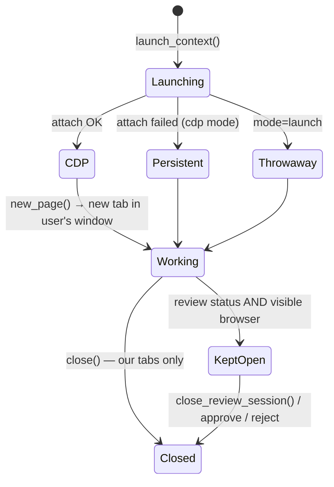

**Questions.** Why is `launch` never an automatic fallback? What does `close()` close in cdp mode? Where do traces go? Why a per-user profile directory?

---

### Step 21 — `automation/browser/selectors.py`

**Why now?** Adapters and the flow manager call these page-level heuristics constantly. They're ATS-agnostic.

**Function families.**

| Family | Functions | Purpose |
|---|---|---|
| Buttons | `find_next_button`, `find_submit_button`, `find_apply_entry_button`, `_find_button_by_text` | Exact accessible-name match first, then loose text. Skips elements inside cookie/chat/newsletter containers (`_is_inside_distraction`) |
| Overlays | `dismiss_overlays`, `has_loading_overlay`, `wait_for_overlays_to_clear` | Cookie banners, spinners |
| Page identity | `find_step_indicator`, `find_page_heading`, `looks_like_review_page` | Feed `PageSignature` |
| Posting metadata | `find_job_posting_title_and_company` | Tier 1 schema.org `JobPosting` JSON-LD, tier 2 Open Graph |
| Form root | `resolve_form_root` | `page` or the application **iframe** (iCIMS) |
| Uploads | `find_file_upload_input`, `find_cover_letter_file_input`, `find_upload_trigger_button` | Prefers résumé/CV-hinted inputs |
| Readiness | `wait_for_form_ready` | Bounded `load` + `networkidle` wait (hydration race, Step 34 / Part 8) |
| Required fields | `find_unfilled_required_fields(_locators)` | Scans the current DOM for required, visible, empty controls, with names |
| Outcome | `find_submission_confirmation`, `wait_for_submission_confirmation` | URL hints (`thank`, `confirmation`, `/success`...) + text patterns |
| Errors | `find_validation_errors` | Visible validation messages |
| Human gates | `find_human_gate`, `page_has_captcha` | Password field / OTP / email-SMS verification / identity / payment gates. Visible CAPTCHA provider (`captcha`, `recaptcha`, `hcaptcha`, `cf-turnstile`, `turnstile`) |

**Questions.** How is a login wall detected? (A visible `input[type=password]` + phrases.) What counts as a confirmed submission? Why does the required-field scan run against `adapter.form_root`?

---

### Step 22 — `automation/utils/{element_actions,human_input,retry,scrolling}.py`

- **`element_actions.safe_click(locator, page, position=None)`**: a click with short timeouts and retries on interception, returning bool instead of blocking 30 s. **`wait_for_dynamic_element(check, timeout_ms)`** polls.
- **`human_input.human_type(locator, text, page, click_first=True)`**: scroll → settle → click → settle → clear → type in jittered chunks (`press_sequentially`). **`human_pause_between_fields`**: once per field. Controlled by `AUTOMATION_HUMAN_PACING` (default on; tests set `0`). Real keystrokes matter for autocompletes, react-select search, masked inputs, and counters.
- **`retry.retry_strategies([(name, fn), ...])`**: try strategies in order, return which succeeded.
- **`scrolling.scroll_container_until_option_found(page, container, find_option, max_attempts)`**: scroll the **container** (not the page) and re-query each time, which is safe for virtualized lists.

⚠️ `.env.example` lists `AUTOGRAM_HUMAN_PACING`, but the code reads **`AUTOMATION_HUMAN_PACING`**.

---

### Step 23 — `automation/ats/detector.py` and `automation/ats/registry.py`

**`ATSDetector.detect(url, page=None)`**, cheapest tier first:
1. **URL patterns** (confidence 0.98): `boards.greenhouse.io`, `job-boards.greenhouse.io` → greenhouse; `jobs.lever.co` → lever; `myworkdayjobs.com`, `myworkdaysite.com`, `/wday/` → workday; plus smartrecruiters, taleo, icims, ashby, bamboohr, oracle_hcm.
2. **DOM fingerprints** (0.75) on an open page (`#grnhse_app`, `[data-automation-id]`...), then **meta generator** (0.65).
3. **Fallback** `{"ats": "custom", "confidence": 0.1, "method": "fallback"}`.

`detect_ats_for_url(url)` tries the URL tier with no browser, and only launches a throwaway headless browser if that's inconclusive.

**`ADAPTER_REGISTRY = {"greenhouse", "lever", "workday"}`.** The six Phase-7 stub adapters are deliberately **not** registered (they raise `NotImplementedError`). `get_adapter_class(name)` returns `None` for them, and the flow manager falls back to `GenericAdapter`.

**Questions.** Why is detection tiered? Why aren't stubs registered? What's the confidence of a URL match?

---

## STAGE E — FORMS: "WHAT VALUE?" AND "HOW DO I PUT IT THERE?"

This stage separates two questions that beginners usually mix up:

```text
"What does this field mean, and what value belongs in it?"  → field_mapper, profile_formatting,
                                                               question_classifier, answer_engine, vision_fallback
"Given an element and a value, how do I interact with it
 and prove it stuck?"                                        → field_handlers (+ utils)
```

### Step 24 — `automation/forms/field_mapper.py` and `profile_formatting.py`

**`FieldMapper.map_field(label, placeholder, name, nearby_text) → (attribute, confidence) | None`.** Checks signals in order of certainty: **name/id** (the ATS backend's own identifier, with snake/camel variants) → **label** → **placeholder** → **nearby text**. A synonym must match on **word boundaries** (`_synonym_pattern`). **Opt-in labels** ("Send me job alerts by email") are never mapped (`looks_like_opt_in_label`). Otherwise the email synonym would tick a marketing checkbox, which actually happened (see `field_handlers._coerce_checkbox_intent`).

`FIELD_SYNONYMS` covers 44 profile attributes. **Order is load-bearing:** `preferred_name` comes before `first_name` because "preferred first name" contains "first name".

**`profile_formatting.format_profile_value(profile, attribute, raw)`.** The **one** place a DB value becomes form text. It fixes real bugs observed live: `requires_sponsorship=True` was typed as "True", `notice_period_days=30` as "30", and `expected_salary` as "120000.0". Named formatters (e.g. `format_requires_sponsorship` → "Yes"/"No" + visa suffix, `format_expected_salary` → "USD 120,000", `format_languages` → "English (Native), ...") and a type-based `format_scalar` fallback. `format_security_clearance` and `format_referrer_name` **never guess**.

**Questions.** Why does name/id beat label? Why word-boundary matching? Why a single formatter module?

---

### Step 25 — `automation/forms/field_handlers.py` (the widget layer)

This is one of the three most important automation files. Part 7 covers every handler in depth. Read it here in this order:

1. `Field` (dataclass): `locator`, `page`, `label`, `tag_name`, `input_type`, `role`, `profile_attribute`, `introspection_error`.
2. `describe_field(locator, ...)`: **one** `evaluate` call reads tag/type/role, retried once if the element isn't attached yet. A failure is logged at WARNING with the element HTML.
3. `FieldHandler` ABC: `supports(field)`, `fill(field, value)`, `verify(field, value) → (ok, actual)`.
4. `FieldFailure` (structured failure) and `FieldFillRefused` (a handler **declining**, which is not retried).
5. The handlers (Part 7).
6. `DEFAULT_HANDLER_REGISTRY` (order matters) and `FieldHandlerRegistry.get_handler` (first match wins; ambiguity logged).
7. **`fill_field(field, value, max_attempts=3, context=None) → HandlerOutcome`**: the single entry point.

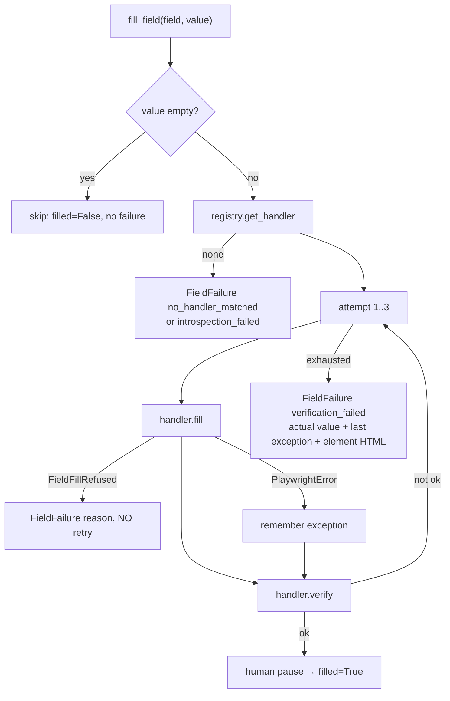

**Why verify-after-fill?** Custom widgets often *look* filled but didn't commit (typed search text vs a selected option). Verification is what makes the confidence score honest.

**Also here:** `read_field_options(field)`, which returns the exact option strings a control offers (native `<option>` texts, or it opens a custom dropdown just long enough to read them via `_probe_dropdown_options`, then closes it). The answer engine uses this so the LLM chooses among **real** options.

⚠️ The module docstring says "Thirteen concrete handlers", but the registry lists **twelve**.

---

### Step 26 — `question_classifier.py`, `option_matching.py`, `demographic_matching.py`

- **`classify_question(text) → category | None`**: regex/keyword classification into ~27 categories (work authorization, sponsorship, visa type, notice period, salaries, preferred name, referral, employment type, background check, language fluency, years, education, relocation, relocation assistance, travel, drug test, driver's license, security clearance, referrer, time zone) plus **six demographic categories** (gender, veteran, disability, race/ethnicity, Hispanic/Latino, pronouns). `is_demographic(category)`.
- **`match_option(answer, options) → option | None`**: exact → case/whitespace-normalized → containment **only if exactly one option matches**. Never picks between two plausible options.
- **`match_demographic_value(stored_token, options)`**: bridges stored tokens (`decline_to_answer`, `non_binary`) to a form's prose ("Decline To Self Identify", "I don't wish to answer"). Born from a live Greenhouse (Warp) form where `decline_to_answer` didn't match and a decline could resolve to a bare "No" (`test_application_profile_demographics.py`).

---

### Step 27 — `app/services/answer_cache_repository.py` and `application_question_repository.py`

- **Answer cache (per user):** `normalize_question` (case, whitespace, punctuation) → `compute_question_hash` → `get_cached_answer` (exact). `find_similar_answer` embeds the question and returns the nearest cached answer with **cosine similarity ≥ 0.87** (`SEMANTIC_SIMILARITY_THRESHOLD`). `save_answer` upserts and stores the embedding. `_looks_like_secret_prompt` refuses to cache anything that looks like an OTP prompt.
- **Question ledger (per application):** `record_question` (text, field type, options, answer, source, confidence, `confidence_level`, `review_status`), `apply_review` (approve/edit/reject by a human), `summarize_for_application` (counts for the pre-submission review gate).

---

### Step 28 — `automation/forms/resume_context.py` and `automation/forms/answer_engine.py`

**Why now?** You know how a field is mapped and filled. This is what answers the fields `FieldMapper` couldn't.

**`resume_context.py`.** `load_resume_context(db, profile)` builds a frozen `ResumeContext` (recent experience first, education, certifications) for the prompt. Pure assembly + a best-effort loader.

**`ApplicationAnswerEngine`** (constructed per run in `_run_application` with `profile` (detached), `job_description`, `user_id`, `application_id`, preloaded `demographics`, `resume_context`, and `session_factory`).

**`answer_batch(questions)` algorithm.**
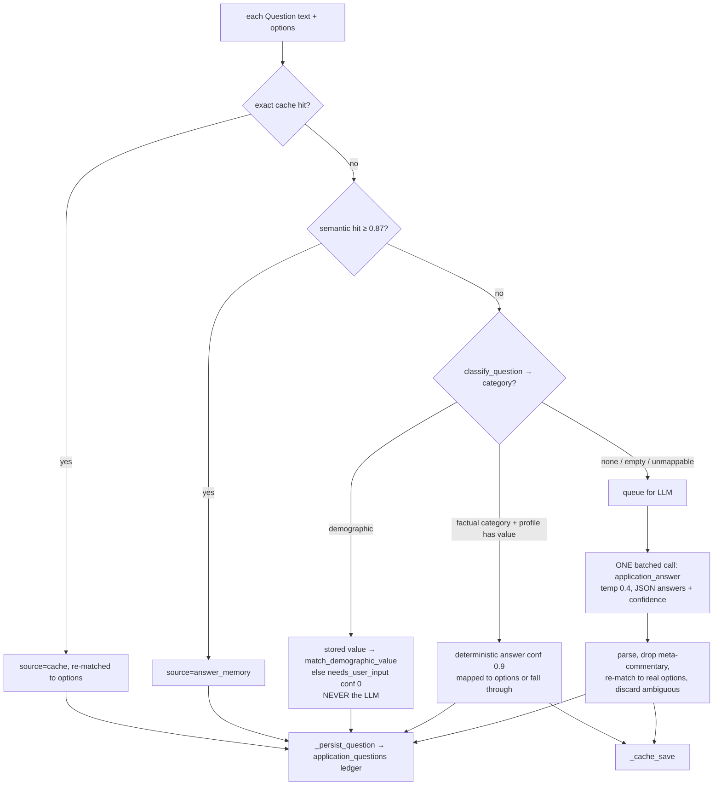

**Constants.** `DETERMINISTIC_CONFIDENCE = 0.9`, `LLM_CONFIDENCE = 0.6` (default when the model gives none), and in `automation/ats/base.py` `ANSWER_REVIEW_CONFIDENCE_THRESHOLD = 0.80`: an LLM answer below 0.80 is **not typed**, and the field is left for a human.

**The system prompt's rules** (`_SYSTEM_PROMPT`): answer only from profile + job description, never invent facts, answer with the *value* not a sentence, never write meta-commentary ("the profile doesn't specify..."), return `null` + 0.0 when unsure, and treat page/job text as **untrusted data** (prompt-injection defense). Calibrate toward under-confidence.

**Resilience.** `_run_db` opens a fresh session per DB touch via `session_factory` and retries once on a dead connection. `answer_batch` failures in `base.py` fall back to answering questions individually, so one bad question doesn't discard the batch.

**Questions.** In what order are answers tried? Why is the LLM call batched? Why are demographics never sent to the LLM? What happens when the LLM answers "Yes, I do" to `["Yes","No"]`? (Containment → "Yes".) What confidence is needed to type an LLM answer? What's persisted per question?

---

### Step 29 — `automation/forms/vision_fallback.py`

**Problem.** Some required fields stay empty after every DOM pass: a conditional follow-up whose meaning is in the question above, a react-select whose value isn't in its input, or a label the DOM doesn't connect to the input.

**`VisionFormAnswerer.answer(fields)`.** Up to **10 fields per call** (`MAX_FIELDS_PER_CALL`), each a cropped screenshot (`ATSAdapter._vision_crop`) + the same `profile_payload()` the text engine uses → LLM task `form_vision_answer` (temp 0.0) → `_validate` per entry:
- `already_filled: true` → not filled; reported as **confirmed already answered** (this waives the required-field scan's false "empty").
- empty answer / no numeric confidence / meta-commentary → declined.
- options present → must `match_option` to exactly one.
- **Demographic questions are dropped before the call.**

The caller (`ATSAdapter.fill_unfilled_fields_with_vision`) applies the same 0.80 confidence gate and fills through `fill_field`, so vision answers are verified against the DOM like any other. Debug crops are saved as `logs/<app>/vision-field-N.png`.

**Config.** `AUTOMATION_VISION_FALLBACK=true` by default. It's the most expensive path (one high-detail image per field).


---

## STAGE F — ADAPTERS & ORCHESTRATION

### Step 30 — `automation/ats/base.py` (`ATSAdapter`)

**Why read this now?** You now know how a field is *mapped* (Step 24), *answered* (Step 28), and *filled* (Step 25). `ATSAdapter` is where those three meet on a real page. Every concrete adapter inherits almost everything from here.

**Problem.** Give each ATS a small, platform-specific surface (selectors, navigation rules) while sharing the ~2,000 lines of generic "find every question on this page and answer it" machinery.

**What it unlocks.** Once you understand `_fill_known_questions`, the Greenhouse/Lever/Workday/Generic adapters are each under 350 lines and easy to read.

**Dependencies.** Imports `selectors`, `field_handlers`, `field_mapper`, `answer_engine`, `profile_formatting`, `vision_fallback`, `app.core.crypto`, `app.services.storage`. Depended on by every adapter, `application_flow_manager.py`, and many tests.

**Class `ATSAdapter(ABC)`.**
- **Constructor:** `page`, `profile` (a detached `CandidateProfile`), `resume_document`, optional `answer_engine`. State: `_form_root_cache`, `_pending_answer_engine_questions`, `_seen_radio_groups`.
- **Abstract (5):** `detect()`, `fill_personal_information()`, `answer_questions()`, `submit_application()`, plus the concrete-but-overridable `upload_resume()`.
- **Multi-page hooks with generic defaults:** `find_next_control()` (`find_next_button`), `find_submit_control()`, `is_final_page()` (no Next control → final), `is_review_page()`, `page_label()`, `dismiss_distractions()`.
- **`form_root` property:** `resolve_form_root(page)`, the iframe-aware root, cached per page and reset by `reset_form_root_cache()`.
- **Decrypting properties:** `phone`, `address`.

**The generic question sweep (`_fill_known_questions`), in order:**

| # | Pass | What it catches | Result |
|---|---|---|---|
| 1 | `_fill_questions_by_label` | Every `<label>`: `FieldMapper` → profile value → `fill_field`. Unmatched labels are queued for the answer engine | Profile facts on labeled fields |
| 2 | `_fill_questions_by_nearby_text` | Controls with **no** label/aria: question text recovered from a single-control ancestor (`_NEARBY_QUESTION_TEXT_JS`). This is the only pass that reaches Lever's screening questions | More queued/filled questions |
| 3 | `_fill_questions_via_answer_engine` | Everything queued. **One** `answer_batch` call with real options (`read_field_options`). Answers < 0.80 confidence are left blank | Screening questions |
| 4 | `_fill_checkbox_groups` | "Select all that apply" groups (pronouns, ethnicity) | Multi-select answers |
| 5 | `_fill_opt_in_checkboxes` | "May we contact you about future roles" **only** if the candidate opted in (`marketing_opt_in`) | Opt-ins |
| 6 | `_fill_questions_by_name_or_placeholder` | Unlabeled inputs by `name`/`placeholder` | Remaining profile facts |
| 7 | `_fill_consent_checkboxes` | Required "I agree"/consent boxes nothing else reached | Consent |

**The "examined" marker.** Every control a pass touches gets `data-automation-examined="1"` (`_mark_examined`), **whether or not the fill succeeded**, so later passes never re-fill (and double-count) the same element. A live American Express form showed why marking only on success was wrong: `Phone Number` failed 3 attempts and then `phoneNumber` (the same input) failed 3 more. `_stamp_candidates` gives each candidate a stable `data-automation-candidate` id first, because `Locator.all()` doesn't snapshot, so writing the marker mid-iteration would shift an in-flight locator (`test_examined_marker_ordering.py`).

**Other important methods.**
- `_fill_first_match(selectors, value)`: try platform selectors in order, first visible wins → `describe_field` → `fill_field` → mark examined.
- `_resolve_profile_value(attribute)`: `format_profile_value` (never raw column values).
- `upload_resume()` / `_find_resume_input()` (clicks an "Attach" trigger if the input is hidden behind one) / `resume_attachment_state()` (`attached`/`missing`/`no_field`) / `ensure_resume_attached()` (re-uploads if the form dropped the file).
- Cover letter: `detect_cover_letter_field`, `find_cover_letter_text_field`, `find_cover_letter_upload_input`, `fill_cover_letter_field`.
- Vision: `collect_unfilled_fields_for_vision` → `fill_unfilled_fields_with_vision(answerer, debug_dir)` → `VisionPassOutcome(results, confirmed_already_filled)`.

**Result type.** `FieldFillResult(field_key, profile_path, value_used, confidence, filled, failure, unfilled_reason)`. `unfilled_reason ∈ {no_answer_available, low_confidence, fill_failed}` feeds `ApplicationState`.

**Beginner explanation.** Think of `ATSAdapter` as a checklist a careful person follows on any form: fill the obvious fields, then the ones with odd labels, then ask for help with the hard questions (all at once), then tick the right boxes, then check nothing was missed.

**Questions.**
1. Which methods must every adapter implement?
2. Why is the answer engine called once per page instead of once per question?
3. Why mark a field examined even when the fill failed?
4. What does `form_root` solve? (Forms inside iframes, e.g. iCIMS.)
5. What stops an opt-in checkbox from being ticked with an email address?
6. How is a résumé that "uploaded then disappeared" caught?

---

### Step 31 — Concrete adapters: `greenhouse/`, `lever/`, `workday/`, `generic/`, and the six stubs

| Adapter | Platform traits encoded | `fill_personal_information` | Navigation/submit |
|---|---|---|---|
| `GreenhouseAdapter` | Public, single-page `#application_form`, predictable ids | `FIELD_SELECTORS`: `#first_name`, `#last_name`, `#email`, `#phone`, `#company`, `#title` (+ `job_application[...]` names, `autocomplete` fallbacks), confidence 0.95 | `find_submit_button` → click |
| `LeverAdapter` | Public, `.application-form`, **one "Full Name" field** | `input[name='name']`, `email`, `phone`, `org` | same |
| `WorkdayAdapter` | 4–6 pages, controls by **`data-automation-id`**, **Next and Submit are the same button** (`bottom-navigation-next-button`), login required | `legalNameSection_firstName` etc. | Overrides `find_next_control`, `find_submit_control`, `is_final_page` (reads the bottom button's label), `page_label` |
| `GenericAdapter` (`name="custom"`) | Anything unrecognized | Returns `[]`. Everything goes through `_fill_known_questions` | `detect()` = 0.1. Never auto-submits (not public) |
| Ashby, BambooHR, iCIMS, OracleHCM, SmartRecruiters, Taleo | 🔵 Phase 7 stubs | `raise NotImplementedError` | Not registered |

`answer_questions()` in Greenhouse, Lever, Workday, and Generic is just `self._fill_known_questions()`. Workday's docstring makes the point that its Application Questions and Voluntary Disclosures pages are ordinary labeled forms. Its platform-specific code is limited to selectors and navigation (`_has_visible_field` is used by its personal-information pass).

**Questions.** Why does Lever need its own adapter at all? (Full-name field, different selectors.) Why is Workday never auto-submitted? (Not in `PUBLIC_ATS_PLATFORMS`.) What protects against a stub being used? (It isn't registered, so the run falls back to Generic.)

---

### Step 32 — `automation/applications/page_navigator.py` and `application_state.py`

**`page_navigator.py`** answers one question: *did the form actually advance?*
- `PageSignature(url, title, heading, step_indicator, controls)`: structural evidence of which page is on screen. `differs_from`, `newly_visible_controls` (how conditional follow-ups announce themselves), `describe`.
- `capture_page_signature(page)`, `wait_for_page_settled(page)`, `click_control(page, control)` (scroll, overlay-clear, fallbacks).
- `advance_to_next_page(page, control, before=...) → NavigationOutcome(advanced, reason, before, after, validation_errors, click_failed)`: click, then poll for a signature change. If there's no change, read validation errors.

**Why this exists.** The old loop "fill, click Next, fill again" filled page 2 against page 1's DOM, couldn't tell a validation-blocked click from a success, and uploaded the résumé only on page 1 (`application_flow_manager.py` docstring).

**`application_state.py`.** `ApplicationState` (one per run): `record_decision`, `record_page_results`, `record_validation_errors`, `record_missing_required`, and `snapshot()`. It holds `PageRecord`s, `PendingUserInput` (fields a human must answer, and why), and a `Decision` timeline. The snapshot is published in `LIVE_RUN_STATE` for `GET /applications/{id}/live`.

---

### Step 33 — `automation/applications/cover_letter.py` and `verification_channel.py`

**`cover_letter.py`.** `generate_cover_letter_text(profile, job_description)` makes one LLM call (`cover_letter_generation`, temp 0.5, prose) grounded in `_profile_facts` + the job description. `write_cover_letter_docx(text)` writes a temp `.docx` for upload fields. It's only invoked when a page **actually has** a cover-letter field.

🟡 **Partial in practice.** It requires `job_description`, which **no frontend or extension caller sends** (`ApplyFromLink.jsx`, `MatchesPanel.jsx`, `ApplicationDetail.jsx`, `background.js`). Via the UI, a cover-letter field is logged and left blank. Via the API with `job_description`, it works.

**`verification_channel.py`.** An in-memory, one-shot mailbox for OTP codes on the deterministic path: `deliver(app_id, code)`, `take(app_id)` (pops), `has_pending`, `discard`. It's **never persisted, never logged, consumed once, and discarded when the wait ends**. It's fed by `POST /applications/{id}/verification-code` and consumed by `ApplicationFlowManager._try_deliver_verification_code` during a human wait.

---

### Step 34 — `automation/applications/application_flow_manager.py` (`ApplicationFlowManager`)

**Why read this now?** Everything in Stages D–F comes together here. This is the deterministic engine's orchestrator: one instance = one run.

**Problem.** Drive one application end to end on any page count, stop safely for humans, never double-submit, and always return a truthful result.

**What it unlocks.** `app/api/applications.py::_run_application` (Step 38) is essentially "build an `ApplicationFlowManager`, call `.run()`, persist the result."

**Dependencies.** `BrowserManager`, `ATSDetector`, `get_adapter_class`, `GenericAdapter`, `page_navigator`, `ApplicationState`, `cover_letter`, `verification_channel`, `selectors`, `ApplicationAnswerEngine`, `VisionFormAnswerer`, `ApplicationRunResult`. Used by `app/api/applications.py`, `app/api/automation.py` (imports `decide_action` + thresholds), and `app/workers/runtime.py`.

**Module-level state (single-process by design).**
- `LIVE_RUN_STATE: dict[app_id, dict]`: the "what is it doing right now" view for `/live`.
- `_OPEN_REVIEW_SESSIONS: dict[app_id, (BrowserManager, adapter, page)]`: strong references that keep a browser left open for review alive after `run()` returns. Without them, garbage collection could kill the Playwright connection.
- Stop requests: `request_stop`, `clear_stop_request`, `is_stop_requested`.

**Constants.** `PUBLIC_ATS_PLATFORMS = {greenhouse, lever, smartrecruiters, ashby}`, `AUTO_SUBMIT_CONFIDENCE_THRESHOLD = 0.85`, `NEEDS_REVIEW_CONFIDENCE_THRESHOLD = 0.6`, `MAX_PAGES = 20`, `MAX_FILL_ROUNDS = 4`, `NAVIGATION_ATTEMPTS = 2`, `REVIEW_STATUSES = {manual_required, needs_review, copilot_review}`, `HUMAN_WAIT_POLL_INTERVAL_S = 5`.

**Important functions.**

| Function | Purpose | Notes |
|---|---|---|
| `decide_action(confidence, ats_platform, autopilot_enabled, trust_level)` (~L324) | The submit decision table | `AUTO_SUBMIT` only if **all four**: autopilot ∧ public ATS ∧ confidence ≥ 0.85 ∧ `TRUSTED_AUTO_SUBMIT`. `< 0.6` → `NEEDS_REVIEW`. Else `COPILOT_REVIEW`. Unknown trust = fail closed |
| `submit_and_confirm(adapter, page, app_id)` (~L274) | **The only place Submit is clicked** (autopilot and human approval share it) | `applied` only on positive confirmation. A click without confirmation → `needs_review` (never retried, to avoid double-applying) |
| `should_keep_browser_open(headless, status)` | Keep a visible browser open on review statuses | Always false when headless |
| `submit_open_review_session(app_id)` | Approve path: replay submit on the left-open page | Then closes the session |
| `ApplicationFlowManager.run(resume_page=None)` (~L553) | Wraps `_run_captured` with per-run log capture (`_RunLogCapture` → `AutomationRun.log_lines`); always clears live state | |
| `_run_captured` | Launch context → new tab (or adopt `resume_page`) → start trace → `_run_on_page` → stop trace → attach detected company/position → `_finish_browser_session` | Any exception becomes a `failed` result, never a crash |
| `_run_on_page(page)` (~L685) | Navigate, `wait_for_form_ready`, detect posting metadata, resolve adapter, **page loop**, final checks, decision | See diagram |
| `_process_page` (~L969) | One page: reset form root → settle → dismiss overlays → **human gate check (early)** → résumé upload → cover letter → `_fill_page` → vision pass → **CAPTCHA check (last)** → `is_final_page` | |
| `_fill_page` (~L1089) | Up to 4 fill rounds. Round 0 includes personal info. Stops when a round reveals no new controls | Conditional follow-ups |
| `_advance_to_next_page` / `_recover_before_retry` | Verified navigation, max 2 attempts, the second only if something changed | |
| `_wait_for_human_to_unblock_page` | **Escalate before giving up** on a stuck page: pause for a human, then retry navigation | |
| `_wait_for_human(page_index, reason, cleared, page)` | Poll every 5 s up to `AUTOMATION_HUMAN_WAIT_TIMEOUT_S` (600 s). Tries OTP delivery each tick. Calls `on_waiting_for_human` | **Never** bypasses/solves anything |
| `_resolve_adapter_from_listing_page` | For no registered adapter: CAPTCHA/gate check → re-detect on the live page → click Apply → re-detect → else `GenericAdapter` | |
| `_fall_back_to_generic_adapter` | Forces `self.ats_platform = "custom"` | **Safety-critical**: stops a confidently detected but unregistered public ATS (Ashby) from reaching AUTO_SUBMIT through generic filling |
| `_kill_switch_engaged` / `_resolve_trust_level` | Injected callbacks. Kill switch read **every page**, fail closed | |
| `_aggregate_confidence(results)` | `filled / total` tracked fields (4 decimals) | Simple, explainable |
| `_still_missing_required` | `find_unfilled_required_fields(form_root)` minus fields vision confirmed as already filled | |

**The run, visualized.**
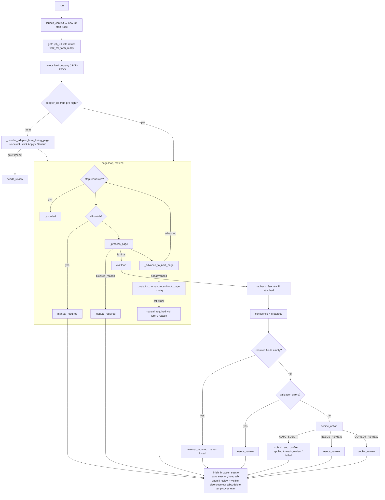

**Why the CAPTCHA check is last but the human-gate check is first.** A login wall or OTP challenge means there is no form yet, so nothing can be filled. A CAPTCHA on a real ATS usually gates *submission*, so AUTOGRAM fills everything first and only then asks a human to solve it (`_process_page` docstring).

**Design decisions and alternatives.**

| Decision | Alternative | Why the current one (per code/docs) |
|---|---|---|
| Returns `ApplicationRunResult`, never writes the DB | Write rows directly | Keeps `automation/` free of persistence concerns; `app/` owns the schema |
| Verified navigation via structural signatures | Trust the click / URL change | SPAs (Workday) often keep the URL, and validation blocks look like success |
| Per-page vision pass | One vision pass at the end | At the end only the last page is visible |
| Browser left open on review | Always close | The human needs something to review/submit. The approve endpoint replays submit on this exact page |
| `decide_action` as a pure function | Inline branching | Independently testable (`test_application_flow_manager.py`) and reused by `/automation/decide` for the extension |

**Beginner explanation.** It's the conductor. For each page: tidy the page, check nothing only a human can do is blocking, upload the résumé if asked, fill everything it knows, ask for help on what it doesn't, make sure Next really worked, and at the end decide whether to submit, ask you to submit, or ask you to fix something.

**Questions.**
1. List the four conditions for AUTO_SUBMIT.
2. What does the engine do if the Submit click can't be confirmed? Why not retry?
3. Why is `ats_platform` forced to `custom` on generic fallback?
4. How are conditional follow-up questions discovered?
5. What happens when a page won't advance?
6. Why is `MAX_PAGES` a backstop and not a form-length assumption?
7. How is a CAPTCHA handled? What if nobody solves it within 10 minutes?
8. Where do screenshots/traces go, and when are screenshots taken?
9. How does `POST /approve` click Submit on a page filled earlier?
10. How is the confidence score computed and what are its weaknesses?

---

## STAGE G — APPLICATION API, PERSISTENCE, COORDINATION

### Step 35 — `app/models/application.py` and `app/services/application_repository.py`

**Pydantic (`application.py`).** `ApplicationStartRequest` (`job_url: HttpUrl`, `autopilot_enabled=False`, `company`, `position`, `resume_document_id`, `job_description`, `source="server_automation"|"browser_extension"`, `ats_platform_hint`, `acknowledge_previous_submission: ReapplyAcknowledgement`), `ApplicationResponse` (+ `display_status`), `AutomationRunResponse`, `ApplicationQuestionResponse`, `QuestionReviewRequest`, `ApplicationReviewSummary`, `ApplicationOverviewResponse`, `DuplicateCheckResponse`, `ApplicationApprovalResult`, `AuditLogEntryResponse`, and the extension contracts `FieldQuery`/`FieldMapRequest`/`FieldMapResult`/`FieldMapResponse`/`PacingConfig`/`DecideRequest`/`DecideResponse`/`AutomationConfigResponse`/`ReportStatusRequest`/`VerificationCodeRequest`.

**Repository highlights.**
- `compute_job_url_hash(url) = sha256(url.strip().lower())`. **Deliberately nothing else** (query strings are often the posting identity, e.g. `?gh_jid=`).
- `DISPLAY_STATUS_MAP`: `pending→READY`, `processing→IN_PROGRESS`, `manual_required→WAITING_FOR_HUMAN`, `needs_review→WAITING_FOR_REVIEW`, `copilot_review→READY_TO_SUBMIT`, `applied→SUBMITTED`, `failed→FAILED`, `cancelled→CANCELLED`.
- `create_application`, `retry_application` (re-arm a retryable row in place, keeping history), `mark_processing`, `mark_waiting_for_human`, `mark_cancelled`, `report_status` (extension).
- **`apply_run_result(db, application, result)`**: copies status/platforms/confidence/pages, fills company/position if empty, sets `applied_date` on `applied`, sets `failure_reason` for `failed`/`manual_required`, and **appends an `AutomationRun`** (screenshots, trace, error log, log lines, retry count).
- `get_overview_counts` (dashboard tiles), `list_reviews_for_user` (action-needed queue), `find_possible_duplicate` (company+position soft warning), `delete` (hard delete + run directory).

⚠️ The module docstring still mentions `uq_applications_user_job_url`. That constraint became the partial index `uq_applications_active_job`.

---

### Step 36 — `app/services/automation_ownership.py` and `automation_recovery.py`

**Why now?** Before reading the start route, understand the guarantees it depends on.

**`automation_ownership.py`: "who owns this job right now?"**
- `job_key(url)` = the same hash as above, shared by **both** engines (this is what makes cross-engine detection possible).
- `reserve_job_automation(db, user_id, job_url)`: `SELECT pg_advisory_xact_lock(k)` with `k` derived from `sha256(user:job)`, folded into signed 64-bit. It serializes concurrent start requests for the same (user, job) **across both tables**, and releases automatically at commit/rollback.
- `find_active_automation(...) → ActiveAutomation(path, status, task_id|application_id) | None`: the autonomous path is checked first (it opens a tab immediately), then the deterministic path (`pending/processing/copilot_review`).
- `find_submitted_application(...) → SubmittedApplication | None`: has this user already **successfully** applied (either path)?
- `validate_reapply_acknowledgement(ack, submitted)`: a deliberate re-apply must name the **exact** prior submission (path + id), otherwise `ReapplyAcknowledgementError`.

**Two layers of protection.** (1) Partial unique indexes: race-proof within one table. (2) The advisory lock + read: covers the cross-table case that no unique index can.

**`automation_recovery.py`: repairing orphans.**
- `try_recover_application`: atomically moves **one** orphaned deterministic attempt out of an active status. **`processing` → `needs_review`, never `failed`**, because `failed` is retryable and a crashed run may already have clicked Submit, so retrying could double-apply.
- `reconcile_orphaned_applications_on_startup`, `reconcile_orphaned_automation_on_startup` (both engines; autonomous via `runner.reconcile_orphaned_tasks_on_startup`).
- With Redis, a row is orphaned only if its **lease** isn't held (`lease.is_held`), which makes periodic sweeps safe (every 60 s from the scheduler). Without Redis, it runs at startup only (empty registries = everything active is orphaned).

**Questions.** Why can't a unique constraint prevent a deterministic run and an autonomous task on the same job? Why `needs_review` rather than `failed` for a crashed `processing` row? Why is the periodic sweep only enabled with Redis?

---

### Step 37 — `automation/coordination/{lease,control}.py` and `app/workers/{dispatch,runtime,celery_app,tasks}.py`

**Leases (`lease.py`).** Key `autogram:lease:{application|autonomous_task}:{id}`. `acquire` = `SET NX PX` (atomic; **the** double-drive guarantee), `renew` every 15 s (TTL 45 s), `release` on a clean exit. **Without Redis**: `acquire` → True, `is_held` → False (single-process semantics).

**Control (`control.py`).** `send_signal(kind, id, resume|cancel|approve)`, `consume_signal`, `clear_all`, `deposit_secret(task_id, code)` / `collect_secret(task_id)` (a one-shot OTP mailbox for cross-process delivery).

**Dispatch (`dispatch.py`).** `CELERY_BROKER_URL` set → `run_application_task.delay(...)` / `run_autonomous_task.delay(...)`. Unset → `BackgroundTasks.add_task(runtime.run_application, ...)` / a daemon `threading.Thread(runtime.run_autonomous_task)`.

**Runtime (`runtime.py`).** `WORKER_ID = host:pid:uuid8`. `_held_lease(kind, id)` = acquire, start a heartbeat thread, yield, stop, release. `run_application` wraps `_run_application` and then `_watch_for_copilot_approval` (Phase 2f): if the run left a `copilot_review` browser open, it **keeps the lease** and polls `control.consume_signal(..., "approve")` every `COPILOT_APPROVAL_POLL_SECONDS` (3 s) for up to `COPILOT_APPROVAL_MAX_WAIT_SECONDS` (30 min), then calls the same `apply_copilot_approval`. `run_autonomous_task` wraps `runner.execute_task_sync`.

**Celery (`celery_app.py`, `tasks.py`).** Broker/backend = Redis (in-memory placeholders if unset so imports and tests work; `_require_broker()` fails a real worker loudly). `task_acks_late`, `task_reject_on_worker_lost`, `worker_prefetch_multiplier=1`, `worker_max_tasks_per_child=50`, TLS for `rediss://`. Tasks `autogram.apply.run_application` / `autogram.apply.run_autonomous_task` with **`max_retries=0`**.

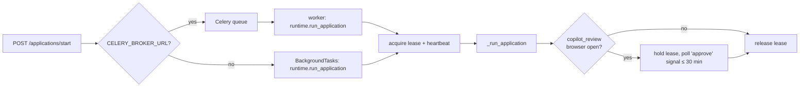

---

### Step 38 — `app/api/applications.py` (deterministic engine's HTTP surface)

**Why now?** You have every dependency. This is the busiest router (~1,280 lines).

**`POST /applications/start` → 202** (`start_application`, ~L172):
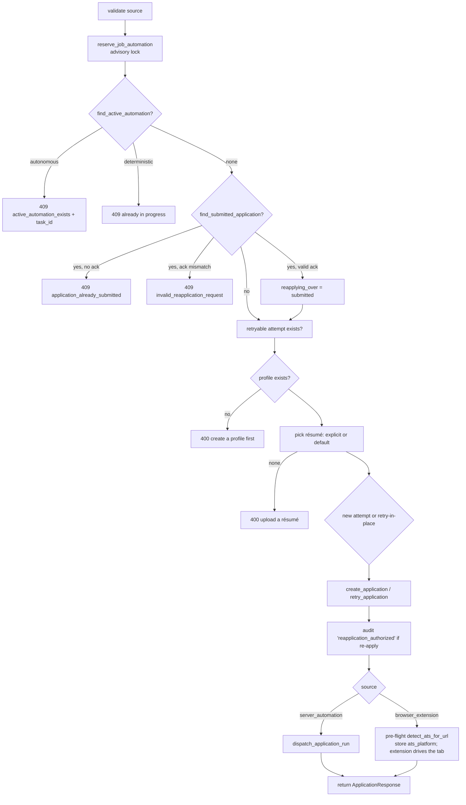

**`_run_application(app_id, resume_doc_id, job_description)`** (~L1029), the background body:
1. `SessionLocal()` → `mark_processing` → emit `APPLICATION_STARTED`.
2. `detect_ats_for_url` → `get_adapter_class` (None allowed → Generic later) → emit `PAGE_ANALYZED`.
3. Load profile + résumé. `load_owned_demographics` (ownership-verified; failure → `failed`). `load_resume_context`. **`detached_copy`** both ORM objects.
4. Build `ApplicationAnswerEngine` (with `session_factory=SessionLocal`) and optionally `VisionFormAnswerer`. Construction failures degrade to `None`, never a failed run.
5. Build `ApplicationFlowManager(..., headless=False, on_waiting_for_human, is_kill_switch_engaged, resolve_trust_level)`.
6. **`db.close()`**, then `_run_on_dedicated_thread(manager.run)`.
7. A new `result_db`: if the user **cancelled** meanwhile, keep `cancelled`. Otherwise `apply_run_result` and emit the status event.
8. Outer `except` → `_recover_crashed_run` (so a crashed thread doesn't leave `processing` forever).

**Other routes.** `GET ""`, `/overview`, `/reviews`, `/check-duplicate`, `/{id}`, `/{id}/runs`, `/{id}/live` (from `LIVE_RUN_STATE`), `/{id}/questions`, `/{id}/review-summary`, `/{id}/audit-log`, `POST /{id}/questions/{qid}/review` (approve/edit/reject; also `write_back_stable_answer`), `POST /{id}/approve` (same-process fast path → else cross-worker signal if the lease is held elsewhere → else 409), `POST /{id}/verification-code` (only accepted while the row is `manual_required` with a verification-type reason; → in-memory `verification_channel.deliver`, so it only reaches a run executing **in the same process**. There's no Redis hand-off on this deterministic path), `POST /{id}/reject`, `POST /{id}/stop`, `DELETE /{id}`, `POST /{id}/report-status` (extension).

⚠️ The module docstring says "no Celery/Redis queue yet". That's outdated since `app/workers/dispatch.py` exists. There's also no `/applications/{id}/retry` route (mentioned in `app/workers/tasks.py`'s docstring). Retrying = calling `/start` again.

**Questions.** What does `/start` return, and why 202? How is "never double-apply" enforced? What happens if the user stops a run that's about to finish? Why close the DB session before the browser run? Why is Playwright run on a brand-new thread and not a thread pool? (A left-open review browser pins its thread's internal loop. A pool would eventually hand a new run a "loop already running" thread.)

---

### Step 39 — `app/api/automation.py` + the browser extension (`extension/`)

**Backend (`/automation`).** `POST /map-fields`: the extension sends every field it scanned (`FieldQuery`: question text, field type, options). The server runs the **same** `ApplicationAnswerEngine.answer_batch` (so answers are cached/ledgered for both paths) and returns per-field answers + an `action` from **`decide_action`**. `POST /decide`: `decide_action` alone for a caller that already has answers. `GET /automation/config`: the "policy brain" the extension polls before every fill **and** before any auto-submit (kill switch, thresholds, public ATS list, trust level, pacing incl. the daily cap).

**Extension.** `manifest.json` (MV3; `storage`, `activeTab`, `scripting`, `sidePanel`; `<all_urls>`; side panel at `dist/sidepanel/index.html`, which needs `npm run build`). `background.js`: login → JWT in `chrome.storage.local`, refuses Incognito, injects `content-script.js`, `POST /applications/start` (`source=browser_extension`), map-fields, `/decide`, enforces the **daily cap** from `/automation/config`, and on `AUTO_SUBMIT` re-checks the kill switch then sends `CLICK_SUBMIT`. It reports progress via `report-status`. `content-script.js`: scans fields, fills text/select/radio/checkbox, detects CAPTCHA/human gates, finds submit + confirmation (mirrors `selectors.py` heuristics). **It can't set file inputs** (browser security), so the user attaches the résumé.

⚠️ `extension/README.md` says "v1 is copilot-only: this extension never clicks Submit". The current `background.js` **does** send `CLICK_SUBMIT` when the server returns `AUTO_SUBMIT` (default `autopilotEnabled: false`, so it's off unless enabled).


---

## STAGE H — THE AUTONOMOUS AGENT

Read `AUTONOMOUS_AGENT.md` sections "What this is", "Module map", and "Concurrency" alongside this stage. They're accurate about the agent's design, but their Celery/Redis notes are out of date (see the audit).

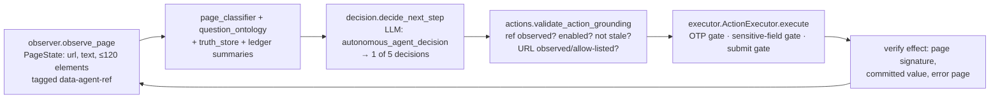

### Step 40 — `app/services/autonomous_task_repository.py` and `human_interaction_repository.py`

**Task repository.** `create_task` (computes `job_url_hash`), `get_active_for_user_and_url`, `set_status` (guarded by `_guard_not_terminal` → `TerminalTaskError`), `update_browser_state`, `append_action` (reassigns the whole JSONB list so SQLAlchemy detects the change), `record_field_attempt` (`field_attempt_ledger`), `record_question_ledger_entry`, `request_human_intervention` (→ `WAITING_FOR_HUMAN`), `record_confirmed_answer` (**task-scoped only**), `clear_intervention_for_resume`, **`try_claim_for_resume`** (atomic `UPDATE ... WHERE task_id=? AND current_status=?`), `mark_ready_for_approval` (→ `WAITING_FOR_APPROVAL`), **`approve_submission`** (the only setter of `auto_submit_approved`), `mark_completed`, `mark_failed`, `cancel_task` (idempotent), `try_claim_orphan_failed`, and `list_orphaned_running_tasks` (`ORPHANABLE_EXECUTING_STATUSES = CREATED, ANALYZING_JOB, RUNNING, RESUMING`).

**Human-request repository.** `create_request` (types from `VALID_HUMAN_REQUEST_TYPES`; OTP/MFA expire in `DEFAULT_EXPIRY_MINUTES = 10`, everything else has no expiry), `get_active_for_task`, `is_expired`, **`try_claim(request_id, from_status, new_status)`** (atomic conditional UPDATE), and `mark_responded/resuming/resolved/expired/cancelled/failed`.

**Why atomic claims?** Two concurrent `/respond` calls, or `/respond` racing `/cancel`, must not resume a task twice or deliver a secret twice. The loser gets 409 **before** any side effect (`test_human_interaction_race_conditions.py`).

---

### Step 41 — `actions.py`, `action_semantics.py`, `observer.py`

**`actions.py`.** `ALLOWED_ACTION_TYPES = {navigate, click, fill, select, check, uncheck, scroll, press_key, upload_file, extract_text, wait, go_back, get_page_state}`. There is **no "run code" action**. `AgentAction.from_dict` raises `InvalidActionError` for anything else. `ActionResult(success, action_type, detail, blocked_reason, verified, failure_code, ...)`. **`validate_action_grounding(action, page_state, canonical_urls, allowlisted_urls, expected_signature, current_signature)`**:
- If a HIGH-confidence APPLY/START_APPLICATION control is visible, **it must be used** (no guessed navigation).
- A targeted action's `element_ref` must be observed and enabled, and **not stale** (the page signature hasn't changed since observation).
- `navigate` URLs must be observed hrefs, the original/canonical URL, or allow-listed. **Never a constructed `/apply` URL.**

**`action_semantics.py`.** `classify_semantic_action(name, ...) → (semantic_action, confidence, irreversible)` (APPLY, START_APPLICATION, NEXT, CONTINUE, SAVE_AND_CONTINUE, REVIEW, SUBMIT...) and `is_submit_control_name(name)`: the **single** source of submit-button patterns (used by the executor's gate).

**`observer.py`.** `observe_page(page, ats_hint) → PageState`: runs a **fixed** extraction script (never LLM-authored), tags up to `MAX_ELEMENTS = 120` interactive elements with `data-agent-ref="<n>"` (form fields always included), and collects headings, dialogs, validation messages, and forms. Plus `compute_page_completion` (page-completion gate), `classify_page_type` (JOB_LISTING / application_page / login / verification / captcha / review / confirmation / unknown), `field_identity`, `CONFIRMATION_PHRASES`, and **`detect_blocker`** (deterministic OTP/MFA/CAPTCHA/login detection, layers 1–2, *before* the LLM is asked anything).

---

### Step 42 — Context builders: `decision.py`, `truth_store.py`, `question_ontology.py`, `question_ledger.py`, `page_classifier.py`, `page_graph.py`, `page_validation.py`, `field_coverage.py`, `saved_demographics.py`, `combobox_verify.py`

- **`decision.py`.** `SYSTEM_PROMPT` ("MUST match the spec verbatim") + `_RESPONSE_FORMAT_INSTRUCTIONS` (JSON shape + grounding rules) + an optional `_VISION_ADDENDUM`. **`decide_next_step(...) → Decision`** builds a JSON context (job URL, objective, résumé text, parsed résumé, profile, confirmed answers, page state, action history, uploadable documents, `auto_submit_approved`, page classification, question-ledger summary, resolved-facts summary) → `generate_answer(task="autonomous_agent_decision")` → `_parse_response` validates exactly one of `EXECUTE_ACTION | REQUEST_HUMAN_INTERVENTION | APPLICATION_READY_FOR_SUBMISSION | TASK_COMPLETED | TASK_FAILED`, else `DecisionError`.
- **`question_ontology.classify_field(element) → QuestionClassification`.** Portal-agnostic coarse categories (PERSONAL_INFORMATION ... SUBMISSION). `SENSITIVE_COARSE_CATEGORIES = {WORK_AUTHORIZATION, VISA, DEMOGRAPHICS, VOLUNTARY_DISCLOSURE, LEGAL_DECLARATION}`.
- **`truth_store.py`.** `TruthStore.from_task_context` flattens confirmed answers, profile, and résumé into `VerifiedFact(value, source, verified)`. **`decide(fact, coarse_category, sensitive, llm_can_generate)`** implements the "can answer → verified → autofill permitted → needs human?" chain: a sensitive field **never** uses résumé-derived text and auto-fills only from `USER_CONFIRMED`/`USER_PROFILE`, with no source it's never inferred, and LLM-generated text always needs review.
- **`question_ledger.py`.** An in-memory per-task `QuestionLedger` (persisted to `autonomous_tasks.question_ledger`), with `pending_human_entries`.
- **`page_classifier.py` / `page_graph.py` / `page_validation.py`.** A platform-independent page classification + application stage. A graph of visited page signatures to detect cycles. Generic error-page detection (404/500/"something went wrong").
- **`field_coverage.unresolved_fields(page_state)`.** Every editable field, **including optional ones**, must be accounted for before "ready".
- **`saved_demographics.find_pending_answer`.** A deterministic prepass: select saved EEO answers in demographic dropdowns *without* asking the LLM.
- **`combobox_verify.py`.** `verify_combobox_commit`, `selection_is_displayed`: strict committed-value checks for custom dropdowns.

---

### Step 43 — `automation/agents/autonomous/executor.py` (`ActionExecutor`)

**The only place in the agent that changes the browser.** Three code-level gates run **before** dispatch, whatever the LLM decided:

| Gate | Blocks | Unless | `blocked_reason` |
|---|---|---|---|
| Verification-code gate | `fill`/`select` on an OTP-shaped field | `verification_code_write=True` (set **only** by the deterministic `_try_consume_pending_secret` path) | `verification_code_requires_deterministic_path` |
| Sensitive-field gate | `fill/select/check/uncheck` whose name matches `SENSITIVE_FIELD_PATTERNS` (work authorization, visa, sponsor, citizenship, race, gender, veteran, disability, criminal, SSN, DOB, "I agree/certify/attest", arbitration, pronouns...) | `is_sourced=True` (a value from confirmed answers/profile) | `sensitive_field_requires_human` |
| Submission gate | `click` on a submit-looking control (`is_submit_control_name`) | `auto_submit_approved` | `submit_requires_approval` |

Then `_do_<action>` dispatches: `_do_click` (verifies an effect via a page signature within 2 s), `_do_fill` (+ `_verify_text_committed`), `_do_select` (native `select_option` or `_select_custom_option` for react-select/ARIA comboboxes, + committed-value verification), `_do_check/uncheck`, `_do_upload_file` (only paths in `uploaded_documents`, normalized), `_do_navigate`, `_do_go_back`, `_do_scroll`, `_do_press_key`, `_do_wait`, `_do_extract_text`, `_do_get_page_state`. `PlaywrightError` becomes a failed `ActionResult` annotated with `recovery.classify_failure`. **It never raises to the loop.**

---

### Step 44 — `budgets.py`, `recovery.py`, `state_machine.py`

- **Budgets (`AgentBudgets`)**, all generous defaults: 150 total actions, 25 navigations, 40 same-page actions, 30 failed actions, 30 min per application, 120 LLM calls, 15 vision calls, 8 no-progress iterations. `BudgetTracker.check()` → `BudgetExceeded`, and the loop either stops or pauses for a human.
- **Recovery.** `FAILURE_CODES` (`ELEMENT_DISAPPEARED`, `VALIDATION_ERROR`, `NETWORK_ERROR`, `SESSION_EXPIRED`, `LOGIN_REQUIRED`, `OTP_REQUIRED`, `CAPTCHA_REQUIRED`, `UPLOAD_FAILURE`, `UNEXPECTED_PAGE`, `UNKNOWN_PAGE`, `NO_PROGRESS`, `STALE_REFERENCE`, `RATE_LIMIT`, `APPLICATION_ERROR`). `classify_failure(...)` → a code. `recovery_policy(code)` → `RecoveryDecision` (retry / re-observe / ask a human).
- **State machine.** `_COARSE_GRAPH` documents the legal persisted transitions (Part 14). `validate_coarse_transition` runs in **warn-only** mode (`STRICT_MODE=False`) and only from `loop._set_status`. `validate_substate_transition` validates the in-memory sub-states (OBSERVING, DECIDING, EXECUTING, VERIFYING, ... `UNKNOWN_SUBMISSION_STATE`, which is a dead end except back to a new task's `CREATED`).

---

### Step 45 — `automation/agents/autonomous/loop.py` (`AutonomousAgentLoop`)

**Why last in the agent stack?** It composes everything above (~2,080 lines).

**`TaskHandle`** (in-memory, per task): `page`, `browser_manager`, `resume_event`, `cancel_requested`, `pending_secret` (OTP held **in memory only**, consumed once), `budgets`, `question_ledger`, `page_graph`, `last_page_signature`, `last_action_verified`, streak counters, pending demographic.

**`run()`**: open a DB session → audit `automation_started` + chat milestone + event → `_ensure_browser` (BrowserManager, `goto job_url`) → `RUNNING` → `_loop_body`. `TerminalTaskError` = quiet stop (a concurrent cancel won). Browser/unexpected errors → `mark_failed` + close.

**`_loop_body` iteration (≤ `MAX_ITERATIONS_PER_RESUME = 80`).**
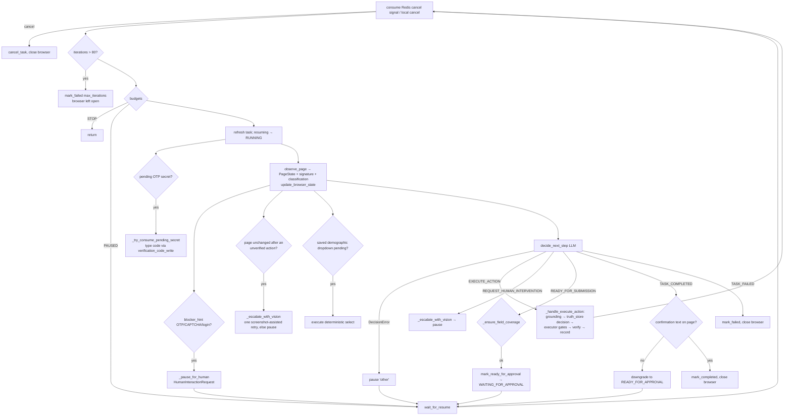

**Key guarantees in code.** It never trusts an LLM "completed" claim without confirmation text. It never submits without `auto_submit_approved`. It never types an OTP via the LLM path. Sensitive fields need a sourced value. Each field has at most 3 real attempts (`MAX_FIELD_ATTEMPTS`, persisted in `field_attempt_ledger`). A submit in flight that can't be confirmed goes to `UNKNOWN_SUBMISSION_STATE` (never resubmitted).

---

### Step 46 — `automation/agents/autonomous/runner.py`

- `_REGISTRY: dict[task_id, TaskHandle]` (process memory). `_claim_handle` (atomically claim for this thread). `execute_task_sync(task_id)` (run the loop on the current thread, used by the daemon thread *and* the Celery worker). `is_running`, `list_live_task_ids`.
- **`deliver_secret(task_id, code)`**: a local handle → set `pending_secret` + resume. Otherwise, if the lease is held elsewhere → `control.deposit_secret`. Otherwise → `False` (the caller creates a fresh LOGIN_REQUIRED request; the secret is dropped).
- `signal_resume`, `request_cancel`: local, or cross-process via `control.send_signal`.
- `reconcile_orphaned_tasks_on_startup` → `_reconcile_one_task`: an orphaned `CREATED/ANALYZING_JOB/RUNNING/RESUMING` task is failed with a clear message. If it was approved and running (`may_have_submitted`), the message says the outcome is uncertain and it's **never resubmitted**. `WAITING_*` tasks are left alone.

---

### Step 47 — `app/api/autonomous_agent.py` and `app/api/human_interaction.py`

**`/agent` routes.** `POST /tasks` (advisory lock → cross-engine active check → submitted check + re-apply ack → **snapshot** profile/résumé/demographics into JSON-safe JSONB (`_json_safe_profile`) → stage uploadable documents → `create_task` (the partial unique index catches races → 409) → `ANALYZING_JOB` → `dispatch_autonomous_task`), `GET /tasks`, `GET /tasks/{id}`, `POST /tasks/{id}/documents` (stage a user file for a paused task), `POST /tasks/{id}/resume` (refuses if the active request is a secret type: use `/respond`), `POST /tasks/{id}/answer` (task-scoped confirmed answer), `POST /tasks/{id}/approve` (**the only route that sets `auto_submit_approved`**), `POST /tasks/{id}/cancel`.

**Human-request routes.** `GET /agent/tasks/{id}/human-request`, `GET /human-requests/{id}`, `POST /human-requests/{id}/respond` (`action ∈ OTP_SUBMITTED | MFA_SUBMITTED | USER_APPROVED | USER_PROVIDED_VALUE`; `try_claim` → 409 on a race; 410 if expired; secret → `deliver_secret` then `del` the value; plain answer → `record_confirmed_answer` + `write_back_stable_answer`; resume), `POST /human-requests/{id}/cancel`. **No route ever echoes an OTP value** (`test_secret_leakage_audit.py`).

---

## STAGE I — HUMAN-IN-THE-LOOP & OPERATIONS

### Step 48 — `app/services/event_bus.py`, `chat_repository.py`, `app/api/chat.py`

- **Event bus.** `WORKFLOW_EVENTS` is a **closed vocabulary** (APPLICATION_STARTED, PAGE_ANALYZED, FIELD_FILLED, SUBMISSION_STARTED, APPLICATION_SUBMITTED, APPLICATION_FAILED, APPLICATION_READY_FOR_SUBMISSION, REVIEW_REQUIRED, DOCUMENT_ATTACHED, HUMAN_ACTION_REQUIRED, HUMAN_ACTION_COMPLETED, REQUEST_HUMAN_INTERVENTION, KEEPALIVE), checked against the frontend by `test_frontend_backend_contract.py`. `EventBus.publish` is thread-safe (`call_soon_threadsafe` into the asyncio loop) with bounded per-subscriber queues (drop the oldest). With Redis it mirrors to `autogram:events:<stream>` and a pattern-subscribed listener re-injects events from other processes (skipping its own via `_PROCESS_ID`). **It's a live tap, not a log:** no replay, and nothing may depend on an event arriving.
- **Chat.** `ChatMessage` rows (`agent`/`user`/`system`) per application or task. `record_secret_submission` records **that** a code was sent, never the code.
- **Routes.** `GET /chat/{scope}/{id}` (transcript, the source of truth) and `WS /chat/{scope}/{id}/stream?token=` (the same `get_current_user` logic, KEEPALIVE when idle).

### Step 49 — Audit, metrics, retention, trust, admin, scripts

- **`audit_log_repository.record_event`**: append-only `application_audit_log` (`autopilot_run_started`, `human_approved`, `human_rejected`, `kill_switch_triggered`, `reapplication_authorized`, `verification_code_supplied`, `automation_*`, `human_request_*`...).
- **`metrics_repository` + `GET /metrics/summary`**: deterministic and autonomous blocks: median time-to-outcome, HITL resolution rate, and honest **proxies** for submission accuracy and mapping confidence. The docstring states true "submission accuracy" isn't computable (there's no field-error reporting).
- **`retention_repository` / `retention_service`**: per-user windows (defaults: screenshots 30 d, run history 90 d, HITL requests 14 d), `run_purge_for_all_users` (scheduled), `run_purge_for_user` (`POST /profile/retention-policy/purge-now`), and `retention_purge_log`.
- **`user_admin_repository.set_role/set_status`** + **`scripts/make_admin.py <email>`**: the only way to create an admin. **`scripts/reset_db.py`**: a destructive dev reset.

---

## STAGE J — FRONTEND

### Step 50 — `frontend/src/api.js`

A single `request(path, options)` wrapper: base URL `VITE_API_URL` or `/api` (Vite proxy), attaches `Authorization: Bearer <token>` from `localStorage`, parses JSON, and on **401** (non-auth routes) clears the token and calls the registered `onUnauthorized`. On other errors it throws an `Error` whose `.message` is human-readable. **5xx bodies are never shown** ("Something went wrong on our side"). Structured `detail` objects (e.g. 409 `application_already_submitted`) are exposed as `error.detail` so the UI can branch. `api.*` has one method per backend route, and `openChatStream(scope, id, onEvent)` opens the WebSocket with `?token=`.

### Step 51 — `frontend/src/main.jsx`, `App.jsx`

`main.jsx` mounts `<BrowserRouter><App/></BrowserRouter>`. `App.jsx`: session restore (`/auth/me` then `/resumes`), a health poll, toasts, nav groups, public routes (landing, login, signup, forgot/reset password), and authenticated routes `/dashboard`, `/search`, `/applications`, `/applications/:id`, `/agent`, `/agent/:id`, `/metrics`, `/profile`, `/resumes`, `/settings`.

### Step 52 — Pages and components

| Page | What it does | Backend calls |
|---|---|---|
| `Landing.jsx` | Marketing page | — |
| `Home.jsx` | Dashboard tiles, `ApplicationJourney` (readiness), **`ApplyFromLink`** (paste a URL → `/applications/start`, handles the 409 re-apply flow) | `/applications/overview`, `/applications`, `/profile/workflow` |
| `JobsAndMatches.jsx` | A 3-step flow: `UploadPanel` (upload→extract→parse→embed), `JobsPanel` (ingest Adzuna + embed), `MatchesPanel` (generate/list/save/dismiss/**Apply**) | `/resumes/*`, `/jobs/*`, `/applications/start`, `/applications/check-duplicate` |
| `Applications.jsx` | List, stop, delete | `/applications` |
| `ApplicationDetail.jsx` | Live state polling, runs, `AnswerReviewList` (approve/edit/reject each answer), approve/reject/stop/retry, `VerificationCodePanel` | `/applications/{id}/*` |
| `AutonomousAgent.jsx` | Start task, status, intervention prompts, `VerificationModal` (OTP), `ChatPanel` (transcript + WebSocket), approve, cancel, attach document | `/agent/*`, `/human-requests/*`, `/chat/*` |
| `Profile.jsx` | Profile, education, experience, skills, résumé-draft apply, `ApplicationProfileSection` (demographics) | `/profile/*` |
| `ResumeManagement.jsx` | Documents, default, profile-draft preview | `/profile/documents*` |
| `Settings.jsx` | Kill switch, site trust levels, retention policy + purge now | `/profile/*` |
| `Metrics.jsx` | Success metrics | `/metrics/summary` |

🟡 **The web UI never sends `autopilot_enabled: true` or `job_description`.** Every web-started deterministic run is copilot mode, and cover-letter generation is skipped. Autopilot is reachable via the API or the extension's stored `autopilotEnabled` setting.

---

## STAGE K — STUBS, TESTS, DEPLOYMENT

### Step 53 — Stubs you should recognize (and not debug)

| File | Status |
|---|---|
| `automation/agents/answer_agent.py`, `job_application_agent.py`, `profile_agent.py` | 🔵 Phase-6 LangGraph agents. Classes raise `NotImplementedError` |
| `automation/workers/apply_worker.py`, `automation/workers/celery_app.py` | 🔵 Superseded by `app/workers/` (stub / comment only) |
| `automation/ats/{ashby,bamboohr,icims,oracle_hcm,smartrecruiters,taleo}` | 🔵 Phase-7 adapters, all `NotImplementedError`, not registered |
| `app/services/tailoring_service.py`, `app/ai/prompts/tailoring_prompts.py` | Removed ("REMOVED at the owner's request") |
| `app/services/job_sources/remotive_source.py`, `arbeitnow_source.py` | Removed |
| `app/services/matching/vector_similarity.py` | Dead code (never imported) |
| `app/core/security.py::require_api_key` | Defined, never wired |
| `LLM routes field_reasoning, resume_selection` | Registered, never called |
| `tests/test_ats_scaffolding.py` | "MOVED to automation/tests" placeholder |

### Step 54 — Tests
See Part 15. Start with `automation/tests/test_application_flow_manager.py` (75 tests) and `test_field_handlers.py`, which run real Chromium against inline HTML fixtures.

### Step 55 — Deployment files
`backend/Dockerfile` (python:3.10-slim, CPU torch, `pip install -r requirements.txt`, `playwright install --with-deps --only-shell chromium`, non-root `autogram` user, `CMD alembic upgrade head && uvicorn ... --port ${PORT:-10000}`). `backend/railway.json` (Dockerfile build, **1 replica**, `/health` check, restart on failure). `frontend/Dockerfile` + `nginx.conf.template` (static `dist`). `docker-compose.yml` (api:8000, frontend:5173, redis:6379, worker, all with `AUTOMATION_CDP_URL=http://host.docker.internal:9222` so containers can attach to the host's Chrome). `RAILWAY.md` (step-by-step). 🔵 No CI workflow files exist in the repo (`requirements-migrate.txt` mentions a "GitHub Actions Alembic job" that isn't present).


---

# PART 6 — END-TO-END USER FLOWS

## Flow 1 — User opens AUTOGRAM

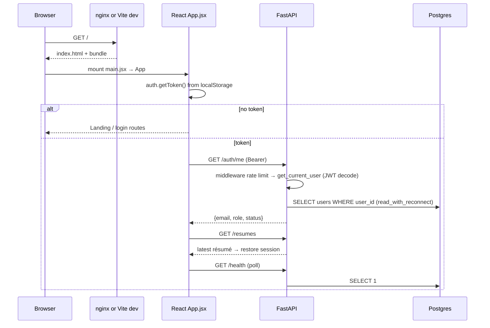

Files: `frontend/src/main.jsx`, `App.jsx`, `api.js`; `app/core/middleware.py`, `app/core/auth.py::get_current_user`, `app/api/auth.py::me`, `app/api/resumes.py::list_my_resumes`, `app/main.py::health_check`.

## Flow 2 — Job discovery

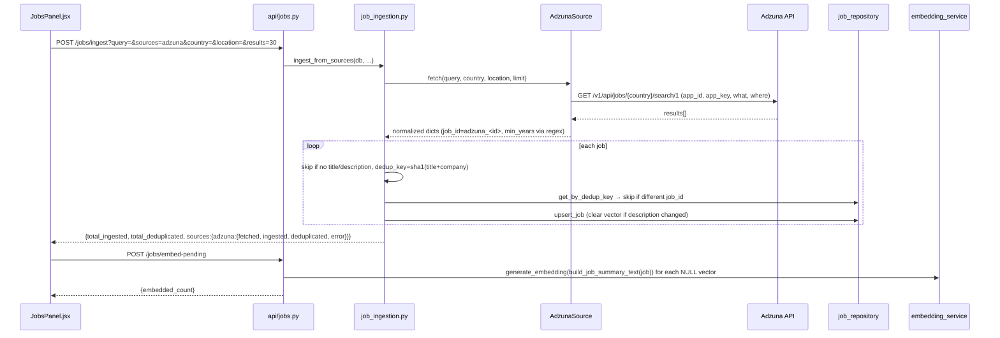

Background alternative: `app/core/scheduler.py::_sync_all_queries` does the same for each `JOB_SYNC_QUERIES` term every N hours.

## Flow 3 — Résumé → matching

**Data used:** the résumé's parsed JSON (`resumes.parsed_data`), its raw text (`extracted_text`), its vector (`resumes.embedding_vector`), and all jobs with vectors.
**Embedding model:** `sentence-transformers/all-MiniLM-L6-v2` via FastEmbed (ONNX), 384-d, L2-normalized.
**Stored:** `resumes.embedding_vector`, `jobs.embedding_vector` (pgvector, HNSW on jobs).
**Similarity:** cosine. `1 - (jobs.embedding_vector <=> resume_vector)`.
**Thresholds:** there's no similarity cutoff. Top-40 by similarity → hard filters → top-15 reranked. The experience buffer is 1 year.
**Scores:** `blended = 0.6·vector + 0.4·skill_overlap` (for ranking); `ats_score = 0.7·keyword_ratio + 0.3·format_score` (shown to the user, not part of the ranking).

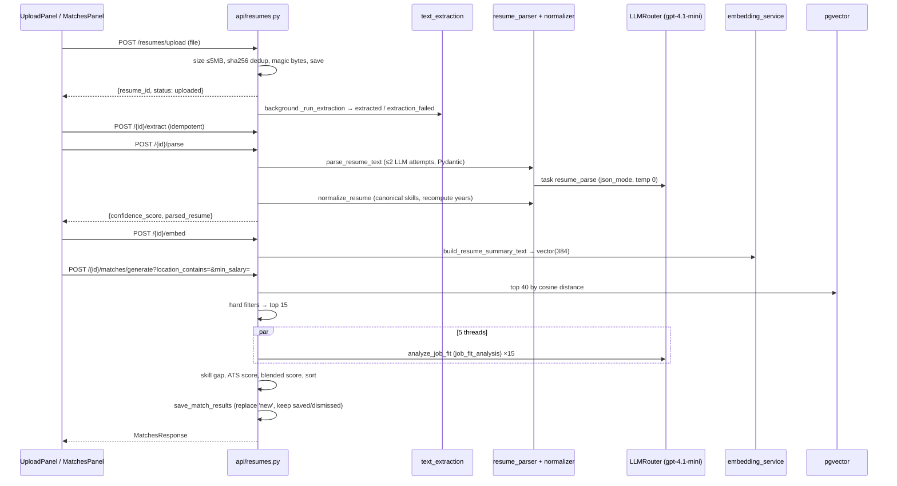

## Flow 4 — Application creation (deterministic)

1. **FE** `ApplyFromLink.jsx` or `MatchesPanel.jsx` → `api.startApplication({job_url, company?, position?})`.
2. **API** `start_application`: advisory lock, active/submitted checks (409s), profile + résumé checks (400s), create or retry the row (`status=pending`), dispatch, return **202**.
3. **Dispatch** (`app/workers/dispatch.py`): queue or `BackgroundTasks`, both through `runtime.run_application` (lease + heartbeat).
4. **Run** `_run_application`: `processing` → detection → answer engine → flow manager on a dedicated thread → `apply_run_result` → `automation_runs` row + final status.
5. **FE** `ApplicationDetail.jsx` polls `/applications/{id}`, `/live`, `/questions`, `/review-summary`, and the user approves/edits answers, approves submission, or rejects.

```mermaid
stateDiagram-v2
    [*] --> pending: POST /start
    pending --> processing: _run_application
    processing --> manual_required: human gate timeout / missing required / kill switch / stuck page
    processing --> needs_review: conf < 0.6 / validation errors / unconfirmed submit / crash recovery
    processing --> copilot_review: filled, default
    processing --> applied: AUTO_SUBMIT confirmed
    processing --> failed: browser launch / detection / run exception
    processing --> cancelled: POST /stop
    copilot_review --> applied: POST /approve (confirmed)
    copilot_review --> needs_review: POST /approve (unconfirmed)
    copilot_review --> cancelled: POST /reject or /stop
    manual_required --> pending: POST /start again (retry in place)
    needs_review --> pending: POST /start again
    failed --> pending: POST /start again
    applied --> pending: POST /start + acknowledge_previous_submission (NEW row)
```

## Flow 5 — Playwright automation, in detail

The 17 questions from the brief, answered against the code:

1. **How is the browser launched?** `BrowserManager.launch_context()` → `sync_playwright().start()` → the mode chain. Default `cdp`: `attach_or_launch_chrome` connects to `AUTOMATION_CDP_URL` (default `http://127.0.0.1:9222`), or starts real Chrome with `--remote-debugging-port` if `AUTOMATION_CDP_AUTOLAUNCH`. Fallback `persistent`: `launch_persistent_chrome` on `storage/chrome_profile/persistent/<user>`. `launch`: `chromium.launch(headless=AUTOMATION_HEADLESS)` + `new_context(storage_state=<decrypted>)`.
2. **Which browser/context/page?** In cdp mode, the **user's existing default context** (their cookies and logins), and `new_page()` opens a **new tab** tracked as "ours". The run's page is `self.browser_manager.new_page()`, and a trace is started on the context.
3. **How is the job page opened?** `run_with_retries(lambda: page.goto(job_url, wait_until="domcontentloaded"))`, then `wait_for_form_ready(page)` (bounded `load` + `networkidle`, for React/Remix hydration).
4. **How is the DOM inspected?** Adapters query `self.form_root` (the page or an application iframe) with CSS selectors, `<label>` iteration, name/placeholder sweeps, and the nearby-text JS. `describe_field` does a single `evaluate` for tag/type/role.
5. **How are fields identified?** By meaning: `FieldMapper.map_field(name → label → placeholder → nearby)`. By platform: adapter `FIELD_SELECTORS`. Unmatched labeled/unlabeled questions go to the answer engine.
6. **How are field types detected?** `describe_field` → `Field(tag_name, input_type, role)`, then `DEFAULT_HANDLER_REGISTRY.get_handler(field)` picks the first handler whose `supports()` is true (file, checkbox, toggle, radio, date, native select, country picker, virtualized listbox, react-select, combobox, textarea, text).
7. **Text fields?** `TextInputHandler`/`TextAreaHandler` → `human_type` (scroll, click, clear, per-character typing), verified by `input_value()` with `_values_match`.
8. **Select fields?** `NativeSelectHandler` reads all options in one `evaluate`, resolves by tier (exact text → exact value → normalized → loose), **refuses on ties or no match**, and `select_option(value=..., force=hidden)`. Verification reads the selected option's text.
9. **Comboboxes?** `ComboboxHandler` (ARIA `combobox`/`listbox`, `aria-haspopup`, `aria-expanded`) via `_DropdownHandler`: open → type into the field's **own** search input → pick the matching option in any visible option container → click → verify via `aria-activedescendant`, `aria-selected` under `aria-controls`, a hidden twin input, then the displayed value.
10. **Dynamic dropdowns?** The same, with `_wait_for_popup` polling (the menu mounts a tick later), a nested-control retry click, a 300 ms debounce after typing, and `_search_with_scrolling` (scroll the container, re-query) when there's no search box. `VirtualizedListboxHandler` handles always-open `role=listbox` panels.
11. **How is candidate data matched to fields?** `FieldMapper` → `_resolve_profile_value` → `format_profile_value` (typed columns become human text). For questions: `ApplicationAnswerEngine` (cache → classifier → LLM), option-matched with `match_option`/`match_demographic_value`.
12. **How are values entered?** Always through `fill_field(field, value)`: handler `fill` → `verify` → up to 3 attempts → `HandlerOutcome`. Then `human_pause_between_fields`.
13. **Ambiguity?** Refuse rather than guess: `NativeSelectHandler` raises `FieldFillRefused("ambiguous_option_match")`, `match_option` returns `None` for two candidates, `FieldMapper` needs word-boundary synonyms, checkboxes refuse non-boolean values.
14. **Missing information?** The field stays unfilled (`unfilled_reason=no_answer_available`), the question is persisted with `needs_user_input`, the aggregate confidence drops, and a required-field scan at the end → `manual_required` naming the fields. For the agent, `REQUEST_HUMAN_INTERVENTION` with `information_required`.
15. **Errors?** `PlaywrightError` is caught per attempt in `fill_field`. The whole run is wrapped (`_run_captured` → `_build_failure_result` with screenshot + error log). Navigation errors are retried by `run_with_retries`. Validation errors are read back (`find_validation_errors`).
16. **Browser lifecycle?** Kept open on review statuses when visible (`_OPEN_REVIEW_SESSIONS` holds strong refs), otherwise `close()` closes only our tabs. The session state is saved either way. In the worker, the lease is held while a copilot browser waits for approval (≤ 30 min).
17. **Why is the user responsible for final submission?** `decide_action` defaults to `COPILOT_REVIEW`. AUTO_SUBMIT needs explicit per-run autopilot **and** a public ATS **and** confidence ≥ 0.85 **and** a site the user marked `TRUSTED_AUTO_SUBMIT`. The UI never enables autopilot. `ARCHITECTURE.md` "Compliance & Risk" makes human review the default because a wrong submission can't be undone and would double-apply if retried.

## Flow 6 — Autonomous agent task

```mermaid
sequenceDiagram
    participant FE as AutonomousAgent.jsx
    participant API as /agent/tasks
    participant T as runner / loop (thread or Celery)
    participant P as Page (user's Chrome)
    participant L as LLM
    participant H as /human-requests
    FE->>API: POST /agent/tasks {job_url, resume_id?}
    API->>API: lock + dup checks + profile snapshot + create_task + ANALYZING_JOB
    API->>T: dispatch_autonomous_task
    API-->>FE: TaskResponse
    loop until pause / terminal
        T->>P: observe_page → PageState
        T->>L: decide_next_step
        L-->>T: EXECUTE_ACTION {click ref 12}
        T->>T: grounding + gates
        T->>P: executor action + verify
    end
    T->>H: OTP detected → HumanInteractionRequest (10 min expiry), WAITING_FOR_HUMAN
    FE->>H: POST /human-requests/{id}/respond {OTP_SUBMITTED, value}
    H->>T: deliver_secret (memory) → resume
    T->>P: type code (deterministic path)
    T->>T: APPLICATION_READY_FOR_SUBMISSION → WAITING_FOR_APPROVAL
    FE->>API: POST /agent/tasks/{id}/approve
    T->>P: click Submit (gate now open) → confirmation text → COMPLETED
```

---

# PART 7 — PLAYWRIGHT / FORM-AUTOMATION DEEP DIVE

## 7.1 Architecture of the form layer

```mermaid
flowchart TB
    subgraph Meaning["What value? (semantic layer)"]
      FM[FieldMapper<br/>label/name/placeholder → attribute]
      PF[profile_formatting<br/>column → form text]
      QC[question_classifier<br/>question → category]
      AE[ApplicationAnswerEngine<br/>cache → deterministic → LLM]
      VF[VisionFormAnswerer<br/>screenshot → answer]
      OM[option_matching / demographic_matching]
    end
    subgraph Widget["How to put it there? (interaction layer)"]
      DF[describe_field → Field]
      REG[FieldHandlerRegistry]
      H[12 handlers]
      FF[fill_field: fill → verify → retry]
      U[utils: human_type, safe_click, scrolling]
    end
    ADP[ATSAdapter passes] --> FM & AE & VF
    FM --> PF
    AE --> QC & OM
    VF --> OM
    ADP --> DF --> FF
    FF --> REG --> H --> U
```

## 7.2 Every handler

Registry order (first match wins): **FileUpload → Checkbox → Toggle → Radio → Date → NativeSelect → CountryPicker → VirtualizedListbox → ReactSelect → Combobox → TextArea → TextInput**.

| Handler | Field it solves | Detection (`supports`) | Fill strategy | Verify | Option doesn't exist | Multiple match | Not visible | Candidate data missing |
|---|---|---|---|---|---|---|---|---|
| **FileUploadHandler** | `<input type=file>` (résumé, cover letter) | `tag=input`, `type=file` | `set_input_files(path)` (works on hidden inputs, **no visibility check**) | `el.files.length`, else the filename visible on the page | n/a | n/a | Works anyway | `fill_field` skips empty values |
| **CheckboxHandler** | Native checkbox or `role=checkbox` | `input[type=checkbox]` or role | `_coerce_checkbox_intent(value)` → True/False/**None (refuse)**. Already correct → no-op. Native `check()` (1 s timeout) → label click → element click → parent click → JS state flip | `is_checked` / `aria-checked` equals intent | n/a | n/a | Label/parent/JS fallbacks | Refuses a non-boolean value (`non_boolean_checkbox_value`) |
| **ToggleHandler** | `role=switch` (e.g. a YES/NO "willing to relocate" switch) | role switch | Coerce to boolean (refuse non-boolean). Read `aria-checked` and click **only if it differs** (clicking toggles, so an already-correct switch would flip to wrong) | `aria-checked` / `is_checked` equals intent | n/a | n/a | `safe_click` | Refuses a non-boolean value |
| **RadioHandler** | Native radio group, ARIA radiogroup, button groups (`aria-pressed`) | radio input / role radio / button with `aria-pressed` | Re-derive the **whole group** (`_native_radio_group` by `name`, `_aria_radio_group`, `_button_choice_group`), pick the option whose accessible text matches → `check()` → label click → click → focus+Space | That option is selected | No-op → verify fails → retries → `verification_failed` | First textual match wins | label click works for visually-hidden inputs (Oracle HCM) | skip |
| **DateHandler** | `input[type=date]` | type date | `fill(ISO YYYY-MM-DD)` via `_coerce_date_string` (**not** typed: segment order is locale-dependent) | exact ISO match | n/a | n/a | Playwright actionability | skip |
| **NativeSelectHandler** | `<select>` (single & multiple) | `tag=select`, visible, or hidden **without** a visible proxy widget beside it | One `evaluate` reads options/multiple/rendered. Tiered resolve (exact text → exact value → normalized → loose), placeholders excluded. `select_option(value, force=hidden)` | Selected option text `_values_match` (multi: every target once) | **Refuse** `no_matching_option` (no retries) | **Refuse** `ambiguous_option_match` | `force=True`; a hidden select with a visible proxy is left for the proxy's handler | skip |
| **CountryPickerHandler** | Country field rendered as a custom dropdown | `profile_attribute=="country"` and not `<select>` | Tries **"India +91"** (`_country_with_dial_code`) first, then the plain name if nothing matched | Alias-aware (`USA`↔`United States`) and dial-code-aware | falls back to the plain name | the labelled form narrows to one | inherits dropdown logic | skip |
| **VirtualizedListboxHandler** | Always-expanded `role=listbox` panel | role listbox **and visible** | Find a visible matching option, else `scroll_container_until_option_found` (20 attempts) → `safe_click` | `[aria-selected=true]` text, else re-find | No-op → verify fails | first match | hidden listbox left for Combobox (which opens it) | skip |
| **ReactSelectHandler** | react-select controls | class `react-select`/`select__control`/`css-*-control` or id contains `react-select` | `_DropdownHandler.fill` | `_DropdownHandler.verify` | no-op → verify fails | first matching option across all containers | nested-control retry click | skip |
| **ComboboxHandler** | Any ARIA/custom dropdown | role `combobox`/`listbox`, or `aria-haspopup`, or `aria-expanded` present | `_DropdownHandler.fill` | same | same | same | same | skip |
| **TextAreaHandler** | `<textarea>` | tag textarea | `human_type` | `input_value` loose match | n/a | n/a | scroll-into-view | skip |
| **TextInputHandler** | Plain inputs (`""`, text, email, tel, number, url, search, password) | tag input + fillable type | `human_type` | `input_value` loose match | n/a | n/a | scroll-into-view | skip |

**`_DropdownHandler.fill` in detail.**
1. Press `Escape` (close a stray popup from a previous attempt).
2. `safe_click(field.locator)` → `_wait_for_popup` (poll for a search input or listbox).
3. If it didn't open: click a more specific nested control (`_INNER_CLICK_TARGET_SELECTOR`) and wait again.
4. If the widget has a search input (**the field's own first**, `_field_search_input`, then page-wide): `human_type(value, click_first=False)` → 300 ms debounce → `_find_matching_option` across **all** visible option containers.
5. Else `_search_with_scrolling` (container scroll, ≤ 12 attempts).
6. `safe_click(option)`.

**`_DropdownHandler.verify`, strongest signal first.** `aria-activedescendant` → `aria-selected="true"` inside `aria-controls` → a hidden input twin → **if the popup is inspectable and reports nothing selected, fail** (typed search text isn't a selection) → the displayed value (`_display_value_scopes`, including the control/container ancestor with an explicit single-value selector).

**Optional vs required.** Handlers don't know. `fill_field` skips empty values. Required-ness is judged at the page level (`find_unfilled_required_fields`) after all passes. The autonomous agent is stricter: `field_coverage` requires every editable field, optional or not, to be accounted for.

## 7.3 Why a generic `select_option()` fails on custom comboboxes

`locator.select_option()` only works on a real `<select>` element. It sets `selectedIndex` and fires `change`. A react-select or ARIA combobox is a `<div>`/`<input role=combobox>` tree whose options only exist in the DOM **after** it's opened, often rendered in a portal elsewhere in the document, filtered by keystrokes, and committed by a click handler that updates React state. Calling `select_option()` on it raises *"Element is not a `<select>` element"*. That exact error is cited in `test_application_profile_demographics.py` for the autonomous agent before `_select_custom_option` existed. Hence the separate open → search → click → verify algorithm, and the executor's `_is_native_select` branch.

---

# PART 8 — REAL BROWSER EXAMPLES

These are documented in `backend/automation/README.md` and pinned by regression tests built from live forms. None of the tests submit a real application.

## 8.1 Greenhouse (`job-boards.greenhouse.io`, incl. the Warp posting)

**Three dropdown bugs only a real form exposed** (`automation/README.md` "Three bugs only a real form exposed"; `test_dropdown_live_form_shapes.py`):
1. **Decoy option container.** `div[class*='dropdown' i]` matched intl-tel-input's phone-country wrapper (`div.iti--inline-dropdown`, 244 hidden country options, always visible). The old code took the *first* visible container and concluded the real dropdown was empty. Fix: `_option_containers()` returns every visible container that actually holds visible options.
2. **Page-global search input.** Nine react-select questions = nine visible `input[role=combobox][aria-autocomplete=list]`. The old code typed every answer into question 1. Fix: `_field_search_input(field)` (the field itself → inside it → its shell) before any page-wide lookup.
3. **Value isn't where the label points.** `<label for>` resolves to react-select's inner input, which is `opacity:0` and has its value cleared after selection. The chosen text lives in a sibling `select__single-value`. Fix: `_display_value_scopes()` checks the control/container ancestor with an explicit selector. It never reads the container's whole text, because the question label ("...are you willing to relocate...") would falsely match "No".

**Résumé dropped by hydration** (`README.md` "A résumé that uploaded, verified, and then wasn't there"; `test_resume_reattach.py`). `set_input_files` succeeded at 4.27 s and verified, React threw hydration errors #418/#425/#423 at ~4.9 s and re-created the subtree, and at 6.35 s the input was empty. Fixes: `wait_for_form_ready` after navigation, and **`ensure_resume_attached()` at the end of the run** (`attached`/`missing`/`no_field`), re-uploading if needed and flipping the result to unfilled if it won't stick.

**Country picker "India" → "+246"** (Warp; `test_country_dial_code.py`). Typing "India" left "British Indian Ocean Territory +246" first. The control then displays only "+246", and all retries repeated it. Fix: search with the full "India +91" (`country_dial_codes.py`) and verify against the labelled form.

**EEO answers came back blank** (Warp; `test_application_profile_demographics.py`). Options were read correctly ("Male", "Female", "Decline To Self Identify") but nothing was selected: there was no saved-demographics UI, Race and Hispanic/Latino weren't classified as demographic (so they would have gone to the LLM), `decline_to_answer` didn't match "Decline To Self Identify", and the agent couldn't `select` in a react-select. Fixes: `ApplicationProfileSection.jsx` + `/profile/demographics`, classifier categories, `demographic_matching.py`, the agent's `saved_demographics` prepass + `_select_custom_option`.

**Neon session death mid-run** (Warp/Greenhouse application `46665f90`; `test_run_db_resilience.py`; `backend/logs/46665f90-.../error.log` contains the `PendingRollbackError`). One session was held through a ~405 s browser phase and Neon dropped it. The first ORM attribute read raised, `answer_batch` raised, the error was swallowed at debug level, and **every** question in the batch was abandoned. Fixes: detached profile copies, preloaded demographics, `session_factory` + one retry on a dead session, per-question fallback, and WARNING-level logging.

## 8.2 Lever (`jobs.lever.co`)
- A single "Full Name" field (`input[name='name']`), hence its own adapter.
- **Unlabeled screening questions** reached only via `_fill_questions_by_nearby_text` (`README.md` "Unlabeled questions (Lever) + a dangerous synonym match"; `test_lever_question_shapes.py`).
- The required marker is **U+2731 "✱"**, not "*" ("When are you available to start working?✱"). It's stripped by `_strip_required_marker` so it doesn't pollute the LLM prompt, cache keys, or synonym matching.
- Checkbox groups and the marketing opt-in (`test_checkbox_group_fill.py`).

## 8.3 Workday (`myworkdayjobs.com`)
- 4–6 SPA pages (My Information, My Experience, Application Questions, Voluntary Disclosures, Self Identify, Review). The résumé is on page 2. The URL often doesn't change, which is why navigation is proven by `PageSignature`, not the URL.
- `bottom-navigation-next-button` is both Next and Submit. `is_final_page` reads its label.
- An account is required, and AUTOGRAM never creates one: the password field triggers `find_human_gate`. The realistic path is CDP-attaching to a Chrome where the user is already signed in.
- Never auto-submitted (not in `PUBLIC_ATS_PLATFORMS`).

## 8.4 iCIMS (Atlassian posting) and Oracle HCM
- **iCIMS** renders the form inside an iframe. Scanning `page` found every required field "missing". Fix: `resolve_form_root` + the `adapter.form_root` cache (`implentation-docs/application-agent-flow.md` "Live-tested against a real posting (Atlassian / iCIMS)").
- **Oracle HCM** visually hides native radios and renders labels as the clickable circles. Fix: `_label_target_is_visible` treats a visible label as actionable for a hidden radio (`test_oracle_hcm_question_shapes.py`).

## 8.5 A job listing page in front of an ATS
When pre-flight detection returns `custom`, `_resolve_adapter_from_listing_page` re-detects on the live DOM, clicks the page's **Apply / Apply Now / Start Application** (`find_apply_entry_button`), follows a new tab if one opened (`adopt_page`), re-detects, and only then falls back to `GenericAdapter` (forced `ats_platform="custom"`).

## 8.6 What the `logs/` directory shows about real outcomes
- `app-captcha-1/error.log`: "CAPTCHA present — a human must solve it; automation never will."
- `app-unconfirmed-1/error.log`: "Submit was clicked but no confirmation could be detected ... retrying a submission that did succeed would double-apply."
- `8d607808-.../error.log`: "Could not advance past page 1 ... You need to agree to the terms and conditions."
- `app-fail-1/error.log`: `Page.goto: ... Cannot navigate to invalid URL` (a test fixture).


---

# PART 9 — DATABASE DEEP DIVE

All tables are defined in `backend/app/models/db_models.py`. String UUID primary keys everywhere (Python-generated `uuid4`). Timestamps default to UTC `now`.

## 9.1 ER diagram

```mermaid
erDiagram
    users ||--o{ password_reset_tokens : has
    users ||--o{ resumes : uploads
    resumes ||--o{ match_results : scored_as
    jobs ||--o{ match_results : matched_in
    users ||--|| candidate_profiles : owns
    candidate_profiles ||--o{ education_entries : has
    candidate_profiles ||--o{ experience_entries : has
    candidate_profiles ||--o{ profile_documents : stores
    candidate_profiles ||--o| candidate_demographics : "EEO answers"
    users ||--o{ applications : starts
    profile_documents |o--o{ applications : "resume_used (SET NULL)"
    applications ||--o{ automation_runs : attempts
    applications ||--o{ application_questions : asked
    applications ||--o{ application_audit_log : audited
    users ||--o{ answer_cache : remembers
    users ||--o{ autonomous_tasks : starts
    autonomous_tasks ||--o{ human_interaction_requests : pauses
    autonomous_tasks ||--o{ application_audit_log : audited
    applications ||--o{ chat_messages : transcript
    autonomous_tasks ||--o{ chat_messages : transcript
    human_interaction_requests |o--o{ chat_messages : "about (SET NULL)"
    users ||--o{ site_trust_levels : sets
    users ||--o| retention_policies : customizes
```
(`retention_purge_log` has no foreign keys.)

## 9.2 Table reference

| Table | Purpose | PK | Key columns | Constraints / indexes | Created by | Read by | Updated by | Deleted by |
|---|---|---|---|---|---|---|---|---|
| `users` | Accounts | `user_id` | `email` (unique, idx), `password_hash`, `role`, `status` | unique email | `/auth/signup` | `get_current_user`, `/auth/*` | `reset_password`, `user_admin_repository`, `scripts/make_admin.py` | — (cascades everything) |
| `password_reset_tokens` | One-time reset links | `token_id` | `user_id`→users CASCADE, `token_hash` (unique), `expires_at`, `used_at` | | forgot-password | reset-password | both (mark used) | cascade |
| `resumes` | Uploaded résumés for **matching** | `resume_id` | `user_id`, `stored_path`, `file_hash` (idx, per-user dedup), `status`, `extracted_text`, `parsed_data` JSONB, `confidence_score`, `embedding_vector` vector(384) | | `/resumes/upload` | resumes API, matching | extract/parse/embed | cascade |
| `jobs` | Normalized listings | `job_id` (`adzuna_<id>`) | title, company, location, description, salary_min/max (Float), `remote`, `apply_url`, `source`, `dedup_key` (idx), `embedding_vector` vector(384), `min_years_required` | **HNSW** `ix_jobs_embedding_vector_hnsw` (cosine) | ingestion | matching | `upsert_job`, `embed_pending_jobs` | — |
| `match_results` | One résumé×job evaluation | `match_id` | `resume_id`→resumes CASCADE, `job_id`→jobs CASCADE, vector_similarity, skill_overlap_ratio, `blended_score`, matched/missing skills JSONB, explanation, ats_* fields, `status` (new/saved/dismissed) | FKs indexed | `save_match_results` | `/matches` | `/matches/{id}/status` | regenerate deletes `new` rows |
| `candidate_profiles` | **Master profile** (1:1 user) | `profile_id` | ~60 columns: identity, `phone_encrypted`, `address_encrypted`, links, work authorization (`work_authorized`, `requires_sponsorship`, `visa_type`, `sponsorship_countries`), salaries, preferences, `languages` JSONB, tier-2/3 answer fields (age_over_18, travel, drug test, license, clearance...), `skills` JSONB, `marketing_opt_in`, `autopilot_globally_disabled`, `default_trust_level` | `user_id` unique | `/profile` POST (or first document upload) | automation (detached copy), `/profile` | PATCH, skills, automation-settings, write-back, résumé draft | cascade |
| `education_entries` / `experience_entries` | Repeating profile sections | `education_id` / `experience_id` | `profile_id` CASCADE, free-form dates, `skills_used` JSONB | | profile API / draft apply | resume_context, UI | PATCH | DELETE |
| `profile_documents` | Résumé versions, cover letters, certificates | `document_id` | `document_type`, `label`, `job_type_tag`, `stored_path`, `file_hash`, `is_default` | | `/profile/documents/upload` | apply start (résumé pick), agent snapshot | set-default | DELETE (+ file) |
| `candidate_demographics` | Voluntary EEO answers | `id` | `candidate_id`→profile (unique), gender, veteran_status, disability_status, race_ethnicity, hispanic_latino, pronouns, `ethnicities` JSONB | unique per profile | `/profile/demographics` POST/PUT | answer engine (preloaded), agent snapshot | PUT | cascade |
| `applications` | One deterministic apply **attempt** | `application_id` | `user_id`, `job_url`, `job_url_hash`, company, position, `ats_platform`, `detected_ats_platform`, `status`, `autopilot_enabled`, `applied_date`, `resume_used` (SET NULL), `confidence_score`, `failure_reason`, `pages_completed`, `source` | **partial unique** `uq_applications_active_job (user_id, job_url_hash) WHERE status IN (pending, processing, copilot_review)` | `/applications/start` | all application routes, ownership, metrics | run result, approve, stop, reject, report-status, recovery | `DELETE /applications/{id}` (+ run dir) |
| `automation_runs` | One `ApplicationFlowManager.run()` | `run_id` | `application_id` CASCADE, started/finished, `status`, `screenshot_paths` JSONB, `trace_path`, `error_log`, `retry_count`, `log_lines` JSONB | | `apply_run_result` | `/runs`, metrics | — | retention purge |
| `application_questions` | Per-application question **ledger** | `question_id` | page_number, question_text, field_type, `available_options` JSONB, answer, `source`, `confidence`, `confidence_level`, `review_status`, `human_answer` | | answer engine `_persist_question` | `/questions`, review summary | `/questions/{qid}/review` | cascade |
| `answer_cache` | Per-user answer memory | `cache_id` | `question_hash`, question_text, answer, `source` (deterministic/llm), confidence, `embedding_vector` | unique `(user_id, question_hash)`; **HNSW** on the vector | answer engine | answer engine (exact + semantic) | upsert | cascade |
| `application_audit_log` | Append-only decisions | `log_id` | `application_id` or `autonomous_task_id` (CASCADE), `user_id`, `event_type`, `actor`, `event_metadata` JSONB | | many call sites | `/audit-log` | never | cascade / retention |
| `autonomous_tasks` | One agent task | `task_id` | `job_url(_hash)`, `original_objective`, `candidate_profile` & `job_information` JSONB **snapshots**, `current_status`, `current_browser_state`, `action_history`, `application_progress`, `human_intervention`, `confirmed_answers`, `field_attempt_ledger`, `question_ledger`, `uploaded_documents`, `final_result`, `error`, `auto_submit_approved` | **partial unique** `uq_autonomous_tasks_active_job WHERE current_status NOT IN (COMPLETED, FAILED, CANCELLED)` | `/agent/tasks` | agent routes, loop | loop, resume/answer/approve/cancel, reconcile | cascade |
| `human_interaction_requests` | Each agent pause | `request_id` | `task_id` CASCADE, `request_type`, `status`, title, message, `safe_metadata` (never a secret), expires/responded/resolved | | loop `_pause_for_human` | human-request routes | respond/cancel/expire | retention purge |
| `chat_messages` | User-visible transcript | `message_id` | `application_id` or `autonomous_task_id`, `role`, `content`, `human_request_id` (SET NULL), `safe_metadata`, `created_at` (idx) | | chat_repository | `/chat/{scope}/{id}` | — | cascade |
| `site_trust_levels` | Per-domain trust override | `trust_id` | `domain`, `trust_level` | unique `(user_id, domain)` | `PUT /profile/site-trust-levels/{domain}` | `resolve_trust_level` | PUT | DELETE |
| `retention_policies` | Per-user retention windows | `user_id` | screenshot 30 / run history 90 / HITL 14 days | | PUT retention | purge job | PUT | cascade |
| `retention_purge_log` | What each purge did | `purge_id` | category, records_purged, files_deleted/failed, error | | purge job | ops | — | its own fixed-window purge |

## 9.3 Vectors
Three `vector(384)` columns: `jobs.embedding_vector` (HNSW, searched by résumé vectors), `answer_cache.embedding_vector` (HNSW, searched by question vectors), and `resumes.embedding_vector` (no index; only a query vector). All vectors are L2-normalized, so cosine similarity = dot product.

## 9.4 State columns at a glance
- `resumes.status`: `uploaded → extracted | extraction_failed → parsed`.
- `match_results.status`: `new | saved | dismissed`.
- `applications.status`: Part 14.
- `application_questions.review_status`: `auto_filled | pending_review | approved | edited | rejected`.
- `autonomous_tasks.current_status`: Part 14.
- `human_interaction_requests.status`: `PENDING → RESPONDED → RESUMING → RESOLVED`, or `EXPIRED | CANCELLED | FAILED`.

---

# PART 10 — API DEEP DIVE

All routes except `/auth/*` and `/health` require `Authorization: Bearer <JWT>`. The WebSocket uses `?token=`. Ownership violations return **404**.

## 10.1 Endpoint table

| Method | Endpoint | Purpose | Input | Output | Main file | Service | DB |
|---|---|---|---|---|---|---|---|
| GET | `/health` | Liveness + DB | — | `{status, database}` | `main.py` | — | `SELECT 1` |
| POST | `/auth/signup` | Create account | `{email, password}` | `TokenResponse` 201 | `api/auth.py` | `core/auth` | users W |
| POST | `/auth/login` | OAuth2 password login | form `username`, `password` | `TokenResponse` | `api/auth.py` | `core/auth` | users R |
| GET | `/auth/me` | Current user | — | user info | `api/auth.py` | — | users R |
| POST | `/auth/forgot-password` | Email reset link | `{email}` | generic message | `api/auth.py` | `email_service` | tokens W |
| POST | `/auth/reset-password` | Set new password | `{token, new_password}` | message | `api/auth.py` | `core/auth` | users, tokens W |
| GET | `/resumes` | List my résumés | — | `{resumes[]}` | `api/resumes.py` | `resume_repository` | R |
| POST | `/resumes/upload` | Upload PDF/DOCX | multipart file | `ResumeUploadResponse` | `api/resumes.py` | `file_storage` | resumes W |
| POST | `/resumes/{id}/extract?force=` | Extract text | — | `{extracted_text, cached}` | `api/resumes.py` | `text_extraction` | W |
| POST | `/resumes/{id}/parse` | LLM parse | — | `{confidence_score, parsed_resume}` | `api/resumes.py` | `resume_parser`, `normalizer` | W |
| POST | `/resumes/{id}/embed` | Résumé vector | — | `{embedding_dim, summary_text_used}` | `api/resumes.py` | `embedding_service` | W |
| GET | `/resumes/{id}/shortlist?top_n=` | Raw vector shortlist | — | `{shortlist[]}` | `api/resumes.py` | `retrieval` | pgvector R |
| POST | `/resumes/{id}/matches/generate` | Full matching | `location_contains`, `min_salary` | `MatchesResponse` | `api/resumes.py` | `ranker`, `match_repository` | match_results W |
| GET | `/resumes/{id}/matches?status=` | Stored matches | — | `MatchesResponse` | `api/resumes.py` | `match_repository` | R |
| PATCH | `/resumes/matches/{match_id}/status` | Save/dismiss | `{status}` | `{match_id, status}` | `api/resumes.py` | `match_repository` | W |
| GET | `/jobs/sources` | Connectors | — | `{sources:["adzuna"]}` | `api/jobs.py` | registry | — |
| POST | `/jobs/ingest` | Fetch jobs | `query, sources, country, location, results≤50` | stats | `api/jobs.py` | `job_ingestion` | jobs W |
| POST | `/jobs/embed-pending` | Embed new jobs | — | `{embedded_count}` | `api/jobs.py` | `job_ingestion` | jobs W |
| GET/POST/PATCH | `/profile` | Master profile | `ProfileUpsertRequest` | `ProfileResponse` | `api/profile.py` | `profile_repository` | R/W |
| GET | `/profile/workflow` | Readiness | — | flags | `api/profile.py` | repo | R |
| POST/GET/PATCH/DELETE | `/profile/education[/{id}]` | Education | `EducationRequest` | `EducationResponse` | `api/profile.py` | repo | R/W |
| POST/GET/PATCH/DELETE | `/profile/experience[/{id}]` | Experience (POST accepts object **or array**) | `ExperienceCreate`/batch | `ExperienceResponse` | `api/profile.py` | repo | R/W |
| PUT | `/profile/skills` | Replace skills | `SkillsRequest` | `ProfileResponse` | `api/profile.py` | repo | W |
| PUT | `/profile/automation-settings` | Kill switch | `{autopilot_globally_disabled}` | settings | `api/profile.py` | repo | W |
| GET/PUT/DELETE | `/profile/site-trust-levels[/{domain}]` | Trust overrides | `{trust_level}` | list/entry | `api/profile.py` | `trust_level_repository` | R/W |
| GET/PUT | `/profile/retention-policy` | Retention windows | `RetentionPolicyRequest` | policy | `api/profile.py` | `retention_repository` | R/W |
| POST | `/profile/retention-policy/purge-now` | Purge my data now | — | results | `api/profile.py` | `retention_service` | D |
| POST | `/profile/documents/upload?document_type=&label=&job_type_tag=` | Upload document | multipart | `DocumentResponse` | `api/profile.py` | `document_storage` | W |
| GET | `/profile/documents?document_type=` | List docs | — | list | `api/profile.py` | repo | R |
| POST | `/profile/documents/{id}/profile-draft` | Preview résumé→profile | — | `ResumeDraftResponse` | `api/profile.py` | `profile_draft` | R (+LLM) |
| POST | `/profile/documents/{id}/apply-resume-draft` | Save résumé→profile | — | `ProfileResponse` | `api/profile.py` | `profile_draft` | W (+LLM) |
| PATCH | `/profile/documents/{id}/set-default` | Default doc | — | doc | `api/profile.py` | repo | W |
| DELETE | `/profile/documents/{id}` | Delete doc | — | 204 | `api/profile.py` | repo, storage | D |
| GET/POST/PUT | `/profile/demographics` | EEO answers | `DemographicsRequest` | `DemographicsResponse` | `api/profile.py` | repo | R/W |
| POST | `/applications/start` | Start deterministic run | `ApplicationStartRequest` | `ApplicationResponse` **202** | `api/applications.py` | ownership, repo, dispatch | W |
| GET | `/applications` | My applications | — | list | `api/applications.py` | repo | R |
| GET | `/applications/overview` | Dashboard tiles | — | counts | `api/applications.py` | repo | R |
| GET | `/applications/reviews` | Action-needed queue | — | list | `api/applications.py` | repo | R |
| GET | `/applications/check-duplicate?company=&position=` | Soft duplicate warning | — | `DuplicateCheckResponse` | `api/applications.py` | repo | R |
| GET | `/applications/{id}` | One application | — | `ApplicationResponse` | `api/applications.py` | repo | R |
| GET | `/applications/{id}/runs` | Run history | — | runs | `api/applications.py` | repo | R |
| GET | `/applications/{id}/live` | Live state | — | `LIVE_RUN_STATE` snapshot | `api/applications.py` | flow manager memory | — |
| GET | `/applications/{id}/questions` | Question ledger | — | list | `api/applications.py` | question repo | R |
| GET | `/applications/{id}/review-summary` | Review counts | — | summary | `api/applications.py` | question repo | R |
| GET | `/applications/{id}/audit-log` | Audit trail | — | entries | `api/applications.py` | audit repo | R |
| POST | `/applications/{id}/questions/{qid}/review` | Approve/edit/reject an answer | `QuestionReviewRequest` | question | `api/applications.py` | question repo, write-back, cache | W |
| POST | `/applications/{id}/approve` | Submit a copilot run | — | `ApplicationApprovalResult` | `api/applications.py` | flow manager / control | W |
| POST | `/applications/{id}/verification-code` | OTP for a paused run | `{code}` | result | `api/applications.py` | `verification_channel` | audit W |
| POST | `/applications/{id}/reject?reason=` | Decline | — | application | `api/applications.py` | repo | W |
| POST | `/applications/{id}/stop` | Stop | — | application | `api/applications.py` | repo, flow manager | W |
| DELETE | `/applications/{id}` | Hard delete | — | 204 | `api/applications.py` | repo | D |
| POST | `/applications/{id}/report-status` | Extension progress | `ReportStatusRequest` | application | `api/applications.py` | repo | W |
| POST | `/automation/map-fields` | Extension: answer fields | `FieldMapRequest` | `FieldMapResponse` | `api/automation.py` | answer engine, `decide_action` | W (ledger/cache) |
| POST | `/automation/decide` | Extension: decision only | `DecideRequest` | `DecideResponse` | `api/automation.py` | `decide_action` | R |
| GET | `/automation/config` | Extension policy | — | `AutomationConfigResponse` | `api/automation.py` | profile, trust | R |
| POST | `/agent/tasks` | Start agent task | `StartTaskRequest` | `TaskResponse` | `api/autonomous_agent.py` | ownership, task repo, dispatch | W |
| GET | `/agent/tasks`, `/agent/tasks/{id}` | List / get | — | `TaskResponse` | `api/autonomous_agent.py` | task repo | R |
| POST | `/agent/tasks/{id}/documents` | Attach file to paused task | multipart | task | `api/autonomous_agent.py` | `document_storage` | W |
| POST | `/agent/tasks/{id}/resume` | Resume (non-secret) | — | task | `api/autonomous_agent.py` | runner | W |
| POST | `/agent/tasks/{id}/answer` | Task-scoped answer | `{question, answer}` | task | `api/autonomous_agent.py` | task repo | W |
| POST | `/agent/tasks/{id}/approve` | Allow final submit | — | task | `api/autonomous_agent.py` | task repo | W |
| POST | `/agent/tasks/{id}/cancel` | Cancel | — | task | `api/autonomous_agent.py` | task repo, runner | W |
| GET | `/agent/tasks/{id}/human-request` | Active pause | — | `HumanRequestResponse` | `api/human_interaction.py` | repo | R |
| GET | `/human-requests/{id}` | A pause | — | response | `api/human_interaction.py` | repo | R |
| POST | `/human-requests/{id}/respond` | Answer a pause (incl. OTP) | `{action, value?}` | `{request_id, status}` | `api/human_interaction.py` | repo, runner | W |
| POST | `/human-requests/{id}/cancel` | Cancel a pause (+task) | — | response | `api/human_interaction.py` | repo, runner | W |
| GET | `/chat/{scope}/{id}` | Transcript (`scope` = `applications` or `tasks`) | — | messages | `api/chat.py` | chat repo | R |
| WS | `/chat/{scope}/{id}/stream?token=` | Live events | — | JSON events | `api/chat.py` | event bus | — |
| GET | `/metrics/summary` | Success metrics | — | `MetricsSummaryResponse` | `api/metrics.py` | `metrics_repository` | R |

## 10.2 The generic request pipeline

```mermaid
flowchart LR
    A[HTTP request] --> B[middleware: rate limit]
    B --> C[FastAPI: path/query/body → Pydantic validation<br/>422 on invalid]
    C --> D[Depends: get_db → Session<br/>get_current_user → 401/403]
    D --> E[route: ownership check → 404<br/>business preconditions → 400/409]
    E --> F[service / repository<br/>SQLAlchemy → Postgres]
    E --> G[background dispatch<br/>automation]
    F --> H[response_model serialization]
    H --> I[middleware: timing log]
    E -->|unhandled| X[middleware: 500 / 503]
```

## 10.3 Status codes you'll meet

| Code | Meaning in AUTOGRAM |
|---|---|
| 400 | Bad preconditions: unsupported file, not extracted/parsed, no profile/résumé, invalid vocabulary, unknown job source |
| 401 | Missing/invalid/expired JWT (frontend clears the token) |
| 403 | Account suspended/banned; `require_role` (unused in routes) |
| 404 | Not found **or not yours** |
| 409 | Duplicate account; active automation exists; already submitted; invalid re-apply ack; wrong status for approve/resume; race lost on a human request |
| 410 | Human request expired (OTP older than 10 min) |
| 413 | File > 5 MB |
| 422 | Pydantic validation; extraction failed; parse failed; résumé draft failed |
| 429 | Rate limited |
| 502 | LLM unavailable after retries (`/parse`) |
| 503 | Database connection lost (retryable) |
| 500 | Anything unhandled (generic body, no stack trace) |

---

# PART 11 — AI / ML / LLM DEEP DIVE

## 11.1 Inventory of model calls

| Task (route) | Model | Temp | JSON | Input | Output | Where called | How output is used | Failure behavior |
|---|---|---|---|---|---|---|---|---|
| `resume_parse` | gpt-4.1-mini | 0.0 | ✓ | Résumé text + schema hint | `ParsedResume` JSON | `resume_parser._call_llm` | Stored as `parsed_data`, embedded, used for matching/profile draft | Retry once with a stricter prompt → `ParsingError` (422). Router errors → 502 |
| `job_fit_analysis` | gpt-4.1-mini | 0.0 | ✓ | Job title + description (≤3k chars) + résumé summary | `{required_skills, ats_keywords, explanation}` | `job_skill_extractor.analyze_job_fit` (×15, 5 threads) | Skill gap, ATS score, explanation | Never raises → empty skills + "Could not generate explanation." |
| `application_answer` | gpt-4.1-mini | 0.4 | ✓ | Profile payload + résumé context + job description + questions (+ options) | `{answers:[{answer, confidence}]}` | `ApplicationAnswerEngine._call_llm` (1 batch per form) | Typed into the form only if confidence ≥ 0.80 and valid vs options | Empty/invalid → field left blank (`no_answer_available`) |
| `form_vision_answer` | gpt-4.1-mini (vision) | 0.0 | ✓ | ≤10 cropped screenshots + profile payload | `{answers:[{field, answer, confidence, already_filled, reason}]}` | `VisionFormAnswerer._call_llm` | Fill (≥0.80) or waive a false "empty" | Declines; the run continues without it |
| `autonomous_agent_decision` | gpt-4.1-mini (vision on escalation) | 0.0 | ✓ | Task context + PageState (+ screenshot) | One of 5 decisions | `decision.decide_next_step` | Drives the loop | `DecisionError` → pause for a human |
| `cover_letter_generation` | gpt-4.1-mini | 0.5 | ✗ | Profile facts + job description | Letter text | `cover_letter.generate_cover_letter_text` | Typed or uploaded as a temp .docx | Left blank |
| `field_reasoning`, `resume_selection` | gpt-4.1-mini | 0.0 | ✓ | — | — | 🔵 never called | — | — |

**Embeddings (not an LLM).** `all-MiniLM-L6-v2` via FastEmbed/ONNX, local, 384-d, normalized. Used for job ↔ résumé retrieval and answer-cache semantic lookup (threshold **0.87**). Deterministic for the same input and model.

## 11.2 Deterministic code vs model-dependent decisions

| Decision | Who decides | Where |
|---|---|---|
| Which jobs are candidates (top-40) | **Math** (vector cosine) | `job_vector_store` |
| Hard filters (location/salary/experience) | **Code** | `hard_filters` |
| Required skills of a job | **LLM** | `job_skill_extractor` |
| Matched/missing skills, overlap ratio, blended score, ATS score | **Code** | `skill_gap`, `ranker`, `ats_scorer` |
| Which ATS a URL is | **Code** (patterns/DOM) | `detector` |
| What a field means | **Code** (synonyms, classifier) | `field_mapper`, `question_classifier` |
| How to fill/verify a widget | **Code** | `field_handlers` |
| Answers to demographic questions | **Code** (stored values only), never the LLM | `answer_engine._demographic_answer` |
| Answers to factual questions with profile data | **Code** | `answer_engine._deterministic_answer` |
| Answers to subjective / unmapped questions | **LLM**, then **code** validates (options, meta-commentary, confidence gate) | `answer_engine`, `base.py` |
| Whether to submit | **Code** (`decide_action`, `auto_submit_approved`) | flow manager, executor |
| Whether a submission succeeded | **Code** (confirmation URL/text) | `selectors.find_submission_confirmation`, `loop._page_shows_confirmation` |
| Next browser action (agent) | **LLM**, constrained by code (vocabulary, grounding, gates) | `decision`, `actions`, `executor` |
| Whether an agent may fill a sensitive field | **Code** (`truth_store.decide` + executor gate) | |

## 11.3 Why embeddings ≠ LLM reasoning ≠ vector similarity
- **Embedding** = a function text → vector (MiniLM). It knows nothing about the user.
- **Vector similarity** = geometry between two vectors (cosine), computed by Postgres. No model call at query time except embedding the query.
- **LLM reasoning** = generating text or JSON from a prompt. It's probabilistic (temperature > 0 for answers/letters), and even at temperature 0 it isn't guaranteed identical across API versions.

## 11.4 Guardrails against model failure

| Risk | Guardrail | File |
|---|---|---|
| Hallucinated résumé facts | Strict prompt, Pydantic schema, explicit vs inferred skills, recomputed years | `resume_parser`, `normalizer` |
| Invented answer / wrong option | Options passed in, `match_option` re-resolution, ambiguous → discard | `answer_engine`, `option_matching` |
| Meta-commentary typed into a form | `_looks_like_meta_commentary` filter + prompt rule | `answer_engine`, `vision_fallback` |
| Overconfident answers | Model self-reported confidence + 0.80 fill gate + 0.85 auto-submit gate | `base.py`, flow manager |
| Demographic inference | Never sent to any LLM (text or vision) | `answer_engine`, `vision_fallback` |
| Prompt injection from page content | "Untrusted data" clauses in both system prompts; the agent can only act through a closed vocabulary on observed refs; code gates for submit/sensitive/OTP | `answer_engine._SYSTEM_PROMPT`, `decision.SYSTEM_PROMPT`, `actions`, `executor`; tests `test_prompt_injection_resistance.py`, `test_malicious_decision_rejection.py` |
| Agent claims success falsely | Confirmation text required, else downgrade | `loop.py` |
| Agent loops forever | 80 iterations/resume + budgets + no-progress detection | `loop.py`, `budgets.py` |
| LLM outage | Router retries (3×, 1 s/2 s backoff), callers degrade (blank field, pause, 502) | `router.py` |

## 11.5 Cost & latency (as evident from code)
- Matching: at most **15** LLM calls per generation, 5 in parallel.
- Deterministic apply: **0** LLM calls when everything maps to profile fields or cached answers. Otherwise **1** batched text call per form pass that has leftovers, plus at most **1** vision call per page. That call is capped at 10 fields, and any fields beyond the cap are declined as "not asked", not sent in a second call.
- Agent: **1** call per iteration (≤ 80 per resume; budget default 120 LLM + 15 vision calls per task).
- Embeddings are local (no API cost). The model loads lazily on first use.


---

# PART 12 — SECURITY

## 12.1 What exists

| Area | Implementation | File |
|---|---|---|
| Authentication | OAuth2 password flow, HS256 JWT (`sub`, `role` hint, `jti`, `exp`), default 24 h expiry | `app/core/auth.py`, `app/api/auth.py` |
| Password storage | PBKDF2-HMAC-SHA256, 200k iterations, per-user 16-byte salt, constant-time compare | `auth.py` |
| Account status | `banned`/`suspended` → 403 on every authenticated request | `get_current_user` |
| Authorization | Per-resource ownership checks returning **404** (`_get_owned_*` helpers in every router, chat `_resolve_scope`) | all `app/api/*` |
| Roles | `require_role`, `get_current_moderator`, `get_current_admin(hide=True)` | `auth.py`. 🔵 No route uses them yet |
| Password reset | 256-bit token, SHA-256 at rest, 30 min expiry, single use, all outstanding tokens invalidated, generic response (no enumeration), email sent after the response | `api/auth.py` |
| PII at rest | Fernet for `phone`, `address` | `core/crypto.py`, `profile_repository.py` |
| Browser sessions at rest | Fernet-encrypted storage-state files | `automation/browser/session.py` |
| OTP/MFA secrets | Never persisted, never logged, never echoed. Held in memory once (`TaskHandle.pending_secret`, `verification_channel`), or a one-shot Redis mailbox cross-process. `answer_cache` refuses secret-looking questions | `runner.py`, `verification_channel.py`, `control.py`, `answer_cache_repository.py`; `test_secret_leakage_audit.py` |
| Upload safety | Extension whitelist + magic-byte signature + size cap (5 MB) + UUID filenames | `file_storage.py`, `document_storage.py` |
| Rate limiting | 60 req/min/IP sliding window (Redis or in-process), fail-open | `middleware.py` |
| Error hygiene | Generic 500 body. The frontend never shows 5xx detail | `middleware.py`, `frontend/src/api.js` |
| CORS | Only when `CORS_ORIGINS`/`CORS_ORIGIN_REGEX` are set | `main.py` |
| LLM prompt injection | "Untrusted data" rules in prompts + closed action vocabulary + grounding + code gates | `answer_engine`, `decision`, `actions`, `executor` |
| Automation compliance | Never solves CAPTCHAs, never creates accounts or enters passwords (`find_human_gate` on password fields), submit gated, kill switch, trust levels, audit log | flow manager, selectors, executor |
| Extension | JWT only in `chrome.storage.local` of the service worker. Refuses Incognito. The content script never sees the token | `extension/background.js` |
| Containers | Non-root `autogram` user in the backend image | `backend/Dockerfile` |

## 12.2 Secrets and credentials map

| Secret | Where it lives | Who reads it |
|---|---|---|
| `DATABASE_URL` | env | `database.py`, `alembic/env.py` |
| `OPENAI_API_KEY` | env | `openai_provider.py` only |
| `ADZUNA_APP_ID/KEY` | env | `adzuna_client.py` (sent as query params to Adzuna) |
| `JWT_SECRET` | env | `auth.py` |
| `ENCRYPTION_KEY` | env | `crypto.py` |
| `SMTP_PASSWORD` / `RESEND_API_KEY` | env | `email_service.py` |
| `REDIS_URL` (may embed a token) | env | `redis_client.py`, Celery |
| AWS creds | env (boto3 default chain) | `s3_backend.py` |
| User JWT | browser `localStorage` (web), `chrome.storage.local` (extension) | frontend/extension |
| ATS logins | the **user's own Chrome profile** (cdp) or AUTOGRAM's per-user profile dirs / encrypted session files | never read by AUTOGRAM code |

A `backend/.env` file exists in the working tree. It was **not** read for this guide. Confirm it's excluded by `.gitignore` before pushing (the root `.gitignore` exists but wasn't audited line by line here).

## 12.3 Security limitations currently present

| Limitation | Evidence | Impact |
|---|---|---|
| `API_KEY` does nothing | `require_api_key` isn't referenced by any router | README's claimed extra auth layer isn't active |
| JWT in `localStorage` | `frontend/src/api.js` | XSS could steal tokens (no httpOnly cookie) |
| No token revocation | JWTs aren't tracked server-side (`jti` unused) | A stolen token is valid until expiry. Password reset doesn't invalidate existing JWTs |
| WebSocket token in the query string | `api/chat.py` docstring | Proxies may log it |
| No login throttling beyond the global IP limiter | `auth.py` | Credential stuffing is limited only to 60/min/IP |
| Demographics stored in plaintext | `candidate_demographics` columns aren't encrypted | Sensitive EEO data relies on DB access control |
| Only phone/address encrypted | `crypto.py` docstring | Email, names, salary, and work authorization are plaintext |
| No key rotation | single `ENCRYPTION_KEY` | Rotating breaks decryption (returns `None`) |
| Rate limiter fails open | by design | A Redis outage removes rate limiting |
| Admin/moderation surfaces not built | roles are unused in routes | Admin actions happen via scripts with DB access |
| Extension has `<all_urls>` host permission | `manifest.json` | Broad, though injection is on demand |
| Audit log is append-only by convention | no DB-level immutability | A DB admin could alter it |
| Screenshots/traces contain PII | `logs/<app>/` | Protected only by filesystem + retention purge (default 30 days) |

---

# PART 13 — ERROR HANDLING

## 13.1 How an error travels

```mermaid
flowchart TD
    E[Exception raised] --> Q{Where?}
    Q -->|route precondition| H1[HTTPException 4xx<br/>detail string or structured dict]
    Q -->|Pydantic| H2[422 automatic]
    Q -->|unhandled in request| MW{is_disconnect_error?}
    MW -->|yes| R503[503 + Retry-After, WARN log]
    MW -->|no| R500[500 generic, exception logged]
    Q -->|LLM provider| L1[LLMError → router retries ×3 → LLMRouterError]
    L1 --> L2[caller: 502 /parse · blank field · pause agent · fallback explanation]
    Q -->|field handler| F1[caught per attempt → FieldFailure<br/>WARNING 'FIELD AUTOMATION FAILURE' report]
    F1 --> F2[FieldFillResult filled=False → confidence ↓ → review/manual_required]
    Q -->|flow manager run| R1[_build_failure_result: status failed,<br/>screenshot + error.log + trace]
    R1 --> R2[apply_run_result → applications.failure_reason + automation_runs row]
    Q -->|_run_application crash| C1[_recover_crashed_run → try_recover_application<br/>processing → needs_review]
    Q -->|process death| C2[startup/periodic reconciliation]
    Q -->|agent loop| A1[TerminalTaskError → quiet stop<br/>BrowserAutomationError/other → mark_failed + close]
    Q -->|agent executor| A2[ActionResult success=False + failure_code<br/>→ recovery policy / pause]
    Q -->|scheduler job| S1[logged; next tick retries]
    H1 & H2 & R503 & R500 & L2 --> FE[frontend api.js: 401 → logout,<br/>5xx → generic message, 4xx → detail/message]
```

## 13.2 Important error types

| Type | Raised by | Handled by |
|---|---|---|
| `RuntimeError` (config) | `config.py` at import | Nobody: the process doesn't start |
| `ExtractionError` | `text_extraction` | `/extract` → 422; background → `extraction_failed` |
| `ParsingError` | `resume_parser` | `/parse` → 422 |
| `LLMError` / `LLMRouterError` | provider / router | callers (see above) |
| `JobSourceError` | connectors | `ingest_from_sources` records per source and continues |
| `ValueError` (unknown source, bad file) | registry / storage | route → 400 |
| `BrowserAutomationError` | `BrowserManager` | run → `failed`; agent → `mark_failed` |
| `ChromeAttachError` | `chrome_attach` | `BrowserManager` tries the next mode |
| `FieldFillRefused` | handlers | `fill_field` → `FieldFailure`, no retry |
| `PlaywrightError` | anywhere in the browser | caught at the nearest boundary (handler attempt, adapter, executor, run) |
| `DemographicsOwnershipError` | `profile_repository.load_owned_demographics` | `_run_application` → `failed` |
| `ReapplyAcknowledgementError` | `automation_ownership` | 409 `invalid_reapplication_request` |
| `TerminalTaskError` | `autonomous_task_repository` | the loop stops quietly |
| `InvalidActionError` / `DecisionError` | `actions` / `decision` | pause for a human |
| `LeaseHeldElsewhere` | `app/workers/runtime` | the task exits (another worker owns the run) |
| `IntegrityError` | unique constraints | signup/upload/task create → 409 or dedup response |
| `PendingRollbackError` / disconnect | Neon | `read_with_reconnect`, answer engine `_run_db` retry once, middleware 503 |

## 13.3 What the user sees
- Deterministic runs: `failure_reason` on the application, `display_status` (e.g. WAITING_FOR_HUMAN), the question ledger with `needs_user_input` entries, a screenshot, and run log lines. The text is written for humans ("Required field(s) could not be filled — no value available in the candidate's profile: Gender, ...").
- Agent: a `HumanInteractionRequest` with a type-specific message (`_REQUEST_TYPE_MESSAGES`), chat transcript entries, and `error` on failure.

---

# PART 14 — STATE MANAGEMENT

## 14.1 Deterministic application (`applications.status`)

(State diagram in Part 6, Flow 4.) Meaning and ownership:

| Status | Display | Set by | Meaning | Next |
|---|---|---|---|---|
| `pending` | READY | `create_application` / `retry_application` | Queued | `processing` |
| `processing` | IN_PROGRESS | `mark_processing` | The browser run is live | any outcome |
| `manual_required` | WAITING_FOR_HUMAN | `mark_waiting_for_human` (**during** a live wait) or the run result | A human must act (gate, missing fact, kill switch, stuck page) | Final status overwritten when the run ends; or retry |
| `needs_review` | WAITING_FOR_REVIEW | run result / crash recovery / unconfirmed approve | Something may be wrong, or the outcome is unknown | Retry (after checking the ATS) |
| `copilot_review` | READY_TO_SUBMIT | run result | Filled, browser open, awaiting a human submit | `/approve`, `/reject`, `/stop` |
| `applied` | SUBMITTED | confirmed submit | Done (positive confirmation) | Only a new row via acknowledged re-apply |
| `failed` | FAILED | run failure | Something broke | Retry |
| `cancelled` | CANCELLED | `/stop`, `/reject` | A human declined | New attempt allowed |

**Note:** while a run waits for a human, the row shows `manual_required` even though the thread is still alive and may resume. `LIVE_RUN_STATE["status"]` shows `WAITING_FOR_HUMAN`/`IN_PROGRESS` for the real-time view.

## 14.2 Autonomous task (`autonomous_tasks.current_status`)

```mermaid
stateDiagram-v2
    [*] --> CREATED: create_task
    CREATED --> ANALYZING_JOB: POST /agent/tasks
    ANALYZING_JOB --> RUNNING: loop.run → browser ready
    RUNNING --> RUNNING: each iteration
    RUNNING --> WAITING_FOR_HUMAN: blocker / intervention / sensitive field / budget pause
    RUNNING --> WAITING_FOR_APPROVAL: ready for submission (or unverified 'completed')
    WAITING_FOR_HUMAN --> RESUMING: /respond, /resume, /answer (atomic claim)
    WAITING_FOR_APPROVAL --> RESUMING: /approve (sets auto_submit_approved)
    RESUMING --> RUNNING
    RUNNING --> COMPLETED: confirmation text observed
    RUNNING --> FAILED: TASK_FAILED / max iterations / budget stop / error / orphaned
    CREATED --> FAILED
    ANALYZING_JOB --> FAILED
    RUNNING --> CANCELLED
    WAITING_FOR_HUMAN --> CANCELLED
    WAITING_FOR_APPROVAL --> CANCELLED
    COMPLETED --> [*]
    FAILED --> [*]
    CANCELLED --> [*]
```
Terminal states are final (`_guard_not_terminal`). `cancel_task` is idempotent. Sub-states (OBSERVING, DECIDING, EXECUTING, VERIFYING, ..., `UNKNOWN_SUBMISSION_STATE`) live in `application_progress["substate"]`.

## 14.3 Human interaction request
`PENDING → RESPONDED → RESUMING → RESOLVED`, or `PENDING → EXPIRED` (OTP/MFA after 10 min) / `CANCELLED` / `FAILED`. Every transition out of `PENDING` is an atomic conditional UPDATE (`try_claim`).

## 14.4 In-memory state (not in the DB)

| State | Where | Survives restart? |
|---|---|---|
| `LIVE_RUN_STATE` | flow manager module | No |
| `_OPEN_REVIEW_SESSIONS` (browser left open) | flow manager module | No (reconciled to `needs_review`) |
| Stop requests | flow manager module | No |
| `verification_channel` codes | module dict | No (by design) |
| `runner._REGISTRY` (`TaskHandle`: page, events, pending secret, budgets, ledger) | runner module | No (task failed or needs a fresh tab) |
| Event bus subscribers | `event_bus.bus` | No (clients refetch) |
| In-process rate-limit windows | middleware | No |
| Leases, control flags, OTP mailbox | Redis | Yes, with TTL |

---

# PART 15 — TESTING

## 15.1 Architecture
- **Framework:** pytest (`backend/pytest.ini` defines the `e2e` marker), plus fakeredis, moto[s3], and real Playwright Chromium for DOM tests. Frontend: Vitest + jsdom + Testing Library.
- **Size:** 138 backend test files (32 in `backend/tests`, 106 in `backend/automation/tests`), about **1,800** test functions by static count, plus 4 frontend test files.
- **Bootstrapping:** both `conftest.py` files `setdefault` fake env vars (DB URL, keys, a test Fernet key) **before** importing the app, and `AUTOMATION_HUMAN_PACING=0`. ⚠️ `setdefault` means a **real `DATABASE_URL` must be exported**, or Postgres-backed tests skip (README warns this looks like a pass).
- **Three tiers:** (1) pure logic with fakes (router, classifier, mapper, truth store...), (2) real-DOM tests against inline HTML in real Chromium (handlers, selectors, adapters, flow manager, observer), (3) real Postgres / end-to-end (`test_e2e_hitl_browser.py` with `fixtures/hitl_test_site.py`, which runs in its own pytest process and needs an LLM key).

## 15.2 Production file → tests

| Production file | Related tests |
|---|---|
| `app/ai/llm/router.py`, `registry.py` | `tests/test_llm_router.py` |
| `app/services/matching/skill_gap.py`, `hard_filters.py` | `tests/test_skill_gap.py`, `tests/test_hard_filters.py` |
| `app/services/job_sources/experience_extractor.py` | `tests/test_experience_extractor.py` |
| `app/services/text_extraction.py` | `tests/test_text_cleaning.py`, `test_text_extraction_markitdown.py`, `test_text_extraction_storage.py` |
| `app/services/storage/*` | `tests/test_storage_backends.py` |
| `app/services/document_storage.py` | `tests/test_document_storage.py` |
| `app/core/crypto.py` | `tests/test_profile_crypto.py` |
| `app/core/auth.py` | `tests/test_rbac.py` |
| `app/core/middleware.py` | `tests/test_rate_limit_redis.py` |
| `app/services/event_bus.py`, `chat_repository.py`, `api/chat.py` | `tests/test_event_bus_redis.py`, `automation/tests/test_chat_and_event_bus.py`, `test_chat_api_integration.py` |
| `app/services/profile_repository.py` | `tests/test_profile_repository_demographics.py`, `test_profile_repository_helpers.py`, `test_profile_write_back.py` |
| `app/services/profile_draft.py` | `tests/test_profile_draft*.py` (3 files) |
| `app/api/profile.py` | `tests/test_profile_workflow.py`, `test_retention_api.py`, `test_trust_level_api.py` |
| `app/services/answer_cache_repository.py` | `tests/test_answer_cache_repository.py` |
| `app/services/application_question_repository.py` | `tests/test_application_question_repository.py` |
| `app/services/application_repository.py` | `tests/test_application_repository.py`, `automation/tests/test_deterministic_reapply.py` |
| `app/api/applications.py` | `tests/test_applications_api.py` (43 tests) |
| `app/api/automation.py` | `tests/test_automation_api.py` |
| `app/services/audit_log_repository.py` | `tests/test_audit_log_repository.py` |
| `app/services/automation_ownership.py` | `automation/tests/test_duplicate_automation_guard.py`, `test_duplicate_automation_api.py` |
| `app/services/automation_recovery.py`, `runner.reconcile_*` | `test_crash_recovery.py`, `test_reconciler_concurrency.py`, `tests/test_reconcile_lease.py` |
| `app/workers/*` | `tests/test_dispatch.py`, `tests/test_worker_runtime.py` |
| `automation/coordination/*` | `test_lease.py`, `test_control_channel.py` |
| `app/services/metrics_repository.py` | `test_metrics_repository.py` |
| `app/services/retention_service.py` | `test_retention_service.py` |
| `app/services/trust_level_repository.py` | `test_trust_level_repository.py` |
| `automation/browser/browser_manager.py`, `chrome_attach.py`, `session.py` | `test_browser_manager.py`, `test_browser_attach.py`, `test_session_store.py` |
| `automation/browser/selectors.py` | `test_selectors.py` (63 tests), `test_capability_gap_escalation.py` |
| `automation/ats/detector.py`, `registry.py` | `test_detector.py`, `test_ats_registry.py`, `test_ats_scaffolding.py` |
| `automation/ats/base.py` | `test_examined_marker_ordering.py`, `test_vision_pass_on_page.py`, `test_resume_reattach.py`, `test_checkbox_group_fill.py`, `test_run_db_resilience.py` |
| Greenhouse / Lever / Workday / Generic adapters | `test_greenhouse_adapter.py`, `test_lever_adapter.py`, `test_lever_question_shapes.py`, `test_workday_adapter.py`, `test_generic_adapter.py`, `test_oracle_hcm_question_shapes.py` |
| `automation/forms/field_handlers.py` | `test_field_handlers.py`, `test_field_handlers_phase8.py`, `test_native_select_handler.py`, `test_combobox_committed_value.py`, `test_dropdown_live_form_shapes.py`, `test_read_field_options.py`, `test_ats_pattern_fixtures.py`, `test_phase8_audit_fixes.py`, `test_checkbox_intent.py`, `test_country_dial_code.py` |
| `automation/forms/field_mapper.py`, `profile_formatting.py` | `test_field_mapper.py`, `test_profile_formatting.py`, `test_profile_answer_fields*.py` |
| `automation/forms/answer_engine.py` | `test_answer_engine.py`, `test_answer_engine_options.py`, `test_answer_engine_phase8.py`, `test_resume_context.py` |
| `question_classifier.py`, `demographic_matching.py` | `test_question_classifier.py`, `test_demographic_option_matching.py`, `test_application_profile_demographics.py` |
| `vision_fallback.py` | `test_vision_fallback.py`, `test_vision_pass_on_page.py` |
| `application_flow_manager.py` | `test_application_flow_manager.py` (75), `test_e2e_deterministic_otp_fill.py`, `test_cover_letter.py` |
| `page_navigator.py`, `application_state.py`, `verification_channel.py` | `test_page_navigator.py`, `test_application_state.py`, `test_verification_channel.py` |
| `utils/human_input.py` | `test_human_input.py` |
| Agent: actions / decision / executor / loop | `test_autonomous_actions.py`, `test_autonomous_decision.py`, `test_decision_context_extensions.py`, `test_autonomous_executor.py`, `test_executor_failure_codes.py`, `test_autonomous_loop.py`, `test_loop_agent_integration.py`, `test_no_progress_detection.py`, `test_recovery_scenarios.py`, `test_submission_safety_matrix.py`, `test_malicious_decision_rejection.py`, `test_prompt_injection_resistance.py`, `test_stale_reference_*.py` |
| Agent: observer / classifier / ontology / truth / ledger / graph / budgets / recovery / state machine | `test_observer_extraction.py`, `test_observer_blocker_detection.py`, `test_page_classifier.py`, `test_page_generalization_corpus.py`, `test_question_ontology.py`, `test_field_label_generalization.py`, `test_truth_store.py`, `test_provenance_regression.py`, `test_question_ledger*.py`, `test_page_graph_identity.py`, `test_budgets.py`, `test_recovery.py`, `test_state_machine.py`, `test_sensitive_field_corpus.py`, `test_field_coverage.py`, `test_agent_code_quality_guards.py` |
| Agent API / HITL | `test_autonomous_agent_legacy_routes.py`, `test_autonomous_uploadable_documents.py`, `test_profile_snapshot_json_safety.py`, `test_human_interaction_api.py`, `test_human_interaction_repository.py`, `test_human_interaction_race_conditions.py`, `test_secret_leakage_audit.py`, `test_human_handoff_quality.py`, `test_validation_run_observability.py` |
| Real-browser agent regressions | `test_autonomous_combobox_verification.py`, `test_autonomous_entry_orchestration.py`, `test_autonomous_multistep.py` |
| End-to-end HITL | `test_e2e_hitl_browser.py` (+ `fixtures/hitl_test_site.py`) |
| Frontend ↔ backend contract | `test_frontend_backend_contract.py` (event names, statuses), `test_frontend_boots.py` (the production bundle boots) |
| Frontend | `frontend/src/__tests__/api.test.js`, `ChatPanel.test.jsx`, `EntryFlow.test.jsx`, `ApplicationProfileSection.test.jsx` |

## 15.3 What a few key tests protect
- **`test_submission_safety_matrix.py`**: every combination of approval flag × submit-looking control × decision can't produce an unapproved submit.
- **`test_malicious_decision_rejection.py` / `test_prompt_injection_resistance.py`**: adversarial LLM output (invented refs, constructed URLs, "ignore instructions" page text) is rejected by code.
- **`test_native_select_handler.py`**: "No" vs `["Not applicable", "None"]` must refuse, not pick "Not applicable".
- **`test_duplicate_automation_guard.py`**: concurrent starts on both engines can't both win.
- **`test_crash_recovery.py`**: empirically reproduces the "stuck 409 forever" bug, then proves the recovery.
- **`test_secret_leakage_audit.py`**: an OTP value never appears in DB rows, logs, or responses.

## 15.4 Missing or thin coverage (identifiable)
- The matching ranker as a whole (`ranker.rank_jobs`), `job_ingestion.ingest_from_sources` end to end, the Adzuna client, and `resume_parser.parse_resume_text` retry logic have no dedicated test files (only helpers are tested: `text_cleaning`, `experience_extractor`, `skill_gap`, `hard_filters`).
- `embedding_service` (FastEmbed) has no test.
- No test exercises the LLM against real providers except the opt-in E2E suite.
- Frontend: 4 test files cover a small share of 32 components/pages.
- The extension (`background.js`, `content-script.js`) has no automated tests.
- No CI config runs any of this automatically.

---

# PART 16 — CONFIGURATION AND ENVIRONMENT

The full variable table is in Step 1. Additional points:

| Topic | Detail |
|---|---|
| Files | `backend/.env` (real, local, **not read here**), `backend/.env.example` (template), root `.env.example` (compose), `frontend/.env.example` (`VITE_API_URL`, `VITE_API_TARGET`) |
| Loading | `python-dotenv` `load_dotenv()` at `config.py` import. Process env wins over `.env` for already-set vars (dotenv doesn't override by default) |
| Frontend | `VITE_API_URL` is baked into the bundle at build time (empty locally → `/api` proxy). `VITE_API_TARGET` is only for the dev proxy |
| Dev vs prod | No explicit `ENV` flag. Behavior differs via optional vars: Redis/Celery (scale), `TRUST_PROXY`, `CORS_ORIGINS`, `AUTOMATION_BROWSER_MODE` (`cdp` on a desktop, `launch` for servers/CI), `STORAGE_BACKEND` |
| Model config | `app/ai/llm/registry.py::TASK_ROUTES` (code, not env). There's no env var for the model name |
| Embedding config | Hard-coded model name in `embedding_service.py`, `EMBEDDING_DIM = 384` in models |
| Docker/Railway | The container binds `$PORT` (default 10000). Railway injects `PORT`. Compose maps 8000 and points CDP at `host.docker.internal:9222` with autolaunch off |

**If a variable is missing:**

| Missing | Effect |
|---|---|
| Any core secret | Import-time `RuntimeError`, no boot |
| `REDIS_URL` | In-process limiter/event bus/leases, startup warning, no orphan sweep, Celery uses an in-memory placeholder (a worker won't start) |
| `CORS_ORIGINS` | No CORS headers (fine behind the Vite proxy; a separate frontend origin would be blocked) |
| `JOB_SYNC_QUERIES` | No scheduled job sync |
| SMTP/Resend | Reset emails are logged only (users can't reset) |
| `S3_BUCKET` with `STORAGE_BACKEND=s3` | Import-time `RuntimeError` |
| Chrome with a debug port (cdp) | Autolaunch real Chrome, else fall back to a persistent profile |
| `fastembed` package (not an env var, but a real gap) | `ImportError` when the embedding service loads |

⚠️ `.env.example` drift: `AUTOGRAM_HUMAN_PACING` (the code reads `AUTOMATION_HUMAN_PACING`), and its Celery command `celery -A automation.worker.celery_app` (the real path is `app.workers.celery_app.celery_app`). `ADMIN_BASE_URL` is listed as "not read yet".

---

# PART 17 — COMPLETE REQUEST TRACES

### Trace A — `POST /resumes/{id}/parse`
```text
frontend UploadPanel.jsx → api.parse(id) → fetch /api/resumes/{id}/parse (Bearer)
  → middleware.request_pipeline (_is_rate_limited)
  → FastAPI route resumes.parse_resume
      Depends(get_current_user) → jwt.decode → read_with_reconnect(User)
      Depends(get_db) → SessionLocal
  → _get_owned_resume (resume_repository.get_by_id; 404 if not owner)
  → resume_parser.parse_resume_text(extracted_text)
      → _call_llm → llm_router.run(task="resume_parse")
          → TASK_ROUTES["resume_parse"] → OpenAIProvider.complete (json_object)
      → _strip_json_fences → json.loads → ParsedResume(**data) → _compute_confidence
  → normalizer.normalize_resume (skills_taxonomy.canonicalize_skill, compute_total_years_experience)
  → record.parsed_data = JSONB; status="parsed"; db.commit()  → Postgres UPDATE resumes
  → JSON {resume_id, confidence_score, parsed_resume}
  → get_db finally: db.close()
```

### Trace B — `POST /resumes/{id}/matches/generate`
```text
resumes.generate_matches
  → _get_owned_resume → require embedding + parsed_data (400)
  → ParsedResume(**parsed_data); build_resume_summary_text
  → retrieval.get_shortlist → job_vector_store.search_similar_jobs
       SQL: SELECT jobs.*, 1 - (embedding_vector <=> :v) AS similarity
            FROM jobs WHERE embedding_vector IS NOT NULL ORDER BY embedding_vector <=> :v LIMIT 40   (HNSW)
  → ranker.rank_jobs
       hard_filters.apply_hard_filters → [:15]
       ThreadPoolExecutor(5).map(job_skill_extractor.analyze_job_fit → llm_router "job_fit_analysis")
       skill_gap.compute_skill_gap; ats_scorer.compute_ats_score; blended score; sort
  → match_repository.save_match_results (DELETE status='new'; INSERT rows; commit)
  → _to_match_response ×N → MatchesResponse
```

### Trace C — `POST /applications/start` → run → `copilot_review`
```text
ApplyFromLink.jsx → api.startApplication({job_url})
→ applications.start_application
    automation_ownership.reserve_job_automation  (SELECT pg_advisory_xact_lock)
    find_active_automation (autonomous_tasks, applications)  → none
    find_submitted_application → none
    application_repository.get_retryable_attempt_for_job → none
    profile_repository.get_by_user_id; _pick_resume_document_id
    application_repository.create_application (INSERT status=pending; commit releases the lock)
    app.workers.dispatch.dispatch_application_run → BackgroundTasks(runtime.run_application)
→ 202 ApplicationResponse
[background thread]
runtime.run_application → _held_lease("application", id) (lease.acquire; heartbeat thread)
  → applications._run_application
      mark_processing → publish APPLICATION_STARTED
      detector.detect_ats_for_url → "greenhouse" (url_pattern 0.98) → registry → GreenhouseAdapter
      load profile, résumé doc, demographics (ownership-checked), resume_context → detached copies
      ApplicationAnswerEngine(...); VisionFormAnswerer(...)
      ApplicationFlowManager(..., headless=False, callbacks)
      db.close(); _run_on_dedicated_thread(manager.run)
          BrowserManager.launch_context (cdp attach) → new_page → start_trace
          goto → wait_for_form_ready → metadata
          page 1: _process_page → upload_resume → _fill_page (personal info + _fill_known_questions
                  → answer_engine.answer_batch → application_questions INSERTs, answer_cache upserts)
                  → vision pass → captcha check → is_final_page (no Next) → True
          recheck résumé → confidence → required scan → validation errors → decide_action → COPILOT_REVIEW
          _finish_browser_session → keep tab open → _OPEN_REVIEW_SESSIONS[id]
      result_db: apply_run_result (UPDATE applications status=copilot_review; INSERT automation_runs)
      publish status event
  → _watch_for_copilot_approval (only meaningful with Redis; in-process the approve route acts directly)
  → release lease
```

### Trace D — `POST /applications/{id}/approve`
```text
applications.approve_application → _get_owned_application → status must be copilot_review (409)
→ apply_copilot_approval
    → application_flow_manager.submit_open_review_session(id)
        → submit_and_confirm(adapter, page): adapter.submit_application() (find_submit_button → click)
            → wait_for_submission_confirmation (URL hints / text) → "applied"
        → close_review_session (close our tab)
    → UPDATE applications (status, applied_date) → audit 'human_approved'
→ ApplicationApprovalResult {status:"applied", message:"Submission confirmed."}
(if no local session but lease held elsewhere → control.send_signal("approve") → status copilot_review "check back")
```

### Trace E — Agent OTP round-trip
```text
loop._loop_body → observe_page → detect_blocker → {request_type: OTP_REQUIRED, masked_destination, otp_field_ref}
→ _pause_for_human → human_interaction_repository.create_request (expires 10 min)
   → task_repo.request_human_intervention (WAITING_FOR_HUMAN) → chat + event HUMAN_ACTION_REQUIRED
→ _wait_for_resume (blocks on resume_event / control signal)
VerificationModal.jsx → api.respondHumanRequest(id, {action:"OTP_SUBMITTED", value})
→ human_interaction.respond_to_human_request
    try_claim PENDING→RESPONDED (409 if lost) → expired? 410
    runner.deliver_secret(task_id, value) → TaskHandle.pending_secret (or control.deposit_secret)
    del value; audit; chat.record_secret_submission (no value)
    try_claim_for_resume → RESUMING → signal_resume
loop: _try_consume_pending_secret → executor.execute(fill otp_field_ref, verification_code_write=True)
    → click submit_ref → re-observe → mark request RESOLVED
```

---

# PART 18 — "IF I DELETE THIS FILE..."

| File | Immediately breaks | Indirectly breaks | Endpoints/features lost |
|---|---|---|---|
| `app/core/config.py` | Every import of `app.*` | Everything | Whole backend |
| `app/core/database.py` | Engine, `Base`, `get_db` | All models, repositories, routes, alembic | Whole backend |
| `app/models/db_models.py` | All ORM classes | Repositories, pgvector setup, alembic autogenerate | Whole backend |
| `app/core/pgvector_setup.py` | `main.py` import | Vector columns/indexes on DBs created by `create_all` | Startup |
| `app/core/auth.py` | `get_current_user` | Every protected route, WebSocket auth, `automation/interfaces.py` import | Everything except `/health` |
| `app/core/crypto.py` | Profile repository, `SessionStore`, `ats/base.py` | Automation imports | Profile, all automation |
| `app/ai/llm/router.py` | `llm_router` | Parser, job fit, answer engine, vision, agent, cover letter | `/parse`, matching explanations, LLM answers, the agent |
| `app/services/embedding_service.py` | Embeddings | Job/résumé vectors, semantic answer cache | `/embed`, `/embed-pending`, matching, semantic cache |
| `app/services/matching/ranker.py` | `rank_jobs` | — | `/matches/generate` |
| `app/services/job_sources/registry.py` | `resolve_sources` | Ingestion + scheduler | `/jobs/*` |
| `app/services/profile_repository.py` | Profile CRUD | `/applications/start` (profile check), agent snapshot, write-back | Profile + both engines |
| `app/services/automation_ownership.py` | Start routes | Duplicate/concurrency guarantees | `/applications/start`, `/agent/tasks` |
| `app/services/automation_recovery.py` | `main.py` import, scheduler | Crash recovery | Startup |
| `app/workers/dispatch.py` | Start routes' dispatch | Queueing | Both engines never run |
| `automation/browser/browser_manager.py` | Flow manager, agent loop | — | All browser automation |
| `automation/browser/selectors.py` | Adapters, flow manager, observer | Gates, confirmation, required scan | All browser automation |
| `automation/forms/field_handlers.py` | `ats/base.py`, executor, combobox verify | Every fill | All form filling |
| `automation/forms/field_mapper.py` | `ats/base.py`, profile write-back | Label → attribute mapping | Deterministic fill + write-back |
| `automation/forms/answer_engine.py` | `ats/base.py`, flow manager, `/automation/map-fields` | Screening answers, extension | Leftover questions, extension |
| `automation/ats/base.py` | All adapters | Flow manager | Deterministic engine |
| `automation/ats/registry.py` | `/applications/start` (extension hint), `_run_application` | — | Deterministic engine |
| `automation/applications/application_flow_manager.py` | `api/applications.py`, `api/automation.py`, workers | `decide_action` for the extension | Deterministic engine + extension decisions |
| `automation/agents/autonomous/executor.py` | Loop | Safety gates | Autonomous agent |
| `automation/agents/autonomous/loop.py` | Runner | — | Autonomous agent |
| `automation/coordination/lease.py` | Runtime, ownership recovery, approve | Multi-process safety | Both engines (import failure) |
| `app/services/event_bus.py` | Many emitters, chat WS | Live UI updates | `/chat/*/stream` |
| `frontend/src/api.js` | Every page | — | Whole UI |
| `automation/agents/job_application_agent.py` (stub) | Nothing imports it for real work | — | None (planned code) |
| `app/services/matching/vector_similarity.py` | Nothing | — | None (dead code) |

---

# PART 19 — "WHY NOT SIMPLER?"

**The "simple" design:** `React → FastAPI → one big Python file → Playwright`.

| Concern | What goes wrong with one big file | What AUTOGRAM does instead |
|---|---|---|
| **Maintainability** | Every ATS quirk, widget quirk, and prompt tweak lands in the same function, and fixes for Greenhouse break Lever | Separate layers: meaning (`field_mapper`, `answer_engine`) vs interaction (`field_handlers`) vs platform (`ats/*`) vs orchestration (flow manager). A widget fix in `fill_field` benefits every adapter and pass at once |
| **Testing** | You can only test by running a real browser against a real site | Pure functions (`decide_action`, `match_option`, `classify_question`, `truth_store.decide`) are unit-tested. Handlers run against inline HTML fixtures. ~1,800 tests |
| **Separation of concerns** | Persistence, HTTP, and browser logic tangle; a DB session is held through a 7-minute browser run (the real Neon bug) | `automation/` returns `ApplicationRunResult`; `app/` persists it. DB sessions are closed around browser work |
| **Safety** | "Submit" can be clicked from anywhere | Exactly **one** submit function (`submit_and_confirm`) for the deterministic engine and **one** gate for the agent (executor), each with dedicated tests |
| **Extensibility** | A new job board or ATS means editing the core | `JobSource` plugin + registry line; `ATSAdapter` subclass + registry line; `LLMProvider` + factory line; `StorageBackend` subclass |
| **Debugging** | "It failed" | Per-run trace.zip, screenshots, error.log, structured `FieldFailure` reports with element HTML, run log lines in the DB, a question ledger, an audit log |
| **Scalability** | One process, one browser, in-memory everything | Optional Redis leases/control/pub-sub + Celery workers, with the same code path in-process |
| **Cost** | An LLM for every field | Deterministic first, cache second, **one batched** LLM call last, and vision only for leftovers |

The two-engine split is itself a "why not simpler" answer: per-ATS adapters are cheap and predictable where they exist, and the LLM agent covers everything else. Neither replaces the other (`AUTONOMOUS_AGENT.md` "Why it coexists rather than replaces").

---

# PART 20 — CURRENT IMPLEMENTATION VS FUTURE ROADMAP

## 20.1 Currently implemented (verified in code)
- ✅ Auth: signup/login/me, JWT, PBKDF2, forgot/reset password with email, account status gate.
- ✅ Résumé pipeline: upload (dedup, validation), extraction (MarkItDown + fallbacks + optional OCR), LLM parse, normalization, embedding.
- ✅ Jobs: Adzuna ingestion, cross-source dedup key, embedding, optional scheduled sync.
- ✅ Matching: pgvector HNSW retrieval, hard filters, LLM skill extraction (15, parallel), skill gap, ATS score, blended ranking, save/dismiss.
- ✅ Master profile: ~60 fields, education, experience (batch), six skill buckets, documents with defaults and job-type tags, demographics, résumé → profile draft/apply, write-back of stable answers.
- ✅ Deterministic engine: ATS detection, Greenhouse/Lever/Workday/Generic adapters, 12 widget handlers, answer engine (cache + semantic + deterministic + LLM, option-aware, demographic rules), vision fallback, multi-page verified navigation, conditional-field rounds, résumé re-check, cover-letter fields (when a job description is supplied), CAPTCHA/login/OTP waits, OTP via the UI (same process), decision table, copilot approve, stop/reject/delete, live state, question ledger + human review, audit log, kill switch, trust levels.
- ✅ Autonomous agent: observe/decide/act, closed vocabulary, grounding, three executor gates, truth store, question ontology, ledgers, page graph, budgets, recovery codes, vision escalation, saved-demographics prepass, human-interaction requests (incl. OTP), approval gate, crash reconciliation.
- ✅ Coordination: advisory-lock + partial-unique-index duplicate protection across both engines, deliberate re-application with acknowledgement, orphan recovery.
- ✅ Scale-out (optional): Redis rate limiter, event bus fan-out, leases, control signals, Celery worker, cross-worker copilot approve.
- ✅ HITL UI: chat transcript + WebSocket, verification modal/panel, answer review, metrics, settings (kill switch, trust, retention).
- ✅ Data retention: per-user windows, scheduled + on-demand purge, purge log.
- ✅ Storage abstraction (local default, S3 optional).
- ✅ Browser extension (fills in the user's tab, server-decided submit, daily cap).
- ✅ Docker, compose, Railway deployment docs.

## 20.2 Partially implemented
- 🟡 **Autopilot:** fully implemented server-side, but the web UI never enables it (API/extension only).
- 🟡 **Cover letters:** implemented for form fields, but only when `job_description` is passed, which no client does.
- 🟡 **RBAC:** roles and gates exist; no route uses them; admin via script.
- 🟡 **S3 storage:** the file paths are wired; `logs/` screenshots/traces stay local (`PLATFORM_ROADMAP.md` Phase 3 "deferred to Phase 12").
- 🟡 **Pacing policy:** per-keystroke/per-field pacing is enforced; `HumanPacing` daily cap and inter-application delays are enforced **only by the extension** (served via `/automation/config`), not by the server engine.
- 🟡 **Trust levels:** `DRAFT_ONLY` behaves the same as `FULL_MANUAL_REVIEW` (documented in `db_models.py`).
- 🟡 **Multi-process OTP on the deterministic path:** `verification_channel` is in-memory only.
- 🟡 **State-machine enforcement:** the coarse graph is warn-only.
- 🟡 **Embedding dependency:** the code uses FastEmbed, but it isn't declared in requirements.

## 20.3 Planned / possible future work (only what the repo states)
- 🔵 Phase-7 adapters: SmartRecruiters, Taleo, iCIMS, Ashby, BambooHR, Oracle HCM (stubs + `ARCHITECTURE.md`).
- 🔵 Phase-6 LangGraph agents: `JobApplicationAgent`, `AnswerGenerationAgent`, `ProfileAgent` (stubs; `PHASE2_ARCHITECTURE.md` Initiative 1). LLM routes `field_reasoning`, `resume_selection` are reserved for them.
- 🔵 More job sources (LinkedIn/Indeed/Naukri/Jooble/JSearch), mentioned in `job_sources/base.py` and README.
- 🔵 A resume tailoring flow (Roadmap Phase 7) and the earlier removed tailoring service.
- 🔵 Unified apply entrypoint, reliability + notifications, job search productization, saved searches + alerts (Roadmap Phases 4–8).
- 🔵 Community (spaces, posts, Q&A, trust & safety) and an admin console (moderation, observability, feature flags, GDPR tools) (Roadmap Phases 9–14; `PLATFORM_PLAN.md`).
- 🔵 A premium model tier decision for agent/field reasoning (registry comments).
- 🔵 `ADMIN_BASE_URL` (in `.env.example`, "not read yet").


---

# PART 21 — KNOWN LIMITATIONS

| # | Limitation | Evidence | Impact | Possible improvement |
|---|---|---|---|---|
| 1 | `fastembed` not declared as a dependency | `embedding_service.py` imports it; `requirements.txt` lists `sentence-transformers` instead; the Dockerfile installs torch | Clean installs/containers fail at embedding time | Add `fastembed`; drop torch + sentence-transformers if unused |
| 2 | Only one job source | `job_sources/registry.py` ("Adzuna only") | Coverage is limited to Adzuna's index | Restore/add connectors (plugin contract exists) |
| 3 | Only 3 dedicated ATS adapters | `ats/registry.py` | Others go through GenericAdapter (review-only) or the agent | Implement the Phase-7 adapters |
| 4 | Single-process assumptions without Redis | `main.py` warning; in-memory `LIVE_RUN_STATE`, `_OPEN_REVIEW_SESSIONS`, `_REGISTRY`, `verification_channel`; `railway.json` 1 replica | Restarts lose open review browsers and paused agent tabs; no horizontal scale without Redis | Set `REDIS_URL` + a worker; move the remaining in-memory channels (deterministic OTP) to Redis |
| 5 | A browser left open for review has no auto-cleanup in-process | flow manager docstring ("stays up until someone closes it") | Resource leak if users never approve/reject | Timeout-based cleanup (the worker path has a 30 min cap) |
| 6 | Server-side daily cap / inter-application delay not enforced | `DEFAULT_PACING` used only by `/automation/config` | The server path could apply faster than the declared floors | Enforce in dispatch/runtime |
| 7 | Confidence = simple filled/total ratio | `_aggregate_confidence` | A trivial field counts the same as a hard one; a form with one tracked field scores 1.0 | Weight by field importance/answer source (the docstring suggests this) |
| 8 | Heuristic detection of gates/confirmation | `selectors.py` phrase lists | False negatives (missed CAPTCHA/confirmation) or false positives | Grow corpora (the agent has layered fallbacks) |
| 9 | Literal ATS keyword matching | `ats_scorer.py` | "JS" ≠ "JavaScript" (intentional realism, but may under-score) | Optional synonym view |
| 10 | Experience overlap not deduped | `normalizer.compute_total_years_experience` | Overlapping roles inflate years | Interval merging |
| 11 | LLM on one vendor/model | `registry.py` | Outage = degraded parsing/answers/agent | Add a provider (one file + one line) |
| 12 | The web UI can't enable autopilot or pass a job description | frontend calls | Autopilot and cover letters are effectively API-only | UI toggle / fetch the job description |
| 13 | Extension can't upload files | `extension/README.md` | The user attaches the résumé manually | Platform limitation |
| 14 | Agent paused-tab loss on restart | `AUTONOMOUS_AGENT.md`, `runner.py` | Resume starts a new tab | Persisted session / worker affinity |
| 15 | State-machine graph is warn-only | `state_machine.STRICT_MODE=False` | Illegal transitions are logged, not blocked (terminal guard still enforced) | Strict mode after a burn-in |
| 16 | API key auth, RBAC routes, admin UI absent | Part 12 | No admin tooling | Roadmap Phases 12–14 |
| 17 | Security gaps | Part 12.3 | See table | See table |
| 18 | No CI | no workflow files | Tests rely on developer discipline | Add CI (pytest, ruff, mypy, vitest, alembic check) |
| 19 | Two schema paths | `create_all` + `ensure_vector_schema` + Alembic | Possible drift | Alembic-only in prod |
| 20 | Real-site E2E coverage is manual | tests use fixtures; README live write-ups | ATS markup changes can regress silently | Scheduled canary runs (read-only, never submit) |
| 21 | `/health` checks only the DB | `main.py` | Redis/OpenAI/Chrome issues aren't surfaced | Richer readiness probe |
| 22 | Matching isn't tested end to end | Part 15.4 | Regressions in ranking could slip | Add ranker/ingestion tests with fakes |

---

# PART 22 — DEBUGGING GUIDE

**Where to look first for any deterministic run:** `GET /applications/{id}` (`failure_reason`, `display_status`), `GET /applications/{id}/runs` (`error_log`, `log_lines`, `screenshot_paths`, `trace_path`), `GET /applications/{id}/questions` (per-question source/confidence), and on disk `backend/logs/<application_id>/` (`error.log`, `screenshot*.png`, `vision-field-*.png`, `trace.zip`, open with `playwright show-trace trace.zip`). Server logs contain `FIELD AUTOMATION FAILURE` blocks with the element HTML.

| Symptom | Likely location | Inspect | Relevant log/text | Likely cause | Verify |
|---|---|---|---|---|---|
| App won't start: `DATABASE_URL not set` / any `... not set in .env` | `app/core/config.py` | env | RuntimeError message | Missing required secret | `python -c "import app.core.config"` from `backend/` |
| `ModuleNotFoundError: fastembed` | `embedding_service.py` | installed packages | ImportError | Not in requirements | `pip show fastembed` |
| `Database bootstrap failed` at start | `main.py`, `pgvector_setup.py` | DB URL, `CREATE EXTENSION vector` permission | critical log | Wrong Neon URL / no `sslmode=require` / extension not allowed | `psql` + `\dx` |
| Random 503 "Database temporarily unavailable" | `middleware.py` | Neon compute state | "Database connection lost on ..." | Neon suspended/dropped the connection | Retry succeeds |
| Uvicorn restarts mid-run and the run dies | dev server | the `--reload` scope | reload log | `--reload` watching `logs/`/`storage/` | Use `--reload-dir app --reload-dir automation` (README) |
| `POST /applications/start` → 409 forever | `automation_ownership`, `automation_recovery` | the `applications`/`autonomous_tasks` status for that URL hash | 409 `active_automation_exists` | Orphaned active row (crash) | Restart reconciles; with Redis the sweep runs every 60 s |
| 409 `application_already_submitted` | `start_application` | prior `applied` row | structured detail | Lifetime duplicate guard | Re-apply with `acknowledge_previous_submission` (UI "Apply again") |
| Runs queue but never execute | `app/workers/dispatch.py` | `REDIS_URL`/`CELERY_BROKER_URL` | "queued to Celery — it will not run until a worker consumes it" | No Celery worker running | Start `celery -A app.workers.celery_app.celery_app worker` |
| "Playwright Sync API inside the asyncio loop" | Playwright launch site | where `run()` is called | Playwright error | Called on a thread with a loop | Use `_run_on_dedicated_thread` |
| Browser never opens / "Could not obtain a browser context" | `browser_manager.py`, `chrome_attach.py` | `AUTOMATION_BROWSER_MODE`, `AUTOMATION_CDP_URL`, Chrome path | "Browser mode 'cdp' unavailable — ..." | Chrome not running with a debug port, profile lock, Chrome not found | `curl http://127.0.0.1:9222/json/version` |
| Docker can't reach Chrome | compose | `host.docker.internal:9222`, autolaunch=false | attach error | Host Chrome not started with `--remote-debugging-port=9222` | Start Chrome with the flag |
| Status `manual_required`: "Human intervention required ... login or registration required" | `selectors.find_human_gate` | screenshot | error.log | Password field → account wall | Log in in your Chrome (cdp) and retry |
| `manual_required`: "CAPTCHA present" | `page_has_captcha` | screenshot | `app-captcha-1` style log | CAPTCHA not solved within 600 s | Solve it in the open window during the wait, or raise `AUTOMATION_HUMAN_WAIT_TIMEOUT_S` |
| `manual_required`: "Required field(s) could not be filled — ...: X, Y" | `_still_missing_required` | `/questions` for X, Y; profile | error.log | Profile lacks the fact, or the widget failed | Fill the profile/demographics; check the FIELD FAILURE report |
| `manual_required`: "Could not advance past page N ... validation error(s)" | `_navigation_blocked_result` | screenshot, validation text | e.g. "You need to agree to the terms and conditions" (`8d607808` log) | A consent box / invalid value | Check `_fill_consent_checkboxes`, field formats |
| `needs_review`: "Submit was clicked but no confirmation could be detected" | `submit_and_confirm` | the ATS inbox/portal | `app-unconfirmed-1` log | Unknown confirmation wording | **Verify on the ATS before retrying**; add a phrase to `SUBMISSION_CONFIRMATION_TEXT_PATTERNS` |
| Dropdown shows the wrong value / "verification_failed" | `field_handlers._DropdownHandler` | FIELD FAILURE report: expected vs actual, element HTML | "Giving up on 'X' after 3 attempt(s)" | Decoy container, page-global search box, value rendered in a sibling (Part 8.1) | Reproduce with a `test_dropdown_live_form_shapes.py`-style fixture |
| `<select>` left empty with `ambiguous_option_match` | `NativeSelectHandler._resolve_one` | `context.ambiguous_options` | "Declining to fill" | Two options tie | The correct behavior; a human answers, or improve the profile value |
| Checkbox refused `non_boolean_checkbox_value` | `_coerce_checkbox_intent` | which synonym matched | refusal log | A text value mapped to a checkbox | Check `FieldMapper` (opt-in patterns) |
| Résumé "uploaded" but missing on the submitted form | `ensure_resume_attached` | checkpoints `resume_lost_after_upload` | warning | Hydration re-rendered the input | Confirm `wait_for_form_ready`; re-check the result |
| Country shows "+246" instead of India | `CountryPickerHandler` | FIELD FAILURE | — | Name-only search ambiguity | `_country_with_dial_code` table entry |
| All screening answers blank; error.log shows `PendingRollbackError` | `answer_engine._run_db`, `profile_repository.detached_copy` | error.log (`46665f90`) | PendingRollbackError | A session held through a long browser phase | Ensure `session_factory` is passed and detached copies are used |
| LLM answers not typed | `base._fill_questions_via_answer_engine` | `/questions` confidence | "leaving 'X' for a human — generated answer confidence 0.xx is below 0.80" | Low model confidence | Add the fact to the profile, or review the answer |
| `/parse` → 502 | `router.py` | `OPENAI_API_KEY`, quota | "LLM task 'resume_parse' attempt n/3 failed" | OpenAI outage/key | Test the key directly |
| Matches all say "Could not generate explanation." | `job_skill_extractor` | LLM logs | (swallowed exception) | LLM failures/JSON errors | Temporarily log the exception |
| Agent stuck: "Autogram's last action didn't seem to change anything" | `loop._loop_body` stalled-signature branch | `current_browser_state`, `action_history` | `blocker_detected stalled_page_signature` audit | Click had no effect | Check the executor `failure_code`; vision escalation result |
| Agent refuses to fill a field | `executor` gates | `ActionResult.blocked_reason` | `sensitive_field_requires_human` / `verification_code_requires_deterministic_path` / `submit_requires_approval` | Working as designed | Answer via `/answer` or `/respond`; `/approve` for submit |
| `/human-requests/{id}/respond` → 410 | `human_interaction.py` | `expires_at` | "This request has expired" | OTP older than 10 min | Wait for the agent's new request |
| WebSocket closes immediately (1008) | `api/chat.py` | token query param, scope `applications`/`tasks` | close reason | Missing/expired token or wrong scope | Refetch the transcript via REST |
| Rate-limited (429) behind a proxy for everyone | `middleware._client_ip` | `TRUST_PROXY` | 429 | All clients share the proxy IP | Set `TRUST_PROXY=true` behind a trusted proxy |
| Postgres-backed tests "pass" suspiciously fast | `conftest.py` | `DATABASE_URL` | skipped tests | setdefault stub DB | Export a real `DATABASE_URL` |

```mermaid
flowchart TD
    S[Run ended badly] --> A{status?}
    A -->|failed| F[runs.error_log → exception<br/>browser launch? invalid URL? detection?]
    A -->|manual_required| M{failure_reason says}
    M -->|human gate / CAPTCHA| M1[solve in the browser within the timeout; for login use cdp]
    M -->|required fields| M2[/questions + profile gaps → fill profile/]
    M -->|could not advance| M3[screenshot + validation text → consent/format]
    M -->|kill switch| M4[Settings → re-enable]
    A -->|needs_review| N{why}
    N -->|validation errors| N1[fix values]
    N -->|unconfirmed submit| N2[CHECK THE ATS before retrying]
    N -->|confidence < 0.6| N3[/questions → answer/approve/]
    N -->|crash recovery| N4[may have submitted → check ATS]
    A -->|copilot_review| C[review answers → /approve]
```

---

# PART 23 — INTERVIEW / VIVA PREPARATION

Answers are concise. Key questions use **Short / Detailed / Files**.

## 23.1 Beginner (22)

1. **What is AUTOGRAM?** A FastAPI + React system that matches jobs to a résumé and fills job applications in a real browser with Playwright, stopping for a human at risky steps.
2. **What language is the backend?** Python 3.10 (FastAPI).
3. **What's the frontend?** React 18 + Vite + Tailwind + React Router.
4. **Which database?** PostgreSQL on Neon with the pgvector extension.
5. **What's pgvector for?** Storing 384-d embeddings and running nearest-neighbour search in SQL.
6. **Which LLM?** OpenAI `gpt-4.1-mini` for every task, via `LLMRouter`.
7. **Which embedding model?** `all-MiniLM-L6-v2` via FastEmbed (local, 384-d).
8. **What is Playwright used for?** Opening job pages and filling/submitting forms.
9. **How do users log in?** Email + password → JWT (`/auth/login`), sent as a Bearer header.
10. **Where does the résumé file go?** `storage/resumes/<uuid>.pdf|docx` via the `StorageBackend` (local by default).
11. **What formats are accepted?** PDF and DOCX, ≤ 5 MB, magic-byte checked.
12. **Where do jobs come from?** The Adzuna API.
13. **What is a "master profile"?** One record of all your application facts (`candidate_profiles` + education/experience/documents/demographics).
14. **What does "copilot mode" mean?** AUTOGRAM fills the form, and you click Submit (via approve).
15. **What does "autopilot" mean?** AUTOGRAM may click Submit itself, but only if four conditions hold (Q in 23.3).
16. **What happens at a CAPTCHA?** It waits for a human to solve it. It never solves one.
17. **What's an ATS?** An Applicant Tracking System (Greenhouse, Lever, Workday...).
18. **Which ATSs have dedicated adapters?** Greenhouse, Lever, Workday.
19. **What happens on other sites?** GenericAdapter (review-only) or the autonomous agent.
20. **What is Alembic?** The migration tool that versions the schema (29 revisions).
21. **How is the phone number stored?** Fernet-encrypted (`phone_encrypted`).
22. **What does `/health` check?** That the database answers `SELECT 1`.

## 23.2 Intermediate (32)

1. **How is a résumé deduplicated?** SHA-256 of the bytes, per user; a duplicate returns `duplicate_of_existing`.
2. **Why does extraction run in the background?** So upload returns immediately. `_run_extraction` uses its own session.
3. **How is résumé text extracted?** MarkItDown, falling back to pdfplumber (column-aware) / python-docx (tables), then optional OCR, then cleaning. Under 50 chars → error.
4. **How does parsing prevent hallucination?** A strict prompt, JSON mode, Pydantic validation, one strict retry, explicit vs inferred skills, recomputed years.
5. **What is the parse confidence score?** The fraction of 6 structural checks (name, email, skills, experience, start dates, education).
6. **Why recompute total years in code?** LLM arithmetic is unreliable.
7. **What text is embedded for a résumé?** `build_resume_summary_text`: years, skills, roles, achievements, education, certifications (no contact info).
8. **Why normalize vectors?** So cosine similarity = dot product and ordering is consistent.
9. **What's the matching funnel?** Top-40 vector → hard filters → top-15 → LLM job fit → skill gap + ATS score → blended sort.
10. **Blended score formula?** `0.6 × vector_similarity + 0.4 × skill_overlap_ratio`.
11. **ATS score formula?** `0.7 × keyword_match_ratio + 0.3 × format_score`.
12. **Why only 15 LLM calls?** Cost/latency. The expensive step runs only on finalists.
13. **What does regenerating matches do to saved matches?** Keeps saved/dismissed and replaces only `new`.
14. **How are jobs deduplicated across sources?** `sha1(normalized title + company)`.
15. **What is `FieldMapper`?** A synonym table mapping label/name/placeholder/nearby text → a profile attribute, with word-boundary matching.
16. **Order of FieldMapper signals?** name/id → label → placeholder → nearby text.
17. **What is `fill_field`?** The single entry point: pick a handler, fill, verify, retry (3), structured failure.
18. **Why verify after fill?** Custom widgets can look filled without committing.
19. **What's the answer engine order?** Exact cache → semantic cache (≥0.87) → deterministic classifier → one batched LLM call.
20. **When is an LLM answer typed?** Confidence ≥ 0.80 and (if options) it resolves to exactly one real option.
21. **How are demographic questions answered?** Only from saved `candidate_demographics`, mapped to the form's wording. Never the LLM.
22. **What does `decide_action` return?** `AUTO_SUBMIT`, `NEEDS_REVIEW`, or `COPILOT_REVIEW`.
23. **What is `copilot_review`?** Form filled, browser left open, waiting for `/approve`.
24. **What is the kill switch?** `autopilot_globally_disabled`, checked before every page; engaging it stops runs as `manual_required`.
25. **What are trust levels?** Per-domain/default `FULL_MANUAL_REVIEW | TRUSTED_AUTO_SUBMIT | DRAFT_ONLY`. Only TRUSTED allows auto-submit.
26. **What is the question ledger?** `application_questions`: every question, answer, source, and confidence, with human review.
27. **What is `automation_runs`?** One row per run: status, screenshots, trace, error log, log lines.
28. **What is the autonomous agent?** An LLM observe/decide/act loop over a closed action vocabulary for any site.
29. **What decisions can the agent LLM return?** EXECUTE_ACTION, REQUEST_HUMAN_INTERVENTION, APPLICATION_READY_FOR_SUBMISSION, TASK_COMPLETED, TASK_FAILED.
30. **How does the frontend handle 401?** It clears the token and calls the unauthorized handler (logout).
31. **What's the event bus?** An in-process (optionally Redis-mirrored) pub/sub of workflow events to WebSocket clients. Not a source of truth.
32. **What's stored in `answer_cache`?** Per-user question hash → answer, source, confidence, embedding.

## 23.3 Advanced (32)

1. **List the four AUTO_SUBMIT conditions.**
   - *Short:* autopilot ∧ public ATS ∧ confidence ≥ 0.85 ∧ `TRUSTED_AUTO_SUBMIT`.
   - *Detailed:* `decide_action` requires `autopilot_enabled` (per run), `ats_platform ∈ {greenhouse, lever, smartrecruiters, ashby}`, aggregated confidence ≥ 0.85, and a resolved trust level of exactly `TRUSTED_AUTO_SUBMIT`. Also, earlier gates must pass: no missing required fields, no validation errors, kill switch off. An unknown trust level fails closed.
   - *Files:* `automation/applications/application_flow_manager.py::decide_action`, `trust_level_repository.py`.
2. **Why force `ats_platform="custom"` on generic fallback?** Otherwise a confidently detected but unregistered public ATS (Ashby/SmartRecruiters) filled by GenericAdapter could satisfy the public-ATS condition and auto-submit without a vetted adapter.
3. **How does the system prove a page advanced?**
   - *Short:* By comparing structural `PageSignature`s before and after the click.
   - *Detailed:* The signature = URL, title, heading, step indicator, ordered visible-control identities. `advance_to_next_page` clicks, polls for a change, and on no change reports validation errors. A signature captured after filling prevents newly revealed conditional fields from being mistaken for navigation.
   - *Files:* `page_navigator.py`, `_advance_to_next_page`.
4. **Why fill in rounds?** Answers can reveal conditional follow-ups. Up to 4 rounds, stopping when no new controls appear.
5. **Why is a CAPTCHA checked last on a page but a login wall first?** A wall means there's no form yet. A CAPTCHA usually gates submission, so fill first, then ask a human.
6. **Why does an unconfirmed submit become `needs_review` and not `failed`?** `failed` is retryable. If the submission actually succeeded, a retry would double-apply.
7. **Why is a crashed `processing` row recovered to `needs_review`?** Same reason: it may already have submitted.
8. **How are concurrent starts on two engines prevented?**
   - *Short:* A Postgres advisory transaction lock + cross-table checks, plus partial unique indexes per table.
   - *Detailed:* `reserve_job_automation` takes `pg_advisory_xact_lock(hash(user, job))`, serializing start requests across both routes. `find_active_automation` reads both tables. Each table's partial unique index makes concurrent same-table inserts impossible even without the lock.
   - *Files:* `automation_ownership.py`, `db_models.Application/AutonomousTask.__table_args__`.
9. **Why are the unique indexes partial?** So finished attempts drop out: retries and deliberate re-applications insert cleanly while history is preserved.
10. **How does deliberate re-application work?** `acknowledge_previous_submission` must name the exact prior submission (path + id). A new row is created and `reapplication_authorized` is audited.
11. **Why does `_run_application` close its DB session before the browser run?** Neon drops idle connections. A ~400 s held session caused `PendingRollbackError` and abandoned all answers.
12. **Why a brand-new thread per Playwright run?** The sync API refuses a thread with a running loop, and a left-open review browser pins its thread's internal loop. Pooled threads would eventually fail.
13. **Why keep `_OPEN_REVIEW_SESSIONS` strong references?** Otherwise the Playwright connection can be garbage-collected when `run()` returns, closing the "kept open" browser.
14. **How does approve work across workers?** A same-process session → replay submit. Else if the lease is held elsewhere → `control.send_signal("approve")`, and the worker's `_watch_for_copilot_approval` performs the same `apply_copilot_approval`.
15. **What is a lease and why `SET NX PX`?** A TTL'd Redis key marking the worker driving a run. NX is atomic, so two workers can't both hold it. Heartbeats renew every 15 s (TTL 45 s).
16. **Why `max_retries=0` and `acks_late` in Celery?** Redelivery after a worker loss is safe (lease/ownership recheck), but automatic retries could resubmit to an employer.
17. **How does the agent avoid invented selectors?** The observer tags elements `data-agent-ref`. The LLM must return an observed ref. Grounding validates that it exists, is enabled, and isn't stale.
18. **What are the executor's three gates?** A verification-code gate (deterministic path only), a sensitive-field gate (needs a sourced value), and a submit gate (needs `auto_submit_approved`).
19. **How is prompt injection mitigated?** Prompts declare page content untrusted. The agent can only use the closed vocabulary on observed refs. URLs must be observed/allow-listed. Code gates don't depend on the model. There are dedicated adversarial tests.
20. **How does the agent verify completion?** It requires confirmation phrases in the observed page. Otherwise the claim is downgraded to ready-for-approval.
21. **How are OTPs kept secret?** They're held only in memory (`pending_secret`/`verification_channel`) or a one-shot Redis mailbox, consumed once, never logged/persisted/echoed. `answer_cache` refuses secret-looking prompts.
22. **What does `truth_store.decide` enforce?** Sensitive fields auto-fill only from user-confirmed/profile facts, never from résumé text or inference. LLM-generated text always needs review.
23. **How does `NativeSelectHandler` avoid wrong options?** Tiered exact → value → normalized → loose, excluding placeholders, and it refuses on ties or no match (no retries).
24. **How does `_DropdownHandler.verify` avoid false positives?** Strong ARIA/hidden-input signals first. If the popup is inspectable and shows no selection, it fails even if the typed search text is visible.
25. **What is the vision fallback and when does it run?** Per page, after all other passes: cropped screenshots of still-empty required fields (≤10) → an LLM with the profile → option-matched, confidence-gated fills. It can also confirm fields as already filled.
26. **Why can the vision pass waive a "missing required" field?** The required scan reads the control's own value. react-select/country pickers show values elsewhere, and the screenshot proves them.
27. **How does the system handle forms in iframes?** `resolve_form_root` returns the application frame, and all scans use `adapter.form_root`.
28. **How is a résumé lost to hydration caught?** `wait_for_form_ready` before filling + `ensure_resume_attached` at the end (re-upload, or mark unfilled).
29. **What's the semantic answer-cache threshold and why?** Cosine ≥ 0.87, so differently worded but equivalent questions reuse answers. It's set high to avoid wrong reuse.
30. **Why are answers batched into one LLM call per form?** Cost and latency: one call instead of N, and consistency across related answers.
31. **Why does `get_current_user` ignore the role claim?** The DB row is authoritative, so a demoted or banned user can't act on an old token's claim.
32. **How does the event bus avoid stalling automation threads?** Thread-safe `call_soon_threadsafe`, bounded per-subscriber queues that drop the oldest. Nothing depends on delivery.

## 23.4 Architecture (22)

1. **Why are `app/` and `automation/` siblings in one backend?** `automation` is an internal domain module that imports `app.services/models/core/ai` directly. One deployable (`automation/README.md`).
2. **What's the dependency rule?** `app.api → automation → app.services/models/core/ai`. `automation` never imports `app.api`.
3. **Where does persistence of run results happen?** In `app/` (`apply_run_result`). `automation/` returns `ApplicationRunResult`.
4. **Why two engines?** Adapters are cheap and predictable for known ATSs. The LLM agent generalizes to unknown portals.
5. **Why a provider-agnostic LLM router?** Vendor isolation, model-as-config, centralized retries, one exception type.
6. **Why a `StorageBackend` abstraction?** Swap local/S3 without touching callers. `local_path()` for tools needing real files.
7. **Why a `JobSource` plugin contract?** Adding a board = one connector + one registry line; one failing source doesn't break ingestion.
8. **Why centralize widget interaction in `field_handlers`?** Every adapter and pass shares fixes. Adapters only decide *what* to fill.
9. **Why is `decide_action` a pure function?** Testable, reusable (extension `/automation/decide`), auditable.
10. **How does the system scale out?** Redis (limiter, pub/sub, leases, control) + Celery workers, with the same run functions via `app/workers/runtime`.
11. **What stays single-process even with Redis?** The deterministic OTP channel, live state views, and the literal open browser (bound to its worker).
12. **Why snapshots for agent tasks?** Consistency and reproducibility mid-run.
13. **Why WebSocket + REST transcript?** The socket accelerates the UI. REST is the truth after reconnects.
14. **Why human-in-the-loop by design?** Irreversible real-world actions, legal/EEO answers, CAPTCHAs/logins that must not be bypassed.
15. **Why CDP attach by default?** It reuses the user's logged-in sessions without handling passwords.
16. **Why keep `create_all` if Alembic exists?** First-run convenience. Alembic is the declared source of truth.
17. **Why is the extension's backend traffic only in `background.js`?** It avoids page CORS and keeps the JWT out of page context.
18. **What's the "policy brain"?** `GET /automation/config`: the server-owned thresholds, kill switch, trust, and pacing the extension obeys.
19. **How are cross-cutting audit needs met?** An append-only `application_audit_log` used by both engines.
20. **Why APScheduler instead of cron?** In-process, no infra, and jobs can share app code/sessions.
21. **How is the frontend decoupled from backend deployment?** `VITE_API_URL` at build time; nginx serves static files; CORS configured on the backend.
22. **What would you change first architecturally?** (Opinion) Add CI, declare `fastembed`, move the remaining in-memory channels to Redis, and make Alembic the only schema path.

## 23.5 Database (16)

1. **Primary key strategy?** String UUIDs generated in Python.
2. **How are vectors indexed?** HNSW with `vector_cosine_ops` on `jobs` and `answer_cache`.
3. **Why isn't `resumes.embedding_vector` indexed?** It's only a query vector.
4. **What does `ON DELETE CASCADE` achieve?** Deleting a user/application removes its dependent history consistently.
5. **Which FK uses `SET NULL`?** `applications.resume_used`, `chat_messages.human_request_id`.
6. **What's JSONB used for?** Parsed résumés, skills, action history, ledgers, options, metadata, screenshots.
7. **How is "one active application per job" enforced?** A partial unique index on `(user_id, job_url_hash)` where status ∈ {pending, processing, copilot_review}.
8. **How is the job URL identity computed?** `sha256(url.strip().lower())`, with no other normalization.
9. **Why not strip query strings?** They often identify the posting (`?gh_jid=`).
10. **How is `answer_cache` uniqueness enforced?** `UNIQUE(user_id, question_hash)`.
11. **How does the semantic lookup query look?** `ORDER BY embedding_vector <=> :q LIMIT 1` filtered by user, with a similarity threshold in Python.
12. **Where are EEO answers stored?** `candidate_demographics` (1:1 with profile, plaintext columns).
13. **What's the migration head?** `b2d8e4f61a37` (hispanic_latino).
14. **Why float salary/score columns?** Correct numeric sorting/filtering (a README "schema hardening" note).
15. **What does `retention_purge_log` record?** The category, counts of records/files purged/failed, and errors per purge run.
16. **How is an atomic status claim written?** A conditional `UPDATE ... WHERE id=? AND status=?` and checking rowcount (`try_claim`, `try_claim_for_resume`, `try_recover_application`).

## 23.6 AI / ML / LLM (22)

1. **Which tasks use the LLM?** Résumé parse, job fit, application answers, vision answers, agent decisions, cover letters.
2. **Which LLM routes are unused?** `field_reasoning`, `resume_selection`.
3. **Why temperature 0 for most tasks?** Determinism for extraction and control flow.
4. **Why 0.4 for answers and 0.5 for cover letters?** Some natural phrasing for prose, still grounded.
5. **Why JSON mode?** Machine-parseable outputs validated by code.
6. **How many retries does the router do?** 3 attempts, 1 s then 2 s backoff, only on `LLMError`.
7. **Why disable SDK retries?** Avoid stacked retries and backoff.
8. **How are images sent?** Base64 PNG data URLs, `detail:"high"`, after the text.
9. **Embeddings vs LLM?** Embeddings map text → vector locally. The LLM generates text. Similarity is computed by Postgres.
10. **Why MiniLM?** Small, fast, free, good general sentence similarity, 384-d.
11. **Why FastEmbed?** ONNX runtime without PyTorch.
12. **Is embedding deterministic?** Yes for the same model and input.
13. **Is the LLM deterministic?** No guarantee, even at temperature 0.
14. **How is LLM confidence used?** Self-reported, then gated at 0.80 (fill) and aggregated with other fields for the 0.85/0.6 decision thresholds.
15. **What is meta-commentary and why filter it?** Text about the profile ("not provided"). Typing it into a form harms the candidate.
16. **How are options enforced?** `match_option` re-resolves to exactly one real option; otherwise it's discarded.
17. **What prevents demographic inference by vision?** Demographic fields are dropped before the vision call.
18. **What limits exist on the agent's LLM usage?** 80 iterations per resume; budgets of 120 LLM and 15 vision calls per task by default.
19. **What happens when the agent's JSON is invalid?** `DecisionError` → a human-intervention pause.
20. **What LLM context does the agent get?** Objective, résumé text/data, profile, confirmed answers, page state, action history, documents, approval flag, page classification, ledger and facts summaries.
21. **Is there RAG?** Not in the classic sense. Retrieval is used for job matching and answer memory. Profile/résumé context is passed directly in prompts.
22. **What's the biggest AI risk here?** A plausible but wrong answer submitted under the candidate's name. Mitigated by review defaults, gates, and option/confidence checks.

## 23.7 Playwright / browser automation (26)

1. **Sync or async Playwright?** Sync.
2. **What are the three browser modes?** `cdp` (attach to user Chrome), `persistent` (our window, real profile dir), `launch` (throwaway, headless-capable).
3. **Fallback chain?** `cdp → persistent`. Never to `launch` automatically.
4. **What does `close()` close in cdp mode?** Only the tabs AUTOGRAM opened.
5. **How are logins persisted in launch mode?** Encrypted storage-state per (user, ATS) via `SessionStore`.
6. **What does `wait_for_form_ready` wait for?** `load` then `networkidle`, bounded and never raising.
7. **How is a job listing page handled?** Detect on the live DOM, click Apply, follow a new tab, re-detect, else Generic.
8. **How does `describe_field` work?** One `evaluate` for tag/type/role, retried once, with the error captured.
9. **Handler registry order?** File, Checkbox, Toggle, Radio, Date, NativeSelect, CountryPicker, VirtualizedListbox, ReactSelect, Combobox, TextArea, TextInput.
10. **Why is TextInput last?** It's the broad fallback. Specific handlers get first refusal.
11. **Why is Date filled with `fill()` rather than typed?** Segment order is locale-dependent.
12. **Why type character by character elsewhere?** Real key events for autocompletes, masks, counters, and react-select filtering.
13. **How does FileUpload work on hidden inputs?** `set_input_files` doesn't require visibility.
14. **How are hidden checkboxes handled?** Native check → label click → element → parent → JS flip.
15. **How are radio groups resolved?** Derive the whole group, then match option text.
16. **What if a `<select>` is hidden behind a custom widget?** It declines if a visible proxy exists, so the proxy's handler fills it. Otherwise it forces selection.
17. **Why doesn't `select_option` work on react-select?** It isn't a `<select>`. Options mount on open, commit on click.
18. **How are dropdown options read for the LLM?** `read_field_options`: native options, or probe-open-read-close.
19. **How do handlers avoid the decoy phone-country container?** `_option_containers` only returns containers with visible options, and all are scanned.
20. **How are country dropdowns disambiguated?** Search "Name +code" first; alias-aware matching.
21. **What's `_mark_examined` for?** Never re-process or double-count an element across passes.
22. **Why stamp candidates with `data-automation-candidate`?** `Locator.all()` doesn't snapshot. Stable ids prevent shifting locators when markers are written.
23. **How are traces captured?** `start_trace` on the context. `stop_trace` → `logs/<id>/trace.zip`.
24. **When is a screenshot taken?** On failure/review statuses and blocked outcomes (`_safe_screenshot`).
25. **What stops infinite loops?** `MAX_PAGES=20`, `MAX_FILL_ROUNDS=4`, `NAVIGATION_ATTEMPTS=2`, handler `max_attempts=3`; agent iterations/budgets.
26. **How does the flow handle a stop request?** `/stop` sets a flag checked before each page and writes `cancelled` immediately (threads can't be killed).

## 23.8 Backend / API (22)

1. **How does ownership checking work?** `_get_owned_*` returns 404 for missing or others' resources.
2. **Why 404 not 403?** Don't reveal that IDs exist.
3. **Why does `/applications/start` return 202?** The work continues in the background.
4. **How are structured 409s shaped?** A `detail` dict with `reason`, `message`, `path`, ids.
5. **How does the frontend use structured errors?** `error.detail` → e.g. the "Apply again" flow in `ApplyFromLink.jsx`.
6. **What middleware exists?** One: rate limit + timing log + last-resort error handling.
7. **How is CORS configured?** Env-driven `CORSMiddleware` only when origins are set.
8. **How does the WebSocket authenticate?** A `?token=` JWT validated by the same `get_current_user`.
9. **What does `/applications/{id}/live` return?** The in-memory `LIVE_RUN_STATE` snapshot, including `ApplicationState`.
10. **How does question review work?** Approve/edit/reject → `human_answer`, `review_status`, and a possible profile write-back.
11. **What's `/automation/map-fields`?** The extension sends scanned fields; the server answers via the same answer engine and returns a decision.
12. **How do you retry an application?** `POST /applications/start` again; retryable rows are re-armed in place.
13. **What does `DELETE /applications/{id}` remove?** The row, its runs/questions/audit (cascade), and its run directory.
14. **How is the reset link built?** `APP_BASE_URL/reset-password?token=...`.
15. **How are background tasks given DB access?** Their own `SessionLocal()`.
16. **What does `GET /profile/workflow` tell the UI?** Readiness to apply (profile + résumé), trust default, kill switch.
17. **How is a profile created implicitly?** On first document upload if none exists.
18. **How are experience batches validated?** A Pydantic `RootModel` list rejects empty and duplicate entries.
19. **How are closed vocabularies validated?** `_validate_*_choices` against `VALID_*` sets.
20. **How are jobs routes protected?** `Depends(get_current_user)` at router include time.
21. **What does `/metrics/summary` compute?** Per-engine medians/rates and honest proxies.
22. **What happens on an unhandled exception?** 500 generic JSON; disconnects give 503.

## 23.9 Debugging (16)

1. **First place to look for a failed run?** `/applications/{id}/runs` and `logs/<id>/error.log`.
2. **How to view what the browser did?** `playwright show-trace logs/<id>/trace.zip`.
3. **Why might tests pass suspiciously?** The DB stub URL makes Postgres tests skip.
4. **Why could uvicorn restart mid-run?** `--reload` watching `logs/`/`storage/`.
5. **Runs queued but idle?** No Celery worker while `REDIS_URL` is set.
6. **409 forever on a job?** An orphaned active row. Restart or wait for the sweep.
7. **A dropdown fails verification — what data do you get?** The FIELD AUTOMATION FAILURE block: expected, actual, handler, attempts, last exception, element HTML.
8. **An LLM answer wasn't typed — why?** Confidence < 0.80 or no option match (see the log line and `/questions`).
9. **Agent refuses an action — why?** A `blocked_reason` from an executor gate.
10. **How to reproduce a live-form widget bug?** Build an inline HTML fixture like `test_dropdown_live_form_shapes.py`.
11. **How to tell detection's method?** The `detect()` dict includes `method` (url_pattern/dom_fingerprint/meta_tag/fallback).
12. **How to tell detected vs used ATS?** `applications.detected_ats_platform` vs `ats_platform`.
13. **How to disable pacing when debugging?** `AUTOMATION_HUMAN_PACING=0`.
14. **How to watch a headless-mode run?** `AUTOMATION_BROWSER_MODE=launch` + `AUTOMATION_HEADLESS=false` (cdp/persistent are always visible).
15. **Why might the résumé be missing after a "successful" upload?** A hydration re-render. Check the `resume_lost_after_upload` checkpoint.
16. **Why "Could not advance past page N"?** Read the validation messages in the reason and screenshot (often consent checkboxes).

## 23.10 Project-specific "Why?" (32)

1. **Why Neon?** Serverless Postgres with pgvector, no local DB, one connection string.
2. **Why pgvector over Qdrant?** One DB, one query returning full rows, no sync (the Qdrant design was replaced).
3. **Why HNSW?** Fast ANN without training, good recall.
4. **Why FastAPI?** Validation, DI, BackgroundTasks, WebSockets, docs.
5. **Why React + Vite?** A fast SPA dev loop, a proxy for `/api` and WS, simple static deploy.
6. **Why Playwright?** Auto-waiting, CDP attach, tracing, hidden-input uploads.
7. **Why an LLM at all?** Free-form résumés, job descriptions, subjective questions, arbitrary portals.
8. **Why `gpt-4.1-mini`?** Cheap/fast, JSON- and vision-capable. The premium choice was deferred.
9. **Why local embeddings?** Zero cost, privacy, speed.
10. **Why is human review the default?** Irreversibility, double-apply risk, legal answers, never bypassing CAPTCHAs.
11. **Why never answer demographics with an LLM?** Legal/ethical: EEO answers must be the candidate's own.
12. **Why refuse ambiguous options?** A wrong answer is worse than a blank one a human fills.
13. **Why log FieldFailure with HTML?** Diagnose widget bugs without re-running.
14. **Why a separate `detected_ats_platform`?** Observability: what was detected vs what actually ran.
15. **Why check the kill switch every page?** Stopping must take effect mid-run.
16. **Why trust levels per domain?** Users may trust one employer's portal for auto-submit but not others.
17. **Why is `DRAFT_ONLY` the same as manual today?** The label captures intent; the code branch hasn't been differentiated.
18. **Why an answer cache?** Repeated questions across postings cost nothing the second time.
19. **Why semantic cache matching?** Equivalent questions phrased differently.
20. **Why write back stable answers to the profile?** Never re-ask the same contact fact.
21. **Why whitelist write-back attributes?** So free-text can't overwrite compliance facts.
22. **Why a separate extension path?** Login-gated sites where only the user's tab has a session.
23. **Why does the extension ask the server whether to submit?** A single policy authority (`decide_action`).
24. **Why Celery `max_retries=0`?** An apply must never auto-retry.
25. **Why an advisory lock?** Cross-table mutual exclusion that no unique index can express.
26. **Why snapshot the profile for agent tasks?** Consistency mid-run.
27. **Why a closed action vocabulary?** The LLM can't run arbitrary code or selectors.
28. **Why require confirmation text for completion?** LLM claims aren't evidence.
29. **Why vision only as a last resort?** It's the most expensive path, and a signal of missing deterministic coverage.
30. **Why per-page vision rather than once at the end?** Earlier pages are gone after navigation.
31. **Why detach ORM objects for runs?** Browser phases outlive DB connections.
32. **Why an audit log separate from the chat transcript?** Compliance record vs user conversation, with different guarantees.

---

# PART 24 — RAPID REVISION

## AUTOGRAM in 30 minutes
1. **Product.** A résumé + master profile → matched jobs → the application is filled in your real Chrome → you approve submission.
2. **Stack.** FastAPI/SQLAlchemy/Alembic on Neon Postgres + pgvector (HNSW). OpenAI `gpt-4.1-mini` via `LLMRouter`. FastEmbed MiniLM 384-d. Playwright (CDP attach). React/Vite/Tailwind. Optional Redis + Celery. Chrome MV3 extension.
3. **Boot.** `config` fail-fast → engine → pgvector + `create_all` + `ensure_vector_schema` → Redis warning → scheduler → orphan reconciliation → middleware + 10 routers.
4. **Matching.** Upload (dedup, magic bytes) → extract (MarkItDown/pdfplumber/docx/OCR) → LLM parse (strict, Pydantic, retry) → normalize → embed → top-40 pgvector → hard filters → top-15 LLM job fit (5 threads) → skill gap + ATS score → `0.6·vec + 0.4·overlap`.
5. **Profile.** ~57 columns (phone/address encrypted), education/experience/skills/documents/demographics, résumé → draft → merge without overwriting, write-back of stable answers.
6. **Deterministic engine.** `/applications/start` (lock, dup checks, 202) → dispatch (thread or Celery + lease) → detect ATS → adapter (Greenhouse/Lever/Workday/Generic) → per page: gates → résumé → cover letter → fill rounds (FieldMapper → answer engine → checkbox groups → name/placeholder → consent) → vision → CAPTCHA → final? else verified navigation → end checks (résumé re-check, required fields, validation) → `decide_action` → `copilot_review` (default) / `needs_review` / `AUTO_SUBMIT` → `submit_and_confirm`.
7. **Widgets.** 12 handlers; `fill_field` fill → verify → 3 attempts → `FieldFailure`. Refuse rather than guess.
8. **Answers.** Cache (exact, semantic ≥0.87) → deterministic classifier → demographics only from saved values → one batched LLM call → option re-match → confidence ≥0.80 to type.
9. **Agent.** observe (fields + ≤120 other elements) → LLM decide (5 decisions) → grounding → executor gates (OTP, sensitive, submit) → verify. Pauses via `HumanInteractionRequest`. Approval sets `auto_submit_approved`. Completion requires confirmation text.
10. **Safety.** No CAPTCHA solving, no passwords, kill switch, trust levels, audit log, secrets never persisted, partial unique indexes + advisory lock, crash → `needs_review`.
11. **Scale.** Redis limiter/pub-sub/leases/control, Celery workers, cross-worker approve.
12. **Gaps.** `fastembed` undeclared, Adzuna-only, API_KEY unwired, RBAC unused, UI never autopilots, cover letters need a job description, no CI.

## AUTOGRAM in 5 minutes
AUTOGRAM stores your application facts once and applies to jobs for you in your own browser. It finds jobs via Adzuna and ranks them with vector search in Postgres plus an LLM skill analysis. When you paste a job link, it figures out which ATS the page uses, fills every page it can from your profile (verifying each widget actually took the value), answers leftover questions from memory or one batched `gpt-4.1-mini` call (never guessing demographics), and uses screenshots as a last resort. It stops whenever a human is needed (CAPTCHA, login, OTP, missing facts, low confidence), and by default it leaves the filled form open for you to approve. A second engine, an LLM agent with strict code-level guardrails, handles portals no adapter knows. The data model and locks guarantee one active automation per job and no silent double-applying.

## AUTOGRAM in 60 seconds
A FastAPI/React/Postgres-pgvector app that matches jobs to your résumé and fills applications in your real Chrome with Playwright. Deterministic per-ATS adapters handle known forms, and an LLM agent handles unknown ones. Answers come from your profile, answer memory, or one guarded LLM call. It always pauses for humans on CAPTCHAs, logins, OTPs, and missing or sensitive info, and it submits only with your approval (or a narrow, explicit autopilot).

## AUTOGRAM — one sentence
AUTOGRAM is a human-in-the-loop job-application engine that turns one master profile into verified, page-by-page form fills on real ATS sites and never submits or answers sensitive questions without the candidate's authority.

---

# PART 25 — COMPLETE MENTAL MODEL

## How I should think about AUTOGRAM

```text
Layer 1 — User            : browser SPA, Chrome extension, the user's own Chrome window (humans solve gates & approve)
Layer 2 — Frontend        : React pages → api.js (JWT, error shaping) → REST + WebSocket
Layer 3 — API             : FastAPI routers (ownership 404s, preconditions, 202 dispatch) + middleware
Layer 4 — Domain services : repositories, ingestion, matching, profile, ownership/recovery, retention, event bus
Layer 5 — AI              : LLMRouter (gpt-4.1-mini routes) · FastEmbed MiniLM · answer engine · vision · agent decisions
Layer 6 — Automation      : dispatch/leases → ApplicationFlowManager (adapters, handlers) | AutonomousAgentLoop (observer, executor)
Layer 7 — Browser         : BrowserManager (cdp/persistent/launch) → Playwright → real pages
Layer 8 — Data            : Neon Postgres (21 tables, JSONB, pgvector HNSW) · local/S3 files · logs/traces · Redis (ephemeral)
Layer 9 — External        : OpenAI · Adzuna · ATS websites · SMTP/Resend
```

```mermaid
flowchart TB
    L1[1 User] <--> L2[2 Frontend / Extension]
    L2 <-->|JSON, JWT, WS| L3[3 API]
    L3 <--> L4[4 Services]
    L4 <--> L8[(8 Postgres / files / Redis)]
    L4 <--> L5[5 AI]
    L3 -->|dispatch| L6[6 Automation engines]
    L6 <--> L5
    L6 <--> L7[7 Browser]
    L7 <--> L9[9 ATS sites]
    L5 <--> L9b[9 OpenAI]
    L4 <--> L9c[9 Adzuna / email]
    L6 -->|ApplicationRunResult, task updates| L4
    L6 -->|events| L3
    L3 -->|WS events| L2
    L1 -.->|solves CAPTCHA / logs in / approves| L7
```

**How information moves.**
- **Down (intent):** the user acts in the UI → REST call → router validates and authorizes → a service writes intent (an application/task row) → dispatch hands off to an engine.
- **Across (facts):** engines read a **detached snapshot** of profile/résumé/demographics, read and write the answer cache and question ledger through services, and call the AI layer through one router.
- **Out (action):** engines act on real pages only through the browser layer and only via verified handlers or gated executor actions.
- **Up (results):** engines return `ApplicationRunResult` or update task status → services persist → events notify the UI → the UI refetches the truth.
- **Sideways (humans):** at any gate, control flows to the human (in the browser or via Autogram's UI) and back through atomic claims, never through guesses.

If you remember one sentence: **the code decides, the LLM suggests, the human authorizes.**

---

# DOCUMENTATION AUDIT

**1. Meaningful source files inspected.** 470 files were staged from the repository and inspected: 102 in `backend/app`, 83 non-test in `backend/automation`, 145 test/fixture Python files, 29 Alembic revisions, 40 frontend `src` files + frontend config, 13 extension files, 14 Markdown docs, and backend/root config (Dockerfiles, compose, requirements, ini/toml, env examples, railway.json). Every Python file was parsed programmatically (classes, functions, docstrings, imports). The core orchestration, handler, adapter, answer, agent, API, ownership, worker, and config files were read in full or in large part. Test files were read by docstring, imports, and counts (~1,800 test functions) rather than line by line.

**2. Files documented.** Every production Python module in `backend/app` and `backend/automation` is covered, either as its own Step or in a grouped Step (Part 5), plus all routers (Part 10), tables (Part 9), frontend pages/components (Steps 50–52), the extension (Step 39), and deployment/config files (Steps 1, 55; Part 16). All 138 backend test files are mapped in Part 15.

**3. Intentionally excluded (and why).**
- `backend/.env`: contains real secrets. Deliberately not read.
- `backend/storage/**` (uploaded PDFs, encrypted `*.session.enc`) and most of `backend/logs/**` (screenshots, `trace.zip` up to ~200 MB): runtime data, not source. Five small `error.log` files were read for the debugging guide.
- `node_modules/`, `.venv/`, `.git/`, `__pycache__`, `package-lock.json`, `public/` images.
- Remotion demo project `src/`: 6 of ~60 files read (`index.ts`, `Root.tsx`, the two demo compositions, `lib/data.ts`, `lib/timing.ts`). The rest are video scenes/components, not product code.
- `frontend/src/index.css`, `pages/landing.css`, `tailwind.config.js`: styling only.
- `.claude/settings.json`: a local AI-assistant tooling allowlist, not application config.

**4. Areas where the repository was ambiguous.**
- Whether `backend/.env` is excluded from version control (the root `.gitignore` wasn't audited line by line).
- Whether Phase 0's migration has been applied in any real database (`PLATFORM_ROADMAP.md` says "not yet applied").
- The intended final ownership of the extension's auto-submit capability (README vs code).
- Whether `DRAFT_ONLY` is meant to diverge from `FULL_MANUAL_REVIEW` later.
- The exact deployment topology in production (Railway docs describe 1 backend replica; Redis/worker are optional).

**5. Where implementation differs from existing docs.**

| Doc claim | Reality in code |
|---|---|
| README: Remotive + Arbeitnow sources | Removed. Adzuna only |
| README: `/resumes/matches/{id}/tailor`, `/cover-letter`, "premium model tier" | Removed (`tailoring_service.py` stub). No premium route |
| README / PROJECT_REPORT / registry / `interfaces.embed_text`: sentence-transformers | Code uses FastEmbed. `requirements.txt` lacks `fastembed` |
| PROJECT_REPORT: Qdrant Cloud, `GET /extract` | pgvector; `POST /extract` |
| README: `API_KEY` makes every endpoint require `X-API-Key` | `require_api_key` is never wired |
| README / roadmap: `SCALING.md` | File not present |
| `tests/test_ats_scaffolding.py`: `MIGRATION.md` | File not present |
| `.env.example`: `AUTOGRAM_HUMAN_PACING`, `celery -A automation.worker.celery_app` | Code reads `AUTOMATION_HUMAN_PACING`; the app is `app.workers.celery_app.celery_app` |
| `config.py` comment: extraction/upload not rewired to `local_path()` | They are |
| `AUTONOMOUS_AGENT.md` / `loop.py` / `applications.py` docstrings: no Celery/Redis | `app/workers/*` + Redis coordination exist (only `automation/workers/*` are stubs) |
| `extension/README.md`: never clicks Submit | `background.js` sends `CLICK_SUBMIT` on server `AUTO_SUBMIT` |
| `field_handlers.py` docstring: thirteen handlers | Twelve registered |
| `application_repository.py` docstring: `uq_applications_user_job_url` | Now the partial index `uq_applications_active_job` |
| `app/workers/tasks.py` docstring: `POST /applications/{id}/retry` | No such route. Retry = `/start` |
| `requirements-migrate.txt`: a GitHub Actions Alembic job | No workflow files in the repo |

**6. Features that appear planned but aren't implemented.** Phase-7 ATS adapters (6), Phase-6 LangGraph agents (3 stubs + 2 reserved LLM routes), additional job sources, resume tailoring, admin console + moderation + RBAC-gated routes, community features, saved searches/alerts/notifications, the premium model tier, `ADMIN_BASE_URL`, S3 for logs/traces, server-side daily cap/inter-application pacing, a strict state-machine mode, and CI.

**7. Questions the repository alone can't answer.**
- Real-world success rates per ATS (only honest proxies in `/metrics/summary`; no production data here).
- The actual OpenAI cost per application in practice.
- Whether employers' terms of service permit automated filling on each platform (docs discuss compliance posture, not legal review).
- Why exactly tailoring, Remotive, and Arbeitnow were removed ("at the owner's request" is the only rationale given).
- The production Redis/worker topology and whether autopilot is used by any real user.
- How `ENCRYPTION_KEY` rotation and backups are meant to work operationally.

